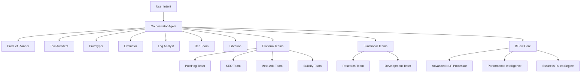
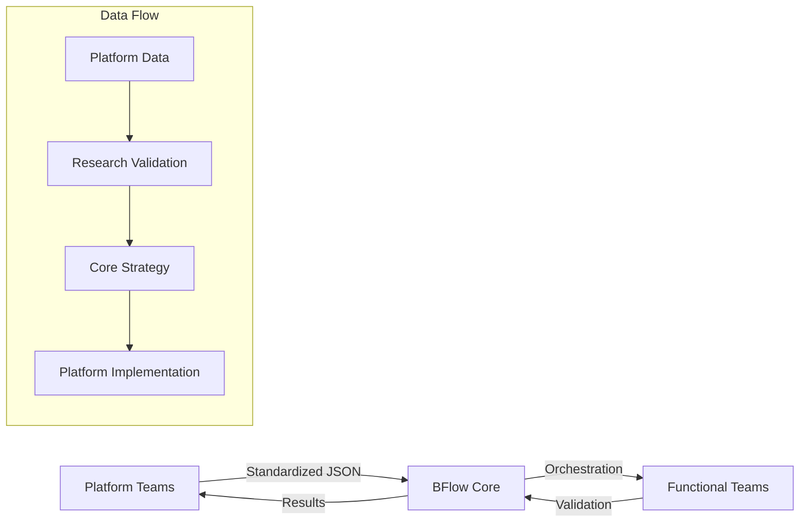

# BFlow Agents: Complete Documentation

## Table of Contents
1. [Overview](#overview)
2. [Architecture](#architecture)
3. [Core Components](#core-components)
4. [Agent Types](#agent-types)
5. [Team Organization](#team-organization)
6. [Implementation Details](#implementation-details)
7. [Performance Intelligence](#performance-intelligence)
8. [Development Workflows](#development-workflows)
9. [Integration Patterns](#integration-patterns)
10. [Configuration & Setup](#configuration--setup)
11. [Best Practices](#best-practices)
12. [Troubleshooting](#troubleshooting)

## Overview

BFlow Agents is an intent-driven AI system for building, evaluating, and continuously improving AI tools through conversational intelligence. It transforms traditional code-first development into a natural language, conversation-driven workflow that implements industry best practices for agent tool development.

### Core Philosophy

**Intent-First Development**: Instead of writing Python scripts or direct implementations, BFlow Agents uses pure intent definitions and conversational workflows to create AI agents that develop better AI tools.

**Agent-First Policy**: All business logic and workflow automation must use BFlow conversational agents rather than direct implementations.

### Key Benefits

- **Conversational Intelligence**: Natural language business requirements over API specifications
- **Cross-Session Memory**: Persistent context beyond individual conversations
- **Platform Specialization**: Deep domain expertise per platform/product
- **Real-time Performance**: Sub-100ms performance monitoring and optimization
- **Industry Best Practices**: Built-in implementation of Anthropic's tool development methodology

## Architecture

### System Layers

```
┌─────────────────────────────────────────────────────────────┐
│                    BFlow Agents Ecosystem                   │
├─────────────────────────────────────────────────────────────┤
│  Intent Layer: Natural Language Business Requirements       │
├─────────────────────────────────────────────────────────────┤
│  Agent Layer: 8-Agent Tool Development Pipeline            │
├─────────────────────────────────────────────────────────────┤
│  Team Layer: 26 Specialized Platform/Functional Teams      │
├─────────────────────────────────────────────────────────────┤
│  Core Layer: BTask Orchestration & Performance Intelligence │
├─────────────────────────────────────────────────────────────┤
│  Infrastructure: Advanced NLP & Real-time Processing       │
└─────────────────────────────────────────────────────────────┘
```

### Component Relationships



## Core Components

### 1. BFlow Agents Framework

**Location**: `packages/bflow/agents/`

**Purpose**: Intent-driven AI tool development system using conversational intelligence.

**Key Features**:
- 8-agent tool development pipeline
- Natural language workflow definitions
- Cross-session memory and context preservation
- Industry best practices enforcement

### 2. BTask Core Agents

**Location**: `packages/btask-core/src/agents/`

**Purpose**: Concrete implementation with orchestration capabilities.

**Components**:
- `BaseAgentOrchestrator.js`: Abstract orchestration base class
- `AgentFactory.js`: Factory pattern for agent creation
- Specialized agents: QA, Debug, Review, Refactor

### 3. Advanced NLP Processor

**Location**: `packages/bflow/core/bflow/advanced_nlp_processor.py`

**Purpose**: Multi-domain conversation context and semantic understanding.

**Capabilities**:
- Cross-session memory management
- Domain-specific language models
- Intent disambiguation
- Entity resolution and tracking

### 4. Performance Intelligence

**Location**: `packages/bflow/core/bflow/real_time_performance_intelligence.py`

**Purpose**: Real-time monitoring with <100ms latency targets.

**Features**:
- Streaming event processing
- Anomaly detection (>95% precision)
- Predictive analytics (15-minute forecasting)
- Autonomous optimization

## Agent Types

### Core Tool Development Pipeline

#### 1. Orchestrator Agent
**File**: `intents/orchestrator.md`

**Responsibilities**:
- Workflow coordination and intelligent routing
- Quality assurance throughout development process
- Context management across agent handoffs
- Decision making for workflow progression

**Routing Logic**:
```
Request → Product Planner → Tool Architect → Prototyper → Evaluator
→ Log Analyst → [Loop if needed] → Red Team → Librarian → Complete
```

#### 2. Product Planner Agent
**File**: `intents/product-planner.md`

**Responsibilities**:
- Transform user requests into testable user stories
- Define acceptance criteria following "task first, not API first"
- Requirements analysis and validation

#### 3. Tool Architect Agent
**File**: `intents/tool-architect.md`

**Responsibilities**:
- Design minimal, well-named tools with proper specifications
- Follow Anthropic's token efficiency principles
- Create technical specifications with clear semantics

#### 4. Prototyper Agent
**File**: `intents/prototyper.md`

**Responsibilities**:
- Build working stubs and mock implementations
- Create deterministic fixtures for immediate testing
- Rapid prototype development

#### 5. Evaluator Agent
**File**: `intents/evaluator.md`

**Responsibilities**:
- Generate realistic test scenarios
- Measure tool performance across multiple dimensions
- Success rate, token efficiency, usability analysis

#### 6. Log Analyst Agent
**File**: `intents/log-analyst.md`

**Responsibilities**:
- Review evaluation transcripts
- Identify concrete improvements
- Propose specific tool design changes

#### 7. Red Team Agent
**File**: `intents/red-team.md`

**Responsibilities**:
- Generate adversarial inputs and edge cases
- Stress-test tools for failure modes
- Security validation and vulnerability assessment

#### 8. Librarian Agent
**File**: `intents/librarian.md`

**Responsibilities**:
- Maintain comprehensive documentation
- Create and manage checklists
- Follow industry evaluation standards

### Specialized Agents

#### BTask-Specific Agents
- **BTask Architecture Validation**: `btask-architecture-validation.md`
- **BTask Code Review**: `btask-code-review.md`
- **BTask Dependency Intelligence**: `btask-dependency-intelligence.md`
- **BTask Documentation Synthesis**: `btask-documentation-synthesis.md`
- **BTask Performance Analytics**: `btask-performance-analytics.md`
- **BTask Project Completion Orchestrator**: `btask-project-completion-orchestrator.md`

#### Platform-Specific Agents
- **PostHog Agents**: CRO, Retention, Stability, A/B Testing
- **SEO Team Agents**: Competitive Analysis, Website Audit, Strategy Optimization
- **Meta Ads Agents**: Campaign Optimizer, Competitive Intelligence, Audience Intelligence
- **Buildify Agents**: Individual Performance, Weekly Health Analysis

#### Functional Agents
- **Research Enhancer**: `research-enhancer.md`
- **Research Validator**: `research-validator.md`
- **Statistical Analyzer**: `statistical-analyzer.md`
- **Cost Intelligence**: `cost-intelligence.md`
- **User Intelligence**: `user-intelligence.md`

## Team Organization

### Platform-Focused Teams

#### BFlow Core Team (`/workflows/teams/bflow-core/`)
**Purpose**: Fundamental BFlow system operations and workflow orchestration

**Agents**:
- Orchestrator: Workflow coordination and intelligent routing
- Product Planner: Requirements analysis with task-first methodology
- Tool Architect: Technical specification design with token optimization
- Prototyper: Mock implementation development
- Evaluator: Multi-metric performance testing

#### PostHog Team (`/workflows/teams/posthog/`)
**Purpose**: PostHog analytics platform integration and optimization

**Agents**:
- PostHog CRO Agent: Conversion rate optimization
- PostHog MCP Integration: API integration and data pipeline automation
- PostHog Retention Agent: User retention analysis and improvement
- PostHog Stability Agent: System stability monitoring

#### SEO Team (`/workflows/teams/seo/`)
**Purpose**: Search engine optimization and content marketing

**Agents**:
- SEO Team Orchestration: Comprehensive SEO workflow coordination
- Competitive Analysis: SEO competitor research and gap analysis
- Website Audit: Technical SEO analysis and optimization
- Strategy Optimization: SEO strategy development and performance optimization
- Content Planning: SEO-driven content strategy and calendar development

#### Meta Ads Team (`/workflows/teams/meta-ads/`)
**Purpose**: Facebook and Instagram advertising platform integration

**Agents**:
- Meta Ads Campaign Optimizer: Campaign performance optimization and ROI analysis
- Meta Ads Competitive Intelligence: Competitive analysis through Facebook Ads Library
- Meta Ads Audience Intelligence: Advanced audience targeting and segmentation
- Meta Ads Creative Intelligence: Creative performance analysis and optimization

#### Microsoft Teams Team (`/workflows/teams/microsoft-teams/`)
**Purpose**: Microsoft Teams integration and workspace intelligence

**Agents**:
- Teams Auto-Discovery Agent: Intelligent workspace discovery and user/chat mapping
- Teams Messaging Agent: Conversational interface for messaging operations
- Teams Integration Agent: Workflow automation and ecosystem integration
- Teams Intelligence Agent: Advanced analytics and behavioral intelligence

### Functional Teams

#### Research Team (`/workflows/teams/research/`)
**Purpose**: Research validation, analysis, and knowledge management

**Agents**:
- Research Validator: A/B testing framework for systematic research validation
- Librarian: Comprehensive documentation and knowledge management
- Red Team: Security validation and adversarial testing
- Log Analyst: Transcript analysis for optimization identification

#### Development Team (`/workflows/teams/development/`)
**Purpose**: Development process health and system integration

**Agents**:
- Weekly Development Health: Development team performance monitoring
- System Integration Test: End-to-end ecosystem validation and quality assurance

#### Integration Team (`/workflows/teams/integration/`)
**Purpose**: Cross-platform system integration and coordination

#### Coordination Team (`/workflows/teams/coordination/`)
**Purpose**: Multi-team workflow coordination and resource management

## Implementation Details

### BTask Core Agent Implementation

#### BaseAgentOrchestrator Class
**File**: `packages/btask-core/src/agents/BaseAgentOrchestrator.js`

**Key Methods**:
```javascript
// Task discovery and filtering
async discoverTasks(scope, options = {})
filterTasks(tasks, options = {})

// Execution with concurrency control
async executeWithConcurrency(items, executor)
async run(scope, options = {})
async processTask(task, options)

// Watch mode for file system monitoring
async watch(patterns, options = {})
async stopWatch()

// Abstract methods for subclass implementation
async executeTask(task, options)
async handleFailure(task, result, options)
```

**Features**:
- Event-driven architecture with EventEmitter
- Configurable concurrency control
- Auto-recovery with failure handling
- File system watching with chokidar
- Comprehensive reporting and metrics

#### AgentFactory Class
**File**: `packages/btask-core/src/agents/AgentFactory.js`

**Supported Agent Types**:
- **QA Agent**: Quality assurance with coverage targets
- **Debug Agent**: Error detection and fix attempts
- **Review Agent**: Code review with severity thresholds
- **Refactor Agent**: Architecture refactoring with risk assessment

**Engine Integration**:
- QATestingEngine
- DebugEngine
- CodeReviewEngine
- RefactorEngine

### Advanced NLP Processor

**File**: `packages/bflow/core/bflow/advanced_nlp_processor.py`

**Key Classes**:

```python
class ConversationContext:
    """Comprehensive conversation context with cross-session memory"""
    user_id: str
    session_id: str
    workspace_id: Optional[str]
    domain: Optional[str]
    workflows: Dict[str, Dict[str, Any]]
    processes: Dict[str, Dict[str, Any]]
    stakeholders: Dict[str, Dict[str, Any]]

class ContextScope(Enum):
    SESSION = "session"
    USER = "user"
    WORKSPACE = "workspace"
    DOMAIN = "domain"

class IntentCategory(Enum):
    CREATE = "create"
    MODIFY = "modify"
    ANALYZE = "analyze"
    INTEGRATE = "integrate"
    OPTIMIZE = "optimize"
    MONITOR = "monitor"
    APPROVAL = "approval"
    EXCEPTION = "exception"
```

**Capabilities**:
- Multi-turn conversation context beyond session
- Semantic understanding of complex business processes
- Domain-specific language models
- Intent disambiguation for similar requests

### Performance Intelligence

**File**: `packages/bflow/core/bflow/real_time_performance_intelligence.py`

**Key Components**:

```python
class EventType(Enum):
    EXECUTION_START = "execution_start"
    EXECUTION_END = "execution_end"
    RESOURCE_USAGE = "resource_usage"
    ERROR_OCCURRED = "error_occurred"
    BOTTLENECK_DETECTED = "bottleneck_detected"
    OPTIMIZATION_APPLIED = "optimization_applied"
    BUSINESS_METRIC = "business_metric"

@dataclass
class PerformanceEvent:
    event_id: str
    event_type: EventType
    timestamp: datetime
    flow_id: str
```

**Performance Targets**:
- **Latency**: <100ms event processing
- **Accuracy**: >95% anomaly detection precision
- **Forecasting**: 15-minute ahead prediction
- **Availability**: Real-time continuous monitoring

## Development Workflows

### Standard Tool Development Session

```markdown
# Intent-Driven Development Flow

1. User Request: "I need a tool that helps agents schedule meetings by understanding natural language requests and handling conflicts."

2. Orchestrator Analysis:
   - Parse intent and identify core problem
   - Assess complexity and validate "task first, not API first"
   - Set up initial context for development workflow

3. Agent Pipeline Execution:
   - Product Planner → Create user story and acceptance criteria
   - Tool Architect → Design technical specification
   - Prototyper → Build working mock implementation
   - Evaluator → Run comprehensive test scenarios
   - Log Analyst → Review results and suggest improvements
   - [Iterate if needed] → Apply improvements
   - Red Team → Adversarial testing and edge cases
   - Librarian → Documentation and checklist completion

4. Completion Criteria:
   - All acceptance criteria validated
   - Evaluation metrics meet targets
   - Adversarial testing passes
   - Documentation comprehensive
   - No outstanding agent concerns
```

### Multi-Platform Coordination Workflow

```yaml
# Cross-platform business objective example
objective: "Improve user retention across all channels"

orchestrator: bflow-core/orchestrator
teams:
  - posthog/retention-agent: "Analyze current retention metrics"
  - seo/content-planning: "Create content strategy for retention"
  - meta-ads/campaign-optimizer: "Optimize paid campaigns for retention"
  - research/research-validator: "Validate retention improvement strategies"

coordination_pattern:
  1. Data Collection: Each platform team gathers relevant metrics
  2. Analysis Synthesis: Research team validates cross-platform insights
  3. Strategy Development: Core team orchestrates unified approach
  4. Implementation: Platform teams execute coordinated actions
  5. Monitoring: Development team tracks cross-platform performance
```

### Quality Assurance Workflow

```yaml
# BTask Core Agent QA Process
workflow:
  discovery:
    scope: { tag: "development", status: ["pending", "in-progress"] }
    options: { priority: "high", autoFix: true }
  
  execution:
    agents: [qa, debug, review, refactor]
    concurrency: 3
    continueOnError: false
  
  reporting:
    coverageTarget: 80
    severityThreshold: "medium"
    blockOnCritical: true
```

## Integration Patterns

### Platform-to-Core Integration



### Cross-Platform Data Sharing

**Standardized Formats**:
```json
{
  "platform": "posthog",
  "data_type": "retention_metrics",
  "timestamp": "2024-01-01T00:00:00Z",
  "metrics": {
    "retention_rate": 0.75,
    "cohort_size": 1000,
    "time_period": "30_days"
  },
  "context": {
    "workspace_id": "workspace_123",
    "domain": "ecommerce"
  }
}
```

### Agent Communication Protocol

```yaml
# Inter-agent communication pattern
communication:
  format: "conversational_handoff"
  
  handoff_structure:
    from_agent: "product-planner"
    to_agent: "tool-architect"
    context_preservation:
      - user_requirements
      - acceptance_criteria
      - constraints
      - domain_context
    
  validation:
    completeness_check: true
    context_integrity: true
    requirement_traceability: true
```

## Configuration & Setup

### Environment Setup

**Required Dependencies**:
```bash
# Core BFlow setup
cd packages/bflow
pip install -r requirements.txt

# BTask Core setup
cd packages/btask-core
npm install

# Agent registration
python agents/register-scheduled-agents.py
```

**API Keys Configuration**:
```bash
# Required for conversational intelligence
export ANTHROPIC_API_KEY="your_key_here"
export PERPLEXITY_API_KEY="your_key_here"  # For research features

# Optional for additional models
export OPENAI_API_KEY="your_key_here"
export GOOGLE_API_KEY="your_key_here"
```

### Agent Configuration

**BFlow Core Configuration**:
```json
{
  "agents": {
    "orchestrator": {
      "maxConcurrent": 3,
      "continueOnError": false,
      "tokenOptimization": true
    },
    "evaluator": {
      "metricsTarget": {
        "successRate": 0.94,
        "tokenEfficiency": 0.85,
        "usabilityScore": 0.90
      }
    }
  },
  "performance": {
    "latencyTarget": 100,
    "anomalyThreshold": 0.95,
    "forecastingWindow": 15
  }
}
```

**Team Configuration**:
```yaml
# Team workflow configuration
teams:
  posthog:
    agents: [cro, retention, stability, ab-testing]
    api_integration: true
    data_pipeline: automatic
  
  seo:
    agents: [competitive-analysis, website-audit, strategy-optimization]
    research_mode: enabled
    competitive_intelligence: true
```

### Performance Intelligence Setup

```python
# Real-time performance monitoring setup
from bflow.core.bflow.real_time_performance_intelligence import (
    ComprehensivePerformanceIntelligence,
    PerformanceMode
)

# Initialize with autonomous mode
performance_system = ComprehensivePerformanceIntelligence(
    mode=PerformanceMode.AUTONOMOUS
)

# Start monitoring
await performance_system.start_monitoring()
```

## Best Practices

### Agent Development

1. **Intent-First Design**
   - Start with clear business intent descriptions
   - Use natural language requirements over technical specifications
   - Focus on user outcomes rather than implementation details

2. **Conversational Workflows**
   - Design agent interactions as natural conversations
   - Maintain context across multiple turns
   - Use semantic handoffs between agents

3. **Platform Specialization**
   - Develop deep expertise in specific platforms
   - Create platform-specific optimization strategies
   - Maintain platform API mastery

### Performance Optimization

1. **Latency Management**
   - Target <100ms for real-time operations
   - Use streaming processing for event handling
   - Implement efficient caching strategies

2. **Token Efficiency**
   - Optimize prompt engineering for minimal token usage
   - Use structured outputs to reduce parsing overhead
   - Implement intelligent context pruning

3. **Quality Assurance**
   - Maintain >95% accuracy in anomaly detection
   - Implement comprehensive test coverage (80%+ target)
   - Use multi-dimensional evaluation metrics

### Team Coordination

1. **Clear Handoffs**
   - Use standardized data exchange formats
   - Maintain complete context preservation
   - Implement validation checkpoints

2. **Autonomous Operation**
   - Enable platform teams to operate independently
   - Provide core orchestration for complex workflows
   - Support cross-platform strategy coordination

3. **Continuous Improvement**
   - Implement learning from successful patterns
   - Monitor performance across all teams
   - Apply optimization insights system-wide

## Troubleshooting

### Common Issues

#### Agent Communication Failures
**Symptoms**: Context loss between agent handoffs
**Solutions**:
- Verify conversation context persistence
- Check agent handoff validation
- Review context preservation settings

#### Performance Degradation
**Symptoms**: Latency >100ms, accuracy drops
**Solutions**:
- Monitor system resource usage
- Check anomaly detection thresholds
- Review performance intelligence logs

#### Platform Integration Issues
**Symptoms**: API failures, data synchronization problems
**Solutions**:
- Validate API credentials and permissions
- Check platform-specific configuration
- Review data pipeline status

### Debugging Tools

#### Performance Monitoring
```python
# Debug performance issues
from bflow.core.bflow.real_time_performance_intelligence import PerformanceMonitor

monitor = PerformanceMonitor()
report = await monitor.generate_performance_report()
print(f"Latency: {report.avg_latency}ms")
print(f"Accuracy: {report.accuracy_rate}%")
```

#### Agent Factory Debugging
```javascript
// Debug agent creation issues
const factory = new AgentFactory();
const agent = factory.createQAAgent({
  coverageTarget: 80,
  maxConcurrent: 3,
  logger: createLogger('QAAgent', 'debug')
});
```

#### Context Analysis
```python
# Analyze conversation context
from bflow.core.bflow.advanced_nlp_processor import AdvancedNLPProcessor

processor = AdvancedNLPProcessor()
context = await processor.analyze_conversation_context(session_id)
print(f"Domain: {context.domain}")
print(f"Intent: {context.resolved_intent}")
```

### Log Analysis

#### Critical Log Locations
- **Agent Orchestration**: `logs/orchestrator.log`
- **Performance Intelligence**: `logs/performance.log`
- **Platform Integration**: `logs/platforms/*.log`
- **Context Management**: `logs/nlp_processor.log`

#### Log Analysis Commands
```bash
# Monitor real-time performance
tail -f logs/performance.log | grep "latency"

# Check agent failures
grep "ERROR" logs/orchestrator.log | tail -20

# Analyze context preservation
grep "context_handoff" logs/nlp_processor.log
```

### Recovery Procedures

#### System Recovery
1. **Stop all agents**: `pkill -f "bflow_agent"`
2. **Clear cached contexts**: `rm -rf /tmp/bflow_contexts/*`
3. **Restart performance monitoring**: `python -m bflow.core.bflow.real_time_performance_intelligence`
4. **Restart agent orchestration**: `node packages/btask-core/src/agents/index.js`

#### Data Recovery
1. **Backup conversation contexts**: `cp -r contexts/ contexts_backup/`
2. **Restore from last known good state**: `git checkout HEAD~1 -- contexts/`
3. **Replay recent events**: `python tools/replay_events.py --since 1h`

## Conclusion

BFlow Agents represents a comprehensive, intent-driven approach to AI tool development that combines conversational intelligence, real-time performance monitoring, and specialized platform expertise. By following this documentation, development teams can leverage the full power of the BFlow ecosystem to create sophisticated, high-performance AI agent workflows that scale across multiple platforms and business domains.

The system's emphasis on natural language intents, cross-session memory, and autonomous optimization makes it uniquely suited for complex business automation scenarios where traditional code-first approaches fall short.