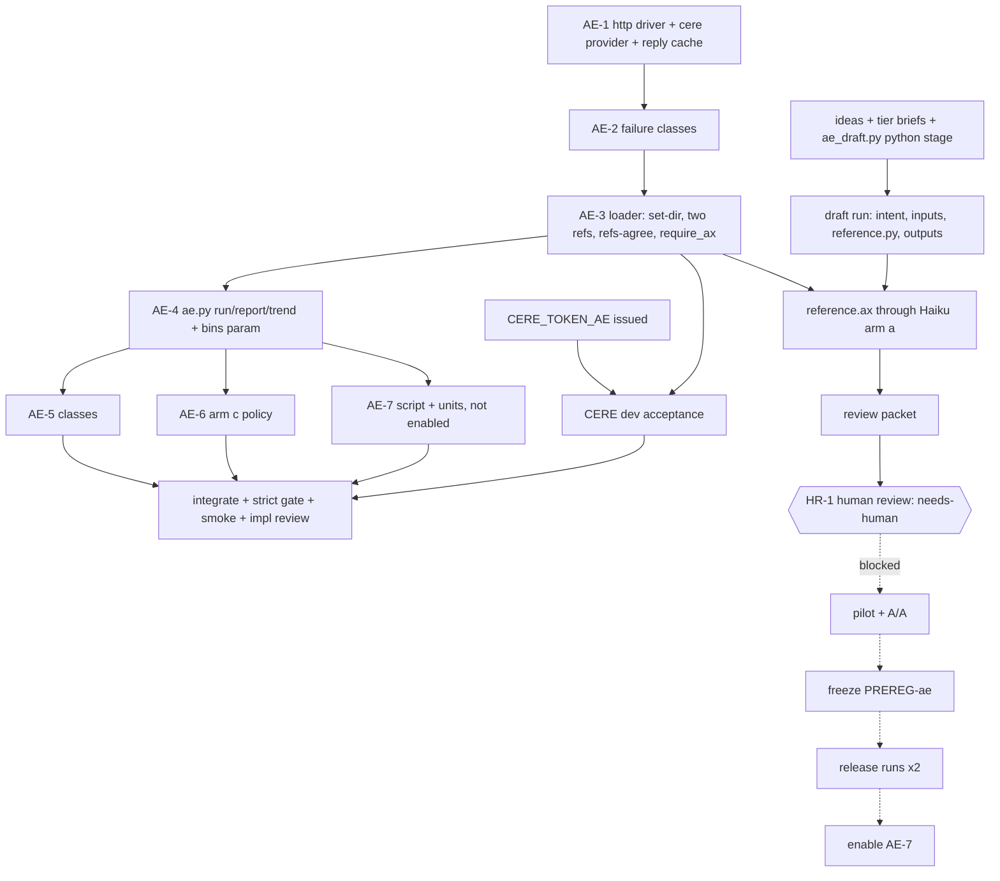

# Build loop: authoring-eval (AE-1..AE-7)

Spec: `tasks/authoring-eval-spec.md` (Step 1 reviewed 2026-11-10, 39 findings accepted; NH-1..NH-6 decided by the human
2026-11-10; build authorized "go" 2026-11-10). Base: `main` 1f71623d. Integration branch `ae/int`
(`/home/cklaus/projects/axon-lanes/ae-int`). Private store: `Cklaus1/axon-ae-private` (PRIVATE), mirror `/root/axon-ae` (0700).

## Step 0 baseline

- Tree clean at 1f71623d (only the user's untracked `docs/` in the main checkout).
- Full suite: the strict gate at a3a79f6c passed (rc 0, 8291 passed, 0 failed, 17 ignored, 2971 s,
  `/var/tmp/r51-tmp/tp-gate.log`). `git diff a3a79f6c 1f71623d` touches only `tasks/` and `CHANGELOG.md`, so it is this
  run's baseline. Known-failure list: empty. CI on main green at 1f71623d (run 42903799495).
- S23 `genviab/selftest.py` at 1f71623d: all checks hold, 9.2 s (binaries `/home/cklaus/projects/axon-lanes/.doc-build/ae-int/debug/{axon,axon-intent}`, `axon 0.1.0 (1f71623d)`).
- `<RUN_CMD>`/`<SMOKE_SCENARIO>`: `genviab.py run --set dev --arm a --generator http --provider cere` on 28 dev tasks
  (signal: 0 infra rows, rows written) and `ae.py run` + `ae.py report` on a fixture set with two binaries (signal: one
  `axon-ae/1` trend row that validates, report first line names the set and drafter).
- Scarce resources: CERE GPU1 (shared with trainloop; never 01:30-08:00), the Haiku OAuth grant ($10 cap, NH-2), and
  the human reviewer (360 candidates).

## Decisions made for this run (engineering; canon)

| # | question | choice | why |
|---|---|---|---|
| E1 | lane split | H1 = AE-1, AE-2, AE-3 loader; H2 = AE-4, AE-5, AE-6, AE-7 script; S = set tooling + drafting | H1/H2 share `genviab.py`/`gv.py`/`selftest.py`, so they run in series; S writes only new files |
| E2 | who lists family ideas | the set lane (Claude Sonnet), from the AE-3 sources only; recorded in PREREG | an idea is not a task; `drafted_by` stays `haiku-5-5`/`human`; Qwen never touches the set |
| E3 | AE-7 | script + unit files built and selftested, timer NOT enabled | spec §7: on after two hand release runs, which need the frozen set |
| E4 | binaries | lanes use the ae-int debug binaries read-only; no `crates/*/src` change is planned; a lane that needs one stops and asks | no cargo builds in lanes, one target dir per checkout |
| E5 | draft-time loader | `gv.load_task(..., require_ax=False)` accepts a candidate without `reference.ax` (drafting only); scoring requires both | D12 earns `reference.ax` through the loop after `reference.py` exists |
| E6 | drafting tool home | public `genviab/ae_draft.py` (code only); every brief, idea, draft and log under `/root/axon-ae/` | contamination rule 2 |

## needs-human (excluded from the autonomous run)

- **HR-1 human ambiguity review of every candidate** (spec AE-3 "Authorship and review"). The run prepares the review
  packet (`/root/axon-ae/ae-1/review/`) and stops. Blocked behind it, transitively: the pilot (incl. A/A), the
  second review of all-6-fail tasks, the seeded draw, the PREREG freeze, the first release run, the second hand run,
  enabling AE-7. Pruned subtree: 7 nodes.

## DAG

Acyclic; every non-needs-human spec item (AE-1..AE-7 code, AE-3 loader and authoring) appears once.
Critical path: AE-1's driver (every CERE number goes through it). Extra gate: the selftest proves `http` never runs
`oracle.sh`, the token never lands in the out dir, and a forced replay mismatch disables the cache.

## Loops

- **Inner:** implement one item, fail-first selftest (red on base, green after), run `selftest.py` with
  `GENVIAB_REQUIRE_BINS=1` on the ae-int binaries, self-review checklist (scope, no secrets, no task text in the public
  repo, existing patterns), commit `-- <paths>`.
- **Lane done:** `selftest.py` green, `python3 -B scripts/spec_ledger.py`, `bash scripts/verify_all_specs.sh`, the
  repo-wide doc/claim checks the gate runs on changed docs, and a grep of `git ls-files` content for every canary.
- **Integration:** merge lanes into `ae/int` (merge, never rebase), then one `scripts/gate.sh --strict` (≈ 50 min,
  CPU) against the baseline, the smoke above, a read-only implementation conformance audit, then ff `main` and CI.
- **Paid spend:** only the drafting run, `--cap-usd 10`, genviab's 3× reserve; a cap stop leaves the rest to HR-1.
- **Dev-loop cost:** per lane; the largest idle share is logged with numbers in `tasks/opportunities.md`.

## Plan options

| option | wall (autonomous part) | chance inside | slip chance | slip cost |
|---|---|---|---|---|
| **Fastest (active, default, not chosen by the user)**: lanes in parallel, selftest per change, one strict gate at the end | 6-10 h, drafting calls dominate `[INFERENCE]` | ~70 % | ≤ 10 % | caught by the pilot or the first release run; ≈ 1 h fix |
| Most reliable: strict gate after each lane merge and a full CERE dev run per harness change | 9-14 h `[INFERENCE]` | ~70 % | ~2 % | same |

Fast: done tomorrow morning; out of 10 runs like this about 1 lets a small harness mistake through, and the pilot finds
it before any number is published. Careful: done tomorrow afternoon; out of 50 runs, about 1 lets one through.
