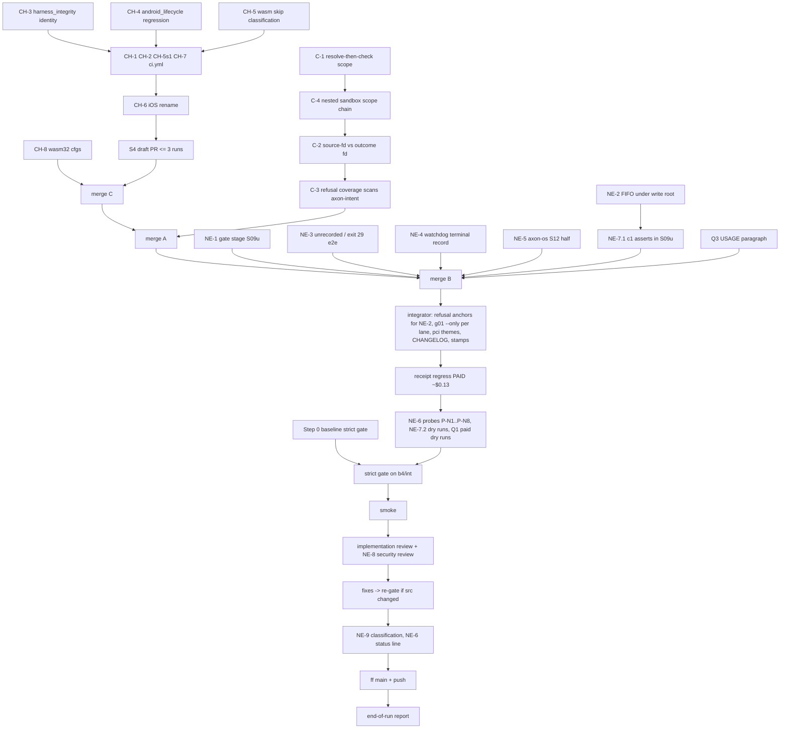

# Build loop - batch 4 (`containment-b4`, `nhr-evidence`, `ci-hygiene`)

Authorized by the human 2026-11-05: "use recommendations, build batch 4". Decisions are recorded in each spec (`[DECIDED by
human 2026-11-05 ...]`). Enabling `--unattended` is NOT part of this batch and stays unauthorized.

Integrator: main agent, `/home/cklaus/projects/axon-lanes/b4-int` (branch `b4/int`, from main 0dcc00b9 + the decision
commit 26dc917f). Lanes are Sonnet subagents, one worktree, branch and absolute `CARGO_TARGET_DIR` each:

| Lane | Spec | Worktree / branch | Target dir |
|---|---|---|---|
| A `LaneContain` | `tasks/containment-b4-spec.md` C-1, C-4, C-2, C-3 | `/home/cklaus/projects/axon-lanes/b4-contain` (`b4/containment`) | `/home/cklaus/projects/axon-lanes/.doc-build/b4-contain` |
| B `LaneNhr` | `tasks/nhr-evidence-spec.md` NE-1..NE-5, NE-7.1, Q3 USAGE paragraph | `/home/cklaus/projects/axon-lanes/b4-nhr` (`b4/nhr`) | `/home/cklaus/projects/axon-lanes/.doc-build/b4-nhr` |
| C `LaneCi` | `tasks/ci-hygiene-spec.md` CH-1..CH-8 | `/home/cklaus/projects/axon-lanes/b4-ci` (`b4/ci-hygiene`) | `/home/cklaus/projects/axon-lanes/.doc-build/b4-ci` |

Env for every shell: `export PATH=$HOME/.cargo/bin:$PATH TMPDIR=/var/tmp/r51-tmp` plus the lane's `CARGO_TARGET_DIR`.

## Placeholders

| Placeholder | Value |
|---|---|
| `<TEST_CMD>` | `scripts/gate.sh --strict` on the integrated head. Baseline: `/var/tmp/r51-tmp/b4-gate-0.log` at 26dc917f (code = main 0dcc00b9); result recorded below when it lands |
| `<RUN_CMD>` | `axon`, `cortex` (with and without `--features unattended`) built from `b4/int` |
| `<SMOKE_SCENARIO>` | § Smoke |
| `<FULL_SUITE_BUDGET>` | 60 min (batch 3 measured 44 min on a quiet host; the host now also runs ai-cere builds). > 120 min is reviewed |
| `<RUN_BUDGET>` | none; paid spend capped per run (§ Paid) |
| `<RELIABILITY>` | Fastest at 90 % (default option, not chosen by the user) |
| `<REVIEW_MODEL>` | Sonnet reviewer subagents, neutral "conformance audit" briefs |
| Known-failure list | empty until the baseline lands |

## DAG

**Tracks** (edges = shared files, including implicitly shared ones):

| Track | Files | Shared with |
|---|---|---|
| A | `crates/axon-core/src/{interp/builtins.rs, path_scope.rs (new), interp.rs (A hunks), lib.rs module list, outcome.rs after :110, main.rs read_source_fd, env_registry.rs}`, `crates/axon-core/tests/{scope_resolution.rs (new), cli_run.rs tail}`, `crates/axon-os/tests/sandbox_console.rs`, `scripts/v022_refusal_coverage.py`, `AXON_REFERENCE.md` | C: disjoint hunks in `interp.rs`, `lib.rs`, `outcome.rs`, `cli_run.rs` (ownership table, containment §5) |
| B | `crates/axon-cortex/src/{unattended,auth,envelope_preview,cas}.rs`, `src/bin/cortex.rs` (USAGE), `crates/axon-cortex/tests/unattended.rs`, `crates/axon-os/tests/acceptance.rs`, `scripts/gate.sh` (S09u only), `governance/gate-lanes.json` | none |
| C | `.github/workflows/{ci,ios}.yml`, `harness_integrity.rs`, `cli_run.rs :985-1017, :35164-35251`, `scripts/android_lifecycle.sh`, `examples/mobile/lifecycle.ax`, `R14-mobile-targets.md:546`, CH-8 `cfg` lines | A as above |
| all | `scripts/v022_g01_mutations.py`, `scripts/v022_attack_markers.py` (each lane appends its own block at the tail: A M4790-M4809, B M4810-M4829, C M4830-M4849) | integrator resolves as concatenation and re-runs the g01 check |

Integrator-only: `CHANGELOG.md`, `tasks/*.md`, `governance/notes/pci-themes/*` and the pci regen output, refusal-coverage
anchors for B's new strings (after A's `ROOT_CRATES` change).

## Loops

**Inner loop (lane task).** Fail-first test (and its g01 row + ATTACK marker in the same commit) -> see it fail -> fix ->
see it pass -> SKILL.md self-review checklist -> the lane's stage list (its spec's §Gates, by touched paths) -> `git commit
-m ... -- <paths>`. Lanes never stash, use absolute paths in every tool call, keep a NOTES file
(`/var/tmp/r51-tmp/b4-<lane>-NOTES.md`) from the first step, and report `READY <sha>` with the stage list they ran.

**Outer loop.** All three lanes run at once (tracks disjoint by hunk). Merge order is fixed by the specs: C's CH-8 commit
first, then A, then B (`git merge --no-ff`, never rebase). After each `crates/*/src` merge: pci theme JSON, `python3 -B
tasks/r51-pci-regen.py`, `python3 -B scripts/pci_delta.py --check`.

**Paid loop.** `set -a; . /root/.openrouter.env; set +a`, probes first (first-prompt diff vs base on >= 3 tasks with a
`cmd:` capture generator; >= 3 real tasks on the frozen binary).

| Run | Cap | Expected |
|---|---|---|
| receipt regress (NE-2 touches 4 digest files) | `--cap-usd 0.50` | ≈ $0.13 |
| Q1 dry runs (3 × `ai:` haiku-5.5 on `fixtures/broken.ax`, private tmpfs `/etc/axon` under `unshare -m`) | see note | ≈ $0.005 |

Q1 cap note: the decided mechanism was an OpenRouter key with a $0.10 credit limit. `/root/.openrouter.env` holds one
ordinary key and no provisioning key, so a limited key cannot be minted here. ⚠ close call: the runs use the envelope's own
`ai` budget as the in-band cap and record the key's usage before and after (`/api/v1/auth/key`); a delta above $0.10 is
reported as a breach. If the envelope budget cannot bound spend, Q1 is parked blocked and reported.

**Full-suite regression loop.** One strict gate on the integrated head after all merges and the integrator's edits
(`/var/tmp/r51-tmp/b4-gate-<n>.log`), compared with the baseline. Any later change to `crates/*/src`, tests or gate
scripts requires a re-run.

**Smoke loop.** § Smoke, in `/var/tmp/r51-tmp/b4-smoke`; afterwards `git status --short --ignored` in b4-int shows nothing
new.

**Implementation review loop.** Two read-only reviewers on `0dcc00b9..b4/int`: a conformance audit against the three specs'
acceptance criteria, and NE-8's adversarial security review of the NH-R1 admitted path (its own report + disposition
table, as §9 bullet 2 requires). Findings are reproduced before acting; every disposition is recorded.

**Meta loop.** `tasks/lessons.md` on corrections/failures; second firing -> mechanism.

**Dev-loop cost loop.** Per phase (lanes, integration, gate): CPU split of the host (lane builds, gate, ai-cere load) and
the largest waste with an action.

## Gates & special handling

- **Critical-path item: C-1** (the resolver everything fs-scoped goes through: ambient scope, ceilings, `sandbox_create_scoped`,
  axon-os grants, genviab grading). Extra proof: the spec's V1-V16 matrix (valid paths still admitted, every escape exit 8) on
  the lane binary, plus `repro_gv08.sh` before/after, plus the axon-os, axon-intent and axon-cortex suites that run `axon`
  under scopes. If C-1 is BLOCKED, the run stops.
- **Transitive blocking / poison ceiling:** per SKILL.md (attempt 3 fails -> park, block dependents).
- **Repair-digest rule:** one receipt regress on the integrated head (NE-2 edits digest files). No waiver (nhr §6 D6).
- **Merge rule:** if `main` moves, merge it into `b4/int`, never rebase; re-verify the receipt after the merge.
- **PREREG freeze:** not in this batch; it runs after this batch merges (C-1/C-2/C-4/CH-4/CH-8 move the `axon` and
  `axon-intent` pins).
- **CI (lane C):** verified on a draft PR `b4/ci-hygiene -> main` and `gh workflow run ios.yml --ref b4/ci-hygiene`, at most 3
  PR iterations; never by pushing to `main`; ruleset 26386102 unchanged; never `#[ignore]` (NH-3 B).

## Smoke

On `b4/int` binaries, each step under `timeout 300`:
1. **C-1:** `AXON_ALLOWED_FS_READ=./data/` with `data/link -> /etc/hostname`: `read_file("./data/link")` exits 8; a plain
   `./data/x.txt` read and `dir_list("./data/")` still work; a write through `/proc/self/root/...` under a write grant exits 8.
2. **C-4:** a nested `sandbox_create_scoped` that widens its parent's fs scope cannot read outside the parent's grant.
3. **C-2:** `axon run --source-fd N` with N equal to the installed outcome fd is refused with its message.
4. **NE-2:** `cortex repair --unattended` (feature build) on a workspace with a FIFO under a write root is refused before
   consume (nothing spent), with no hang (`timeout -s KILL 60`).
5. **Default refusal:** a default `cortex` still exits 29 on `--unattended`.

## Plan options

| Option | Shape | Wall (AI dev) | Finishes in range | Slip chance | Slip cost |
|---|---|---|---|---|---|
| **Fastest (90 %) - active** | 3 lanes in parallel; lane stage lists; one strict gate + one receipt regress on the integrated head; one re-gate only if review fixes touch src | 9-13 h `[INFERENCE]` | ~70 % | ~10 % | found by the next batch's gate or CI (now unmasked by CH-2); ~1-2 h to fix |
| Most reliable | strict gate after each lane merge (3 ×), per-lane review before merge, receipt after each cortex change | 13-18 h `[INFERENCE]` | ~70 % | ~2 % | same, rarer |

⚠ production-level: C-1/C-4 are the sandbox's fs containment and NE-* is evidence for an authorization decision. Most reliable
adds about 4-5 h (two extra strict gates and per-lane reviews). Fastest keeps the critical-path V1-V16 proof, the security
review and one strict gate on the exact merged head.

## Harness self-check

| Spec item | DAG node |
|---|---|
| C-1, C-2, C-3, C-4 | C1, C2, C3, C4 |
| NE-1 | N1 |
| NE-2 | N2 |
| NE-3, NE-4, NE-5 | N3, N4, N5 |
| NE-6 | P (probes, g01 N-rows) + N9 (status line) |
| NE-7 | N7 (7.1) + P (7.2) |
| NE-8 | V |
| NE-9 | N9 |
| nhr Q1 / Q3 | P / U |
| CH-1, CH-2, CH-5 step 1, CH-7 | Y |
| CH-3, CH-4, CH-5, CH-6, CH-8 | H3, H4, H5, H6, H8 |
| CH-9 | I (stamps) |

Every non-needs-human item maps to a node; no needs-human subtree remains (all decided 2026-11-05); edges point downward,
so the graph is acyclic.

## Status log

- 2026-11-05: decisions recorded (26dc917f); baseline strict gate started; lanes spawned.
