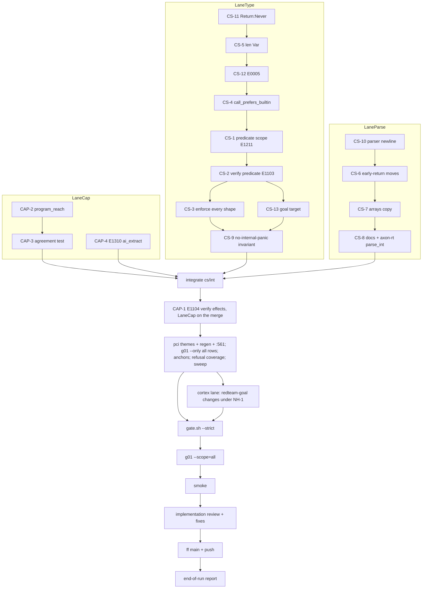

# Build loop — checker-soundness + capability-surface batch

Specs: `tasks/checker-soundness-spec.md` (CS-1…CS-13) and `tasks/capability-surface-spec.md` (CAP-1…CAP-4). Both
are Step 1 reviewed, and every needs-human question was decided by the human on 2026-10-27 (spec §7 / §6). There
is no needs-human subtree.

Integrator: main agent, in `/home/cklaus/projects/axon-lanes/cs-int` (branch `cs/int`, base `1f6b761a`). Lanes are
Sonnet subagents. Each has its own worktree, branch and absolute `CARGO_TARGET_DIR`:

| Lane | Worktree / branch | Target dir | Items, in order |
|---|---|---|---|
| LaneCap | `/home/cklaus/projects/axon-lanes/cs-cap` (`cs/cap`) | `/home/cklaus/projects/axon-lanes/.doc-build/cs-cap` | CAP-2 → CAP-3, CAP-4; after integration, CAP-1 |
| LaneType (agents B1 → B2 → B3, serial, one worktree) | `/home/cklaus/projects/axon-lanes/cs-type` (`cs/type`) | `/home/cklaus/projects/axon-lanes/.doc-build/cs-type` | B1: CS-11, CS-5, CS-12, CS-4 · B2: CS-1, CS-2 · B3: CS-3, CS-13, CS-9 |
| LaneParse | `/home/cklaus/projects/axon-lanes/cs-parse` (`cs/parse`) | `/home/cklaus/projects/axon-lanes/.doc-build/cs-parse` | CS-10, CS-6, CS-7, CS-8 |

Env for every shell: `export PATH=$HOME/.cargo/bin:$PATH TMPDIR=/var/tmp/r51-tmp
CARGO_HOME=/var/tmp/r51-tmp/cargo-home-nowrap`, plus that lane's `CARGO_TARGET_DIR`. Each agent keeps
`/var/tmp/r51-tmp/<Agent>-NOTES.md` from its first step. Every `cargo test` and every gate/harness script runs as
`/var/tmp/r51-tmp/privtmp.sh nice -n 10 <cmd>`; plain cargo builds/clippy run as `nice -n 10 <cmd>`. The nice
keeps lane load below the baseline gate, which runs at the same time.

**Why the shadow `CARGO_HOME`.** `/root/.cargo/config.toml` (created 2026-10-21, after the last green gate) sets
`build.rustc-wrapper = sccache` host-wide. `axon-fabric/tests/build_state.rs:151-155`'s control ("a clean production
build builds") strips every wrapper env var (:66-75) but not the config file, so it inherits sccache and fails. The
baseline gate stopped there at 3m48s (`/var/tmp/r51-tmp/cs-base-gate-1-sccache.log`). The shadow home symlinks
`registry`, `bin`, `advisory-dbs` and the cache locks from `/root/.cargo`, and omits `config.toml`. That is the
environment of the 10-18 green gate. The host file is not edited; the test defect is logged as O-CS-01.

**Why the private `/tmp`.** The second baseline attempt (`/var/tmp/r51-tmp/cs-base-gate-2-tmp.log`, 37m08s) failed 2
cli_run harness tests. `wasm_unknown_interp_builds.sh:44` writes `/tmp/wasm_unknown_check.err`, and
`examples/file_roundtrip.ax:7` writes `/tmp/axon_roundtrip.txt`. Both files already exist from the user's 2026-10-26
gate run as `cklaus`, and root cannot overwrite them under `fs.protected_regular = 2`. Every gate and every test run
that can reach a harness therefore goes through `/var/tmp/r51-tmp/privtmp.sh <cmd>`: a tmpfs `/tmp` in a private
mount namespace. The host `/tmp` is not touched. Both harnesses pass under it (22 s probe). The fixed-path defect is
logged as O-CS-02. Attempt 3 (`cs-base-gate-3-nodev.log`, 4m12s) failed because the first wrapper mounted the tmpfs
without `nodev`, and `operator_examples` refuses that ("NODEV-MISSING /tmp"). The wrapper now mirrors the host's
`nosuid,nodev`, and `operator_examples` passes 4/4 under it.

## Placeholders

| Placeholder | Value |
|---|---|
| `<TEST_CMD>` | `privtmp.sh ./scripts/gate.sh --strict` (shadow `CARGO_HOME`) on the integrated head (codegen is touched: CS-3(c), CS-4; spec §5 CSD#1). Baseline at `1f6b761a`: **rc 0, 83m35s** (attempt 4, under 3-lane load), log `/var/tmp/r51-tmp/cs-base-gate.log`. Attempts 1–3 failed on host environment only (O-CS-01, O-CS-02, the wrapper's missing `nodev`). |
| `<RUN_CMD>` | `axon` built from the integrated head (`--no-default-features`), plus the codegen `axon` that `--strict` builds |
| `<SMOKE_SCENARIO>` | § Smoke |
| `<FULL_SUITE_BUDGET>` | 45 min idle (43m24s measured, gate.sh:1039); 84 min under 3-lane load (baseline). > 90 min triggers a review |
| `<RUN_BUDGET>` | none set (compound stop condition + poison ceiling) |
| `<RELIABILITY>` | Fastest at 90 % (default; not chosen by the user) |
| `<REVIEW_MODEL>` | Sonnet `reviewer` (no `fable` here) |
| Check-outcome sweep baseline | `/var/tmp/r51-tmp/cs-sweep-base.txt`: 290 files, 274 rc 0, 16 rc 2 (`/var/tmp/r51-tmp/cs-sweep.sh`, ≈ 3 s idle / 15 s loaded) |
| Known-failure list | empty (baseline rc 0) |

## DAG

The order inside LaneType is a file-contention order, not a dependency order: every B item touches `infer.rs`,
`resolver.rs` or `checker.rs`. The spec's own dependency edges are kept: CS-1/CS-2 → CS-9, CS-4 → CS-9, CS-2 → CS-3,
NH-1 → CS-13, NH-3 → CS-7 → CS-8. CS-1 lands with NH-2 = (a), i.e. the field name is bound (and the interpreter
binds it at `interp/eval.rs:2726-2727`).

**Tracks.** Edges come from shared files, including implicitly shared ones:

| Track | Files | Shared with |
|---|---|---|
| LaneCap | `crates/axon-core/src/{capabilities,effects}.rs`, `tests/{predicate_capability_routes,caps_verb}.rs`; CAP-1 adds `error.rs`, `spec/compiler-phase5.md:391` | tails below; CAP-1 runs after the merge, so its `error.rs` edit is serial |
| LaneType | `crates/axon-core/src/{infer,resolver,checker,verify,types,builtins,error,lsp,lib,main,interp,interp/*,codegen/*}.rs`, `crates/axon-surface/src/compile.rs`, `examples/goals/hello-goal.ax`, `README.md`, `spec/compiler-phase5.md` (binding table), `crates/axon-core/tests/{integration_fixtures,pipeline_parity}.rs`, `tests/fixtures/check_sound/`, `scripts/exit_code_parity.sh` | tails below |
| LaneParse | `crates/axon-core/src/{parser,borrow}.rs`, `spec/{compiler-phase3,stdlib,axon-for-llms,language-tour}.md`, `crates/axon-rt/src/lib.rs`, `scripts/parse_int_err_parity.sh` | tails below |

- **Append-only tails** shared by every lane: `crates/axon-core/tests/cli_run.rs` (end of file),
  `scripts/v022_g01_mutations.py` (row list end), `scripts/v022_attack_markers.py` (marker list end). The integrator
  merges them as a concatenation and re-runs `g01_anchors.py` and the rows.
- **Integrator-only:** `tasks/*.md`, `governance/notes/pci-themes/*`, `governance/notes/v022-pci-delta.md` (:561),
  the pci regen output, `AXON_REFERENCE.md` regeneration, `Cargo.lock`.
- A lane that needs a file outside its track asks the integrator first (`write agent://Main`).

**g01 ids.** LaneCap M3800–M3819 (spec uses M3800–M3809). LaneType M3820–M3832, M3836, plus spares M3837 (NH-1
binder collision, `verify_param_named_like_a_bound_binder_is_refused`) and M3838 (NH-2 field-name binding).
LaneParse M3833–M3835, plus spare M3839 (NH-3 array/`&[T]` copy). Every `crates/axon-core/src` row adds 1 to the pci
line (470 at base).

## Loops

**Inner loop (per item, in the lane).**
1. Write the fail-first test(s) named in the spec and see them fail on the lane head.
2. Fix; see them pass.
3. Add the item's g01 row(s) and `ATTACK_MARKERS` entries in the same commit; the killing test's assert message
   carries the `ATTACK:` text.
4. Self-review against the SKILL.md checklist (scope, no dead code, existing pattern, proportionate diff).
5. Item stage list: `cargo fmt --check`; the targeted tests the spec names (`-p axon-core --no-default-features
   --test <t> <names>`; never all of `cli_run` in a lane); `--test harness_binaries`; `python3 -B
   scripts/g01_anchors.py`; `python3 -B scripts/v022_refusal_coverage.py` (src commits); for
   parser/resolver/checker/infer/borrow commits, the sweep diffed against the baseline, where any change outside
   the files the item names is a failure.
6. `git commit -m … -- <paths>`, then `python3 -B scripts/v022_g01_mutations.py --only=<the item's ids> OUT.json` on
   the committed tree (feedback, not evidence).

**Lane exit (before reporting done).** Run every stage below; a red stage blocks the report:
- `cargo clippy -p <touched crates> --no-default-features --all-targets -- -D warnings`;
- all targeted tests of all the lane's items in one run;
- for codegen or axon-rt touches (CS-3(c), CS-4, CS-8): a fresh default-features build and
  `AXON_HARNESS_STRICT=1 scripts/exit_code_parity.sh`, `--test integration_fixtures` (default features), and
  `scripts/parse_int_err_parity.sh` (CS-8);
- `axon-fabric` `--test check_effects` (LaneType, after CS-1/CS-2);
- the fast tier's stages run directly. `gate.sh --fast` cannot serve as lane exit: its source-check `par_join`
  (gate.sh:330-337) aborts the whole tier on the stale `pci_delta_note`, which a lane cannot fix because theme files
  are integrator-only (LaneParse: rc 1 after 8 s, nothing else ran). Stages: `v022_refusal_coverage.py`,
  `g01_anchors.py`, `scorecard.py receipt --check`, `cargo test --locked -p axon-core --no-default-features` (the
  whole suite, including all of `cli_run`; this is the one place a lane runs it), `cargo test --locked -p
  axon-cortex`, `-p axon-psv`, `bash scripts/vm_parity.sh`, `bash scripts/test_harness_skip.sh`. Each goes through
  privtmp + nice.

Lanes never stash, never edit integrator-only files, and use absolute paths in every tool call. After each spawn the
integrator checks `git -C /home/cklaus/projects/axon status --short` and expects only the user's untracked docs.

**Outer loop.** The integrator dispatches LaneCap, LaneType-B1 and LaneParse concurrently, since their source files are
disjoint (track table). B2 starts when B1 reports done, and B3 when B2 does. Each lane is merged into `cs/int` with
`git merge` (never rebase or squash) as it reports done. Then:
1. `cs/int` is merged into `cs/cap`, and LaneCap lands CAP-1 there. It is merged back.
2. The integrator writes one `governance/notes/pci-themes/<hash8>.json` per `crates/axon-core/src` commit and
   updates `v022-pci-delta.md:561` (count + range list). It runs `python3 -B tasks/r51-pci-regen.py` and
   `python3 -B scripts/pci_delta.py --check`.
3. On the integrated committed tree, it runs: `v022_g01_mutations.py --only=<every new row, M3760–M3764, M3763>`;
   `g01_anchors.py`; `v022_refusal_coverage.py`; the sweep; the caps/check sweep (CAPD#12); and
   `cargo test -p axon-cortex --features ai` (trigger: `redteam-goal` changes under NH-1).

**Cross-lane fixups at integration** (found during the lanes; each is a commit on `cs/int` with a fail-first test):
- CS-6 × CS-4: `borrow.rs` `branch_diverges` matches `exit` by name (LaneParse). After CS-4, a call with a `&mut`
  argument reaches a user `fn exit`. The by-name match must go through `builtins::call_prefers_builtin("exit",
  has_mut_arg)`. Test: a user `fn exit(v: &mut S)`, a move in the branch that calls `exit(&mut s)`, then a use →
  E0601.
- `AXON_REFERENCE.md`: regenerated once for E0005, E1211, E1103 and E1104
  (`axon_reference_is_in_sync_with_the_binary`).
- `crates/axon-core/tests/multi_kind_capability_consumers.rs:11` names the removed `collect_caps_expr` (CAP-2 spec
  asks for the fix; outside LaneCap's track).

**Full-suite regression loop.** One `./scripts/gate.sh --strict` on the integrated head, logged to
`/var/tmp/r51-tmp/cs-gate-<n>.log` and compared with the baseline. Then one g01 `--scope=all` (≈ 35 min). Any later
commit to `crates/*/src`, tests or scripts requires a re-run of the gate.

**Smoke loop.** § Smoke, in `/var/tmp/r51-tmp/cs-smoke`. Afterwards `git status --short --ignored` in cs-int shows
nothing new.

**Implementation review loop.** Two read-only conformance audits of `1f6b761a..cs/int`, one per spec, against the
acceptance criteria. Every finding is reproduced before acting on it, and every disposition is recorded.

**Meta loop.** `tasks/lessons.md` gets an entry on each correction or failure. On a second firing, the rule becomes a
mechanism.

**Dev-loop cost loop.** Per phase (lanes, integration, gate): a useful / idle / queued split of the host's cores across
up to 4 concurrent target dirs, the largest waste, and the action taken.

## Gates & special handling

| Gate | Expected cost | Trigger |
|---|---|---|
| targeted `--test cli_run <names>` | measured 4–15 s warm (LaneParse 8 tests 4 s, LaneTypeB1 12 tests 15 s, LaneCap 11 s) | each item |
| sweep | ≈ 3 s (15 s loaded) | each parser/resolver/checker/infer/borrow commit |
| g01 `--only` | measured: 10 rows 5m05s (LaneCap) | each item commit |
| codegen build + `exit_code_parity.sh` | measured: build 3–13 s warm, parity 34–73 s | lane exit, LaneType/LaneParse |
| lane-exit fast stages (replaces `gate.sh --fast`) | measured: axon-core whole suite 15–25 min under load, cortex 40–53 s, psv 54–245 s, vm_parity 77–100 s | once per lane exit |
| `pci_delta.py --check` / `g01_anchors.py` | measured 2.8 s / 1.2 s | integration |
| cortex lane | 10–15 min | once at integration |
| `gate.sh --strict` | ≈ 43 min | integrated head |
| g01 `--scope=all` | ≈ 35 min | integrated head, after the gate |
| paid receipt regress | $0 | not triggered: no `crates/axon-cortex/src` or driver change. The gate's `receipt --check` stage is the mechanism that would catch one. |

A run above 2× budget is reviewed before it runs again.

- **Critical-path items:** CS-1's predicate-scope pass (every CS predicate item, CS-9 and CAP-1 read through it) and
  CAP-2's `program_reach` (CAP-3 and CAP-1 build on it). Extra proof for CS-1/CS-2: the 290-file sweep equals the
  baseline except the files the items name, and all 108 benchmark programs still check rc 0. Extra proof for CAP-2:
  the caps/check sweep differs only where the spec says, and M3760–M3764 stay killed. A BLOCKED CS-1 or CAP-2 stops
  the run.
- **Transitive blocking / poison ceiling:** per SKILL.md. B items are serial, so a blocked B item blocks its
  successors in the lane only when the DAG edge is real (CS-9 needs CS-1, CS-2, CS-4; CS-3 and CS-13 need CS-2). A
  file-order-only successor is re-planned onto the head without the blocked item.
- **Merge rule:** if `main` moves, merge it into `cs/int`; never rebase.
- **Production-level:** capability and effect reporting feed G2, E1203, deploy risk and the VM manifest; verify
  enforcement changes user-visible exits. The integrated `--strict` gate, the agreement fixtures and the two sweeps
  are the extra proofs.

## Smoke

On the integrated `axon` (`--no-default-features`, `/home/cklaus/projects/axon-lanes/.doc-build/cs-int/debug/axon`),
each step `timeout 60`, in `/var/tmp/r51-tmp/cs-smoke`:
1. **CS-4:** the fu06ln repro (user `fn ln(a,b,c,d)`) → `axon check` rc 2 with E0305; before it was W0003, then a run
   panic.
2. **CS-1 / NH-2(a):** `type Amt = { value: i64 where value > 0 }`. Check rc 0; a valid value runs rc 0, an invalid
   one fails the refinement with its normal exit, never 101. An unknown name in the predicate → E1211.
3. **CS-2 / NH-1(a):** `@[verify(value >= lo && value <= hi)] fn clampv(…)` → check rc 0; in-range runs rc 0, an
   out-of-range return fails verify (rc 3), never 101.
4. **CAP-1 / Q1(a2):** a verify predicate calling `write_file` → E1104; one calling `now_ms()` → accepted.
5. **CAP-2:** a fn body calling a native-module fn → `program_effect_rows` includes the module's effects (via the
   codegen `axon build --emit-manifest`, if the gate's codegen binary is present; otherwise the
   `predicate_capability_routes` assertion is cited and the visual limit stated).
6. **CS-10 / CS-11 / CS-5:** n_paren, o24_ret and n_q repros → check rc 0 and the spec's printed values.
7. **CS-13:** `axon run examples/goals/hello-goal.ax` → the exit the spec states under NH-1(a) with target 70.

## Plan options

| Option | Shape | Wall time | P(finish in range) | P(slip) | Cost of a slip |
|---|---|---|---|---|---|
| **Fastest (90 %) — default** | 3 lanes in parallel; per-item targeted tests + sweep; one `--fast` per lane exit; one `--strict` + one g01 `--scope=all` at the integrated head | 10–14 h `[INFERENCE]` | ≈ 60 % `[INFERENCE]` | ≈ 10 % `[INFERENCE]` (a path covered only by the full suite, between lane exit and the integrated gate; the gate catches it before ship) | 1–2 h re-fix + one gate re-run |
| Most reliable | same lanes; `--strict` after each lane merge and after CAP-1 (4 gates); g01 `--scope=all` twice | 14–19 h `[INFERENCE]` | ≈ 60 % | ≈ 3 % | same, found earlier |

5th-grade version:
- **Fast:** done by tomorrow morning. Out of 10 runs like this, about 1 lets a small mistake slip into a lane, and the
  big final test catches it before anything ships; fixing it takes an hour or two.
- **Careful:** done tomorrow afternoon. The big test runs four times instead of once, so a mistake is caught sooner.
  Out of 100 runs, about 3 would need a late fix.

## Harness self-check

| Spec item | DAG node |
|---|---|
| CS-1 … CS-13 | CS1 … CS13 (one node each) |
| CAP-1 | CAP1 |
| CAP-2 | CAP2 |
| CAP-3 | CAP3 |
| CAP-4 | CAP4 |

17 items, 17 nodes, each item exactly once, no needs-human subtree. The graph is acyclic: every edge points down
the mermaid order (lane chains → INT → CAP1 → PCI → CORTEX/GATE → G01 → SMOKE → REV → SHIP → END).
