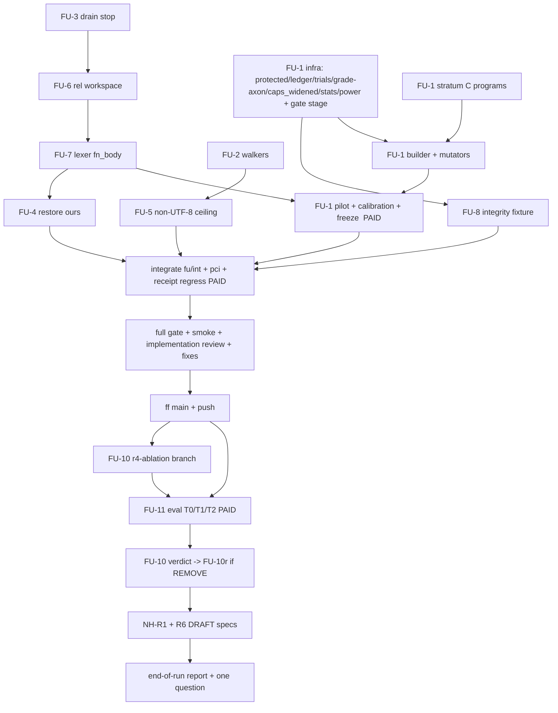

# Build loop — follow-up batch (`tasks/followup-spec.md`)

Integrator: main agent, in `/home/cklaus/projects/axon-lanes/fu-int` (branch `fu/int`). Lanes are Sonnet subagents,
each with its own worktree, branch and `CARGO_TARGET_DIR`:

| Lane | Worktree / branch | Target dir |
|---|---|---|
| LaneCortex | `/home/cklaus/projects/axon-lanes/fu-cortex` (`fu/cortex`) | `.doc-build/fu-cortex` |
| LaneCore | `/home/cklaus/projects/axon-lanes/fu-core` (`fu/core`) | `.doc-build/fu-core` |
| LaneEval | `/home/cklaus/projects/axon-lanes/fu-eval` (`fu/eval`) | `.doc-build/fu-eval` |
| AuthorC | `/home/cklaus/projects/axon-lanes/fu-progs` (`fu/progs`) | — (writes `.ax` programs only; runs `axon test` with the base binary) |

Target dirs are absolute: `/home/cklaus/projects/axon-lanes/.doc-build/<lane>`.

Env for every shell: `export PATH=$HOME/.cargo/bin:$PATH TMPDIR=/var/tmp/r51-tmp`, plus that lane's
`CARGO_TARGET_DIR`.

## Placeholders

| Placeholder | Value |
|---|---|
| `<TEST_CMD>` | `./scripts/gate.sh` on the integrated head (~27–32 min). Baseline: the 9d2c1c51 full gate — rc 0; 6912 passed, 0 failed, 12 ignored; "receipt: PASS … cf15378caadfe824"; "REDTEAM FAILED: blocking deploy" expected. main = f26e9506 differs only in `tasks/*.md`. |
| `<RUN_CMD>` | `cortex repair` / `axon` built from the integrated head |
| `<SMOKE_SCENARIO>` | see § Smoke |
| `<FULL_SUITE_BUDGET>` | 35 min; > 70 min triggers review |
| Known-failure list | empty. The 4 serde-json-only clippy errors in `lsp.rs` are pre-existing and outside the gate's feature set. |

## DAG

FU-9 is already DONE (out of repo).

**Tracks.** Edges between tracks come from shared files, including implicitly shared ones:

| Track | Files | Shared with |
|---|---|---|
| T-cortex | `crates/axon-cortex/src/{runner,generate,locate}.rs`, `src/bin/cortex.rs`, `crates/axon-cortex/tests/cli.rs`, `scripts/v022_g01_mutations.py`, `scripts/v022_refusal_coverage.py` | T-core shares the two `scripts/` files and the PCI files |
| T-core | `crates/axon-core/src/{capabilities,interp,main}.rs`, new `crates/axon-core/tests/*` fixture file, `cli_run.rs` | as above |
| T-eval | `crates/axon-cortex/benchmarks/{ab,scorecard,headroom}/**`, `B/protected.py`, `B/heldout-spent.jsonl`, `scripts/gate.sh` (one stage) | — |
| T-progs | `B/headroom/programs/**` only | — |

- Both lanes may add g01 rows; both append to the end of the rows file. The integrator resolves the merge as a
  concatenation and re-runs the g01 check.
- `governance/notes/pci-themes/*`, the pci regen output and `tasks/*.md` are integrator-only.

## Loops

**Inner loop (per lane task).**
1. Write the fail-first test (and the g01 row with it) and see it fail.
2. Fix, and see it pass.
3. Self-review against the SKILL.md checklist.
4. Run the lane stage list (spec § Cross-cutting, by touched paths).
5. Commit with `git commit -m … -- <paths>`.

Lanes never stash and use absolute paths in every tool call. After spawning, the integrator checks
`git -C /home/cklaus/projects/axon status --short` and expects only the user's untracked docs.

**Outer loop.** The integrator dispatches the four lanes concurrently, since their file scopes are disjoint (track table
above). Then:
- merges each lane into `fu/int` as it reports done;
- writes the pci theme and runs `python3 -B tasks/r51-pci-regen.py` and `python3 -B scripts/pci_delta.py --check`
  after each `crates/*/src` merge;
- updates `tasks/todo` state from the commits.

**Paid-run loop (CAL, regress, FU-11).** Each run has a stated cap, `--cap-usd`, a fresh
`set -a; . /root/.openrouter.env; set +a`, and probes before spending:
- a first-prompt diff against base with a `cmd:` capture generator on ≥ 3 tasks;
- ≥ 3 real tasks on the frozen binary.

| Run | Cap | Expected |
|---|---|---|
| pilot | $1 | |
| calibration | $5 | |
| receipt regress | $1 | ≈ $0.14 |
| FU-11 | $25 | ≈ $16 |

A run above 2× its expected cost or wall time is reviewed before the next.

**Full-suite regression loop.** One `./scripts/gate.sh` on the integrated head, logged to
`/var/tmp/r51-tmp/fu-gate-<n>.log`. Its results are compared with the baseline above. Any later commit to
`crates/*/src` or to tests requires a re-run.

**Smoke loop.** See § Smoke. It runs in `/var/tmp/r51-tmp/fu-smoke`. Afterwards `git status --short --ignored` in
fu-int must show nothing new.

**Implementation review loop.** A read-only "conformance audit" reviewer checks the finished diff `f26e9506..fu/int`
against the spec's acceptance criteria. Every finding is reproduced before acting on it, and every disposition is
recorded.

**Meta loop.** After each task, correction or failure, `tasks/lessons.md` gets a new entry (S1 follow-up section).
Second firing → mechanism.

**Dev-loop cost loop.** Runs per phase (lanes, paid, gate). It reports a useful / idle / queued split for the machine
(cargo builds of up to 4 target dirs) and for the OAuth grant (paid runs), and names the largest waste and the action
taken.

## Gates & special handling

- **Critical-path item:** FU-1e integrity (pins, ledger, paid-only spend, resume), because FU-11 and NH-R2 rest on it.
  Extra proof: the tamper suite (chain edit, pin edit, a copied corpus with the same sha, duplicate spend, oracle
  writing nothing) passes, and a dry `--spend` paid run with `--cap-usd 0` refuses before any model call while still
  appending nothing. FU-2 is security-relevant: its agreement fixtures are the extra proof.
- **Transitive blocking / poison ceiling:** per SKILL.md.
  - CAL blocked → FU-11 blocked. The batch still ships FU-2…FU-9, and FU-1 is reported not-frozen.
  - The integrity critical path blocked → stop the run.
- **Repair-digest rule:** one receipt regress on the integrated head (FU-3/4/6/7), plus one more if FU-10r lands. No
  waiver.
- **Merge rule:** if `main` moves, merge it into `fu/int`, never rebase. Receipt integrity is re-verified after the
  merge.
- **Run budget:** none set. Paid totals are capped per run as above.

## Smoke

On the integrated binaries (`.doc-build/fu-int/debug/{axon,cortex}`):
1. **FU-6:** `cortex repair` on a copy of a receipt task, run from its parent with a relative `--workspace`. Expect a
   real verdict and accepted bytes on disk equal to `accepted.sha256`.
2. **FU-2:** `axon caps`, `axon check` (E1203 importer) and `program_effect_rows` via `axon build --emit-manifest`
   (skipped if no codegen) on the `@[verify(read_file…)]` fixture. All report fs:read / IO.
3. **FU-5:** `axon run` with a non-UTF-8 `AXON_ALLOWED_EFFECTS` is refused.
4. **FU-4:** `cortex repair` where a concurrent writer edits the file after acceptance (via the `cmd:` generator hook).
   The external bytes survive and the reason says so.
5. **FU-1:** a probe of 3 hx-dev tasks through `run_ab.py --trials 2` with the oracle generator. Expect `(id, trial)`
   rows, `caps_widened` recorded, and no ledger row. The same on hx-test with oracle writes nothing.

Each step is bounded by `timeout 300`.

## Plan options

| Option | Shape | Est. AI dev time | Model wall | Gate runs |
|---|---|---|---|---|
| **Fastest (90 %) — default** | 4 lanes in parallel; lane stages by touched paths; one full gate + one regress on the integrated head | ≈ 4–6 h | ≈ 7 h (pilot, CAL, FU-11) | 1–2 full gates |
| Most reliable | full gate after each lane merge; regress after each digest item | ≈ 8–10 h | ≈ 7.5 h | 4–5 full gates, 4 regresses |

⚠ production-level: capability-gate and approval-adjacent code (FU-2 walkers feed G2, E1203, deploy risk and the VM
manifest; FU-5 is an effect ceiling). Fastest keeps the extra agreement and tamper proofs, plus the full gate on the
integrated head before merge.

## Harness self-check

| Spec item | DAG node |
|---|---|
| FU-1 | E1, P, B, CAL |
| FU-2 | K2 |
| FU-3 | C3 |
| FU-4 | C4 |
| FU-5 | K5 |
| FU-6 | C6 |
| FU-7 | C7 |
| FU-8 | E8 |
| FU-9 | DONE |
| FU-10 | T2, R |
| FU-11 | F11 |

Every item maps to exactly one node set, no needs-human subtree, and the graph is acyclic (edges only point downward in
the mermaid order).
