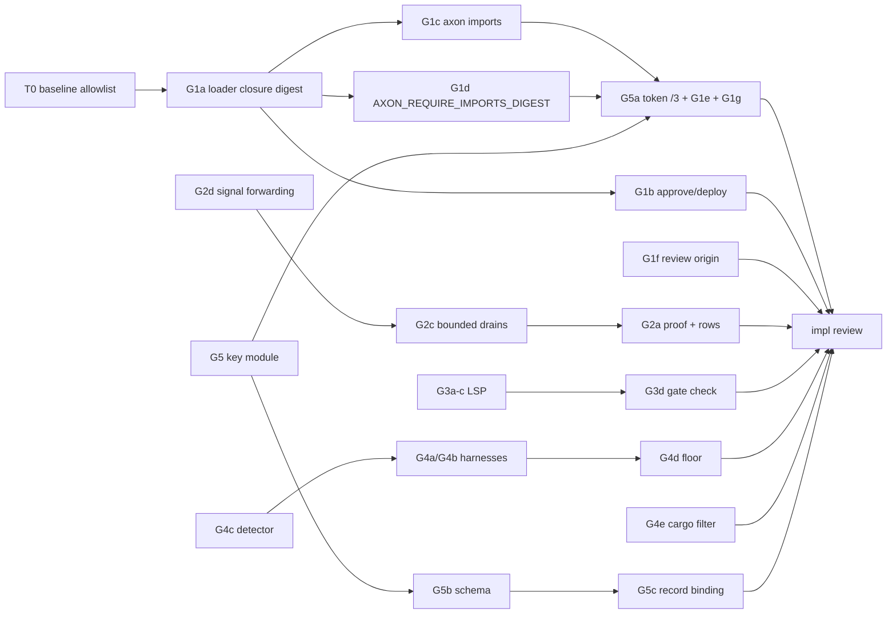

# Build loop: gaps (G1-G5)

Spec: `tasks/gaps-spec.md` (reviewed; original 9602cc11). Integration branch `gaps/int`, worktree
`/home/cklaus/projects/axon-lanes/gaps-int`. Integrator = main agent: merges lanes, runs the full gate, edits the
implicitly shared files last, pushes `main`.

## Resolved placeholders

- `<TEST_CMD>`: `./scripts/gate.sh` (non-strict; the repo's full gate, ~25-40 min) with `TMPDIR=/var/tmp/r51-tmp`,
  plus `AXON_HARNESS_STRICT=1 ./scripts/parity_all.sh` for G4 (strict tier, needs LLVM 17: present).
- `<RUN_CMD>` / `<SMOKE_SCENARIO>`: the interpreter CLI and `axon-intent`/`axon-os` binaries — the demonstrated
  attack, end to end, per path (see Smoke loop). Success signal: exit codes 8/11 on tamper, 0 on unchanged.
- `<FULL_SUITE_BUDGET>`: one gate run. `<RUN_BUDGET>`: unbounded. `<REVIEW_MODEL>`: reviewer subagent (Sonnet 5.5).

## Tracks (contention graph)

| Track | Lane worktree | Items | Owned files |
|---|---|---|---|
| A core | `axon-lanes/gaps-core` | G1a G1b G1c G1d G1f | axon-core `lib.rs`, `main.rs`, `lockfile.rs`, `env_registry.rs`, `axon-rt/src/lib.rs` (refusal row), `tests/cli_run.rs` (new tests), `scripts/build_outcome_regression.sh`, axon-web review consumer |
| B cancel | `axon-lanes/gaps-cancel` | G2d G2c G2a | axon-os `runtime.rs`, `cli.rs` (signal exit path only), `tests/legacy_adapter.rs` |
| C lsp | `axon-lanes/gaps-lsp` | G3a-G3d | axon-core `lsp.rs` (+ its tests) |
| D parity | `axon-lanes/gaps-parity` | G4c G4a G4b G4d G4e | `scripts/*_parity.sh`, `scripts/lib/harness_skip.sh`, `scripts/parity_all.sh`, `scripts/r26/r33/r34_acceptance_gate.sh`, `gate.sh:996` line, `cli_run.rs:79-84` doc comment only |
| E record | `axon-lanes/gaps-record` | G5 key module + G5b + G5c | axon-os `approval.rs` (key + schema only), `record.rs`, `supervisor.rs`, `cli.rs` (verify), axon-attest `constant_time_eq` |
| F token (wave 2) | `axon-lanes/gaps-token` | G5a token /3 + G1e + G1g | axon-intent `approval.rs`/`cli.rs`/`emit.rs`, axon-os `approval.rs`/`runtime.rs` (child env), axon-fabric admission + tests, r22 gate |

Implicitly shared (lanes may edit; integrator resolves conflicts and regenerates last): `AXON-COMPLETENESS.json`
(control rows the env registry requires), `AXON_REFERENCE.md` (regenerated), `scripts/v022_refusal_coverage.py`,
`scripts/v022_g01_mutations.py`, `Cargo.lock`, `CHANGELOG.md`, `tasks/*`. `AXON-COMPLETENESS.md` is regenerated by the
integrator only.

Overlaps: B and E both touch `axon-os/src/cli.rs` (different functions) → merge B before E. A and D both touch
`cli_run.rs` (distinct regions). F depends on A (G1c/G1d) and E (key module) merged.

## Task DAG

Critical-path item: **G1a** (loader-recorded closure digest) — G1b/G1c/G1d/G1e all bind to it. Extra gate: a
cross-check test that, for every `examples/**/*.ax` with a `use`, `axon imports`' module set equals what the
loader merged and the digest is stable across two processes and two working directories; plus the empty-closure
known value. If G1a blocks, the run stops.

## Loops

- **Inner (per lane, one task):** fail-first test → fix → crate tests + `cargo fmt --all --check` + the touched
  gates (`v022_refusal_coverage.py`, `v022_g01_mutations.py` rows for touched files, `reference_gate.sh` if env/CLI
  changed) → self-review checklist (scope confined, no TODO/dead code, no secret values, reuse existing helpers,
  matches crate pattern, diff proportionate) → commit `-- <paths>` on the lane branch.
- **Lane done:** lane runs `./scripts/gate.sh --fast` and its crates' full tests; the full non-strict gate runs at
  the integrator after merge (five concurrent full gates on one host produce load failures, measured in r51:
  deviation from the skill's "full suite per task" recorded here).
- **Outer (integrator):** wave 1 = A, B, C, D, E in parallel (disjoint per the table). Merge order B, E, C, D, A
  (smallest conflict surface first). Then wave 2 = F on the merged tree.
- **Full-suite regression:** after each wave merge: `./scripts/gate.sh` vs baseline; after D merges also
  `AXON_HARNESS_STRICT=1 ./scripts/parity_all.sh`. New failure → known-failure procedure (tally, 3× through the
  gate's launch, deterministic blocks).
- **Smoke (after each wave, temp dir):** (1) `axon ast approve main.ax` → rewrite `lib.ax` → `axon deploy` exits 8;
  unchanged → deploys. (2) wave 2: `axon-intent approve` → rewrite imported module → `axon-os run` refused; unchanged
  runs; forged token with `AXON_APPROVAL_KEY` set refused; edited record `approval` field refused by `axon-os verify`.
  (3) `axon-os run` of a job that backgrounds a grandchild, SIGTERM to axon-os → grandchild gone, record written.
  `git status --short --ignored` clean afterwards.
- **Meta:** `tasks/lessons.md` on corrections; spec/DAG updated when reality diverges.
- **Implementation review:** after F, a reviewer subagent against finished code + spec acceptance; findings
  reproduced before acting; dispositions recorded in the report.
- **Poison ceiling:** 3 failed attempts → park blocked, block dependents, continue.

## Known-failure list

(empty at start; baseline recorded in `tasks/gaps-baseline.md`)
