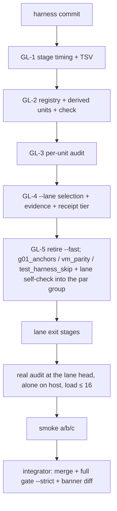

# Build loop: gate-lane (GL-1 … GL-5)

Spec: `tasks/gate-lane-spec.md`, AUTHORIZED 2026-10-29 for P1 (GL-1…GL-4) and P2 (GL-5, Q1 = B). Q4 = B (the lane
self-check joins the full gate's par group). GL-6 (P3) is deferred and not built.

Base: `main` 43e895d0. Its full gate is the baseline the integrator compares against; the known-failure list is empty.

| Lane | Worktree / branch | `CARGO_TARGET_DIR` | Items |
|---|---|---|---|
| GateLane | `axon-lanes/gl` (`gl/lane`) | `axon-lanes/.doc-build/gl` | GL-1 → GL-2 → GL-3 → GL-4 → GL-5, serial |

All paths are under `/home/cklaus/projects/`. One lane only: every item edits `scripts/gate.sh`, so nothing is
disjoint and the parallel dispatch loop does not apply.

**Env for every shell:** `export PATH=$HOME/.cargo/bin:$PATH TMPDIR=/var/tmp/r51-tmp
CARGO_HOME=/var/tmp/r51-tmp/cargo-home-nowrap CARGO_TARGET_DIR=/home/cklaus/projects/axon-lanes/.doc-build/gl`.
Cargo, the audit and the smoke runs go through `nice -n 10` (and `/var/tmp/r51-tmp/privtmp.sh` for `cargo test` and
gate runs).

**Agent rules:** notes in `/var/tmp/r51-tmp/<Agent>-NOTES.md`; absolute paths; never stash; commit with
`git commit -- <paths>` only.

## Placeholders

| Placeholder | Value |
|---|---|
| `<TEST_CMD>` | `python3 -B scripts/test_gate_lane.py` per item; the integrator's `privtmp.sh ./scripts/gate.sh --strict` on the integrated head |
| `<RUN_CMD>` | `scripts/gate.sh --lane` (and `--lane --plan`) |
| `<SMOKE_SCENARIO>` | § Smoke |
| `<FULL_SUITE_BUDGET>` | 39 min unloaded (fu-gate-2.log 38m51s); a run over 80 min is reviewed |
| `<RUN_BUDGET>` | no money (no paid or model call); no time cap |
| `<RELIABILITY>` | Fastest at 90 % (default, not chosen by the user) |

## DAG

Every edge is a file edge (`scripts/gate.sh`, `scripts/gate_lane.py`, `scripts/test_gate_lane.py`) and a data edge
(GL-4 selects from GL-3's audit, GL-3 audits GL-2's units, GL-2 rows name GL-1's stage IDs).

**g01:** no rows. Python and shell only, no `crates/*/src` change (spec §2 g01). The GateLane block M3890–M3909 stays
unused.

## Loops

**Inner loop (per item):**
1. Write the item's fail-first tests in `scripts/test_gate_lane.py` (fixtures in `scripts/testdata/gate_lane/`); run
   them on the lane head and record the failure.
2. Implement.
3. Watch them pass; `bash -n scripts/gate.sh`.
4. Self-review: scope, no dead code, existing pattern, the full gate's command lines unchanged.
5. Commit `-- <paths>`.

**Lane exit (before reporting):**

| Stage | Why it reads the change |
|---|---|
| `python3 -B scripts/test_gate_lane.py` | the item tests |
| `python3 -B scripts/gate_lane.py check` | registry against gate.sh text and the manifest |
| `bash -n scripts/gate.sh`; `bash scripts/test_harness_skip.sh` | syntax; the gate's own selftest the spec names |
| gate.sh's run_quiet / par / par_abort self-checks | run at every gate start (`--lane --plan` exercises them) |
| `cargo test -p axon-core --no-default-features --test release_manifest` | scans gate.sh / run_managed.sh cargo lines |
| `cargo test -p axon-core --no-default-features --test requirements_evidence` | parses gate.sh's script invocations and their `if` guards |
| `cargo test -p axon-core --no-default-features --test harness_integrity` | scripts/ shape rules |
| the par group's source checks (`artifact_admission_gate.sh`, `opkit_ns_drift.py`, `v022_refusal_coverage.py`, `g01_anchors.py`, `scorecard.py report --check`) | new files under scripts/; scorecard README edit (GL-5) |
| `bash scripts/run_managed.sh` receipt for `gate.sh --lane --plan` | `gate_tier=lane gate_run=no` |

**Outer loop:** GL-1…GL-5 in order; the integrator merges `gl/lane`.

**Full-suite loop:** the integrator's one `gate.sh --strict` on the integrated head, then the banner and `→ cargo`
sequence diff against `/var/tmp/r51-tmp/fu-gate-2.log` (GL-1 acceptance). Full-gate stages this run changes:
every serial stage S01–S20 (wrapped, timed), the par group (three moved checks + the lane self-check), the end table.

**Meta loop:** `tasks/lessons.md` on each correction. **Dev-loop cost loop:** wall time per phase in the notes.

## Gates & special handling

| Gate | Expected cost | Trigger |
|---|---|---|
| `test_gate_lane.py` + `check` | seconds | every edit |
| `--lane --plan` | seconds | every edit |
| real audit `gate_lane.py audit` | ≈ 50–55 min `[INFERENCE]`, alone on the host; a fresh target dir adds a cold build | once at the lane head; only when load avg ≤ 16 (one `uptime` check per 10 min of other work); measured wall time recorded with the load |
| smoke a/b/c | (a) ≈ 1–10 min, (b) ≈ 35 min, (c) ≈ 39 min `[INFERENCE, spec §4]` | once, after the audit |
| `gate.sh --strict` | ≈ 43–55 min | integrator only |

- **Critical path:** GL-2's unit derivation and GL-3's audit; every lane decision reads them. Extra proof: the
  `lane_every_stage_reachable` check runs against the real audit, and smoke (b) must list fabric `cortex_via_fabric`
  as RUN (the S1 miss).
- **Load rule:** no timing (audit, smoke) under load avg > 16; wait and say so.

## Smoke

On the lane head after the real audit. Each case is a scratch commit on a throwaway branch in a scratch worktree
under `/var/tmp/r51-tmp/gl-smoke-<x>`, `CARGO_TARGET_DIR=/var/tmp/r51-tmp/gl-smoke-target` (shared by the three, run
one after another); `timeout 3h`. Recorded per case: selected units, wall time, rc, load avg.

1. **(a) docs-only** (`docs/` file edited).
   - Expected (spec §4): the always group plus units whose audit read the file; ≈ 1–10 min; rc 0.
   - First line `════ LANE — NOT THE GATE, NOT EVIDENCE · audit=<A> ════`; last line `lane: N run / M skipped passed —
     not the gate; …`; no `✅ gate PASSED`.
2. **(b) `crates/axon-cortex/src/locate.rs`** (comment edit).
   - Expected: S02, S03 (all targets), S05–S07, S09, S14, S16 `cli_run` + `refusal_coverage_gate`, S20
     cortex/fabric/loop/contracts/reflex/adapter RUN; S11–S13 and unrelated S20 crates SKIP; rc 0.
3. **(c) `crates/axon-core/src/checker.rs`** (comment edit).
   - Expected: ≈ everything RUN; rc 0.

Afterwards the scratch worktrees and branches are removed and `git worktree list` shows none of them.

## Plan options

| Option | Shape | Wall | P(finish in range) | P(slip) |
|---|---|---|---|---|
| **Fastest (90 %), default** | one serial lane; fixture tests per item; one real audit; three smokes; integrator's one strict gate | 6–10 h `[INFERENCE]`, longer if the host stays loaded | ≈ 50 % `[INFERENCE]` | ≈ 10 %: a full-gate-only failure costs one fix and one strict gate (≈ 1 h) |
| Most reliable | plus a full non-strict gate after GL-1 and after GL-5 in the lane | 8–12 h | ≈ 50 % | ≈ 3 % |

Fastest in words: done by the end of the day if the computer is not busy; out of 10 runs about 1 lets a small
mistake through to the final full check, which catches it and costs about an hour.

## Harness self-check

| Spec item | Node |
|---|---|
| GL-1 | GL1 |
| GL-2 | GL2 |
| GL-3 | GL3, AUD |
| GL-4 | GL4, SMOKE |
| GL-5 | GL5 |
| GL-6 | deferred (P3, Q3) |

- Every item appears exactly once; the graph is acyclic.
