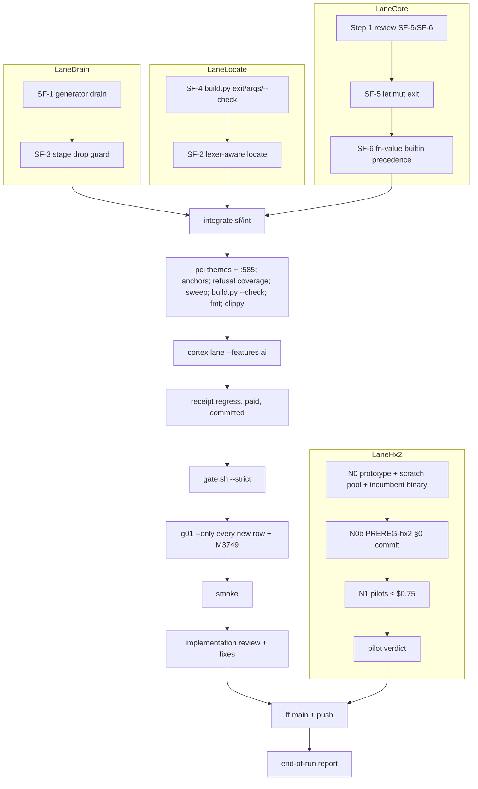

# Build loop: small-fixes batch, plus the hx2 HX-0 pilot

Specs:
- `tasks/small-fixes-spec.md`: SF-1 to SF-4, Step 1 reviewed 2026-10-19; OQ-3 decided by the human 2026-10-27. This
  run adds SF-5 (O-CS-04) and SF-6 (O-CS-03) by human go-ahead ("do it", 2026-10-28). They get their own Step 1
  review before any lane implements them.
- `tasks/hx2-spec.md`: HX-0 only (nodes N0, N0b, N1). NH-1 = (b) authorizes $5.75; this run spends at most HX-0's
  $0.75. The run stops at the pilot verdict, and N2+ is reported, not started.

Base: `main` ef19a064. Its full `gate.sh --strict` passed rc 0 in 54m50s (`/var/tmp/r51-tmp/ck-gate.log`). That run
is the baseline, and the known-failure list is empty.

Integrator: Main, in `/home/cklaus/projects/axon-lanes/sf-int` (`sf/int`).

| Lane | Worktree / branch | `CARGO_TARGET_DIR` | Items |
|---|---|---|---|
| LaneDrain | `axon-lanes/sf-drain` (`sf/drain`) | `axon-lanes/.doc-build/sf-drain` | SF-1, then SF-3 |
| LaneLocate | `axon-lanes/sf-locate` (`sf/locate`) | `axon-lanes/.doc-build/sf-locate` | SF-4, then SF-2 |
| LaneCore | `axon-lanes/sf-core` (`sf/core`, reset to `sf/int` ≥ 28be0dbd before starting so it carries SF-3's `StagedWs`, SF56D#1) | `axon-lanes/.doc-build/sf-core` | SF-5, then SF-6, after their Step 1 review |
| LaneHx2 | `axon-lanes/hx2-proto` (`hx2/proto`, never merged); records in `axon-lanes/hx2-rec` (`hx2/rec`) | `axon-lanes/.doc-build/hx2` (only if a build is needed) | HX-0: N0, N0b, N1 |

All paths are under `/home/cklaus/projects/`.

**Env for every shell:**
- `export PATH=$HOME/.cargo/bin:$PATH TMPDIR=/var/tmp/r51-tmp CARGO_HOME=/var/tmp/r51-tmp/cargo-home-nowrap`, plus
  the lane's own `CARGO_TARGET_DIR`. The shadow `CARGO_HOME` exists because of O-CS-01.
- `cargo test` and the gate/harness scripts run as `/var/tmp/r51-tmp/privtmp.sh nice -n 10 <cmd>` (O-CS-02).
- Builds and clippy run as `nice -n 10 <cmd>`.

**Agent rules:**
- Each agent keeps `/var/tmp/r51-tmp/<Agent>-NOTES.md`.
- Use absolute paths, never stash, commit only with `git commit -- <paths>`, and never touch rep-int's target dir.

## Placeholders

| Placeholder | Value |
|---|---|
| `<TEST_CMD>` | `privtmp.sh ./scripts/gate.sh --strict` on the integrated head. `--strict` is used because SF-5/SF-6 touch `crates/axon-core/src` (checker/interp) |
| `<RUN_CMD>` | `axon` and `cortex` built from the integrated head |
| `<SMOKE_SCENARIO>` | § Smoke |
| `<FULL_SUITE_BUDGET>` | 55 min under load (54m50s at base). A run over 110 min triggers a review |
| `<RUN_BUDGET>` | Money: receipt cap $1 and hx2 HX-0 cap $0.75. No time cap |
| `<RELIABILITY>` | Fastest at 90 % (default) |
| Sweep baseline | `/var/tmp/r51-tmp/sf-sweep-base.txt`: 290 files, 274 rc 0, 16 rc 2. `cs-sweep.sh`, ck-int axon at ef19a064 |

## DAG

- SF-4 comes before SF-2 so that SF-2's rank acceptance is an exit code (spec Sequencing).
- SF-6 follows SF-5 because both touch the checker's diagnostics. This is a file-order edge, not a dependency.
- Any fix after RCPT that touches `crates/axon-cortex/src` re-runs RCPT and then GATE (spec SFD#1).

**g01 ids:**

| Lane | Rows |
|---|---|
| LaneDrain | M3840–M3843 |
| LaneLocate | M3844–M3847 |
| LaneCore | M3848–M3855 |
| Spare | M3856–M3859 |

- Every row gets an `ATTACK_MARKERS` entry in the same commit.
- The tails of `scripts/v022_g01_mutations.py` and `scripts/v022_attack_markers.py` are append-only, and the
  integrator merges them as a concatenation.

**Integrator-only files:**
- `tasks/*.md`
- `governance/notes/pci-themes/*`
- `governance/notes/v022-pci-delta.md` (:585)
- `AXON_REFERENCE.md`
- `Cargo.lock`
- receipt outputs

## Loops

**Inner loop (per item):**
1. Write the spec's fail-first tests and watch them fail on the lane head.
2. Fix the item.
3. Watch the tests pass.
4. Add the g01 rows and markers.
5. Self-review: scope, no dead code, existing pattern, proportionate diff.
6. Run the item's stage list from the spec's gate table:
   - targeted tests only, never the whole `cli_run` in a lane;
   - `g01_anchors.py`;
   - `v022_refusal_coverage.py`;
   - the sweep for checker/infer/interp edits, diffed against the baseline.
7. Commit.
8. Run `v022_g01_mutations.py --only=<ids>` on the committed tree.

**Lane exit:**
- `cargo clippy` for the touched crates, with `-D warnings`.
- All of the lane's targeted tests.
- LaneDrain/LaneLocate: the whole `--test cli` once.
- LaneCore: the whole `axon-core --no-default-features` suite once, plus the codegen parity scripts the SF-6 item
  names.

**Outer loop:** the integrator merges each lane into `sf/int` with `git merge`, then runs the tail of the DAG.

**Full-suite loop:** one `--strict` gate on the receipted head (`/var/tmp/r51-tmp/sf-gate-<n>.log`). Any commit after
it re-runs the gate.

**Review loop:** two read-only conformance audits of `ef19a064..sf/int`:
- one for SF-1 to SF-4;
- one for SF-5/SF-6.

Each finding is reproduced before anyone acts on it.

**Meta loop:** `tasks/lessons.md` on each correction. **Dev-loop cost loop:** a useful/idle split per phase.

## Gates & special handling

| Gate | Expected cost | Trigger |
|---|---|---|
| per-item targeted tests | seconds plus incremental rebuild | each item |
| sweep | ≈ 3 s | SF-5/SF-6 commits |
| g01 `--only` | ≈ 30 s per row (5 min per 10 rows measured) | each item commit |
| cortex lane `--features ai` | 10–15 min | once, after the last src edit |
| receipt regress | $0.13–0.14, ≈ 5 min, cap $1 | after the cortex lane, clean tree |
| `gate.sh --strict` | ≈ 55 min | receipted head |
| HX-0 scratch pool build | ≈ 7.5 min at `--jobs 16` | N0 |
| HX-0 pilots | ≤ $0.25 per class, $0.75 total | N1, only after the §0 commit is checked by Main |

- **Critical path:** SF-1, a P1 false success. A BLOCKED SF-1 stops the small-fixes ship.
- **Money:** LaneHx2 stops before its first paid call and reports the §0 commit to Main. Main checks it, then
  releases the pilot.
- **Merge rule:** if `main` moves, merge it in; never rebase.

## Smoke

On the integrated binaries, `timeout 60` per step, in `/var/tmp/r51-tmp/sf-smoke`:
1. **SF-1:** run reproductions (a) and (b) through `cortex repair`.
   - Expected: exit 24, file unchanged.
   - KG2's silent leftover still exits 0.
2. **SF-2:** run `cortex locate --json` on `c_comment`, `c_string`, `d_ghost`, `t_test` and `i_interp`.
   - Expected: the spec's "correct" column.
3. **SF-4:** `build.py --check` with built binaries.
   - Expected: rc 0, 57 OK.
   - Broken spec: rc 1. `--bogus`: rc 2.
4. **SF-5:** the smoke list in SF-5's Acceptance (`tasks/small-fixes-spec.md`), e.g. `axon check letmut.ax`.
   - Expected: exactly the outputs stated there (rc 0 with the I0002 note; an error-severity file still rc 2).
5. **SF-6:** the smoke list in SF-6's Acceptance, e.g. `axon check fnval.ax` / `axon run fnval.ax`.
   - Expected: exactly the outputs stated there (E0306 at the reference, rc 2), never rc 0 followed by a run panic
     of 101; the `toplet`/`toplam` top-level `let` cases still check rc 0 and run.
6. **SF-3:** the private-`TMPDIR` conformance run leaves 0 `cortex_*` dirs.

## Plan options

| Option | Shape | Wall | P(finish in range) | P(slip) |
|---|---|---|---|---|
| **Fastest (90 %), default** | 3 code lanes + hx2 in parallel; one cortex lane, one receipt, one strict gate | 5–8 h `[INFERENCE]` | ≈ 60 % `[INFERENCE]` | ≈ 10 %: a full-suite-only failure costs one fix, plus receipt and gate re-runs (≈ 1.5 h, $0.14) |
| Most reliable | plus a strict gate after each lane merge | 8–11 h | ≈ 60 % | ≈ 3 % |

## Harness self-check

| Spec item | Node |
|---|---|
| SF-1 | SF1 |
| SF-2 | SF2 |
| SF-3 | SF3 |
| SF-4 | SF4 |
| SF-5 | SF5 |
| SF-6 | SF6 |
| hx2 HX-0 | N0, N0b, N1 |

- Every item appears exactly once.
- HX-1 to HX-6 are out of this run, because they are gated on the pilot verdict.
- The graph is acyclic.
