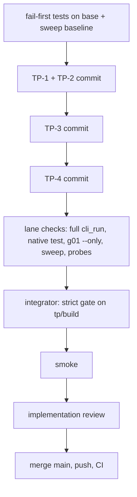

# Build loop: tuple-patterns batch (TP-1..TP-4)

Spec: `tasks/tuple-patterns-spec.md`, Step 1 reviewed 2026-11-09 (14 findings accepted). NH-1 (a) and NH-2 (a) decided by
the human 2026-11-10 ("go"). Every item is in scope; no needs-human subtree is excluded.

Base: `main` 9919af87. Baseline: the strict gate at 4199c91c under CapLoad's measurement load, rc 0, 3038 s
(`/var/tmp/r51-tmp/cap-load/gate.log`); 4199c91c..9919af87 changes only `tasks/` text. Before it, `gate.sh --strict` at
557e746c: 8287 passed, 0 failed, 17 ignored. Known-failure list: empty.

| Role | Worktree / branch | `CARGO_TARGET_DIR` | Items |
|---|---|---|---|
| Integrator (Main) | `axon-lanes/tp-build` (`tp/build`) | `axon-lanes/.doc-build/tp-build` | records, opportunities, strict gate, merge |
| LaneTP | `axon-lanes/tp-lane` (`tp/lane`) | `axon-lanes/.doc-build/tp-lane` | TP-1+TP-2, TP-3, TP-4 |

All paths are under `/home/cklaus/projects/`. One lane: every item edits `bind_pattern_with_subj` (spec §6), so there is no
disjoint pair to parallelise.

**Env for every shell:** `export PATH=$HOME/.cargo/bin:$PATH TMPDIR=/var/tmp/r51-tmp
CARGO_HOME=/var/tmp/r51-tmp/cargo-home-nowrap CARGO_TARGET_DIR=<lane dir>`. `cargo test` and gate scripts run as
`/var/tmp/r51-tmp/privtmp.sh nice -n 10 <cmd>`.

## Placeholders

| Placeholder | Value |
|---|---|
| `<TEST_CMD>` | `privtmp.sh ./scripts/gate.sh --strict` on the integrated head (`crates/axon-core/src` changes) |
| `<RUN_CMD>` | `axon` built from the integrated head |
| `<SMOKE_SCENARIO>` | § Smoke |
| `<FULL_SUITE_BUDGET>` | 0.75-1.6 h (spec §5). Over 3.2 h triggers a review |
| `<RUN_BUDGET>` | $0 (no AI path). No time cap |
| `<RELIABILITY>` | Fastest at 90 % (default, not chosen by the user) |
| Sweep baseline | `/var/tmp/r51-tmp/LFT/base.tsv`: 717 files, 626 rc 0, 91 rc 2 |

## DAG

Critical path: TP-1 (every later item reuses its binding loop). Extra gate: the corpus sweep shows no rc 0 -> nonzero file,
and the ICS-1 width controls (`ics_w4` etc.) stay legal (M4714's killer).

## Loops

- **Inner loop (lane):** spec §6 order of work. Each commit carries its g01 rows, `ATTACK:` markers, pci theme and CHANGELOG
  line. Self-review: diff confined to the §6 file list.
- **Full-suite regression:** one strict gate after TP-4, integrator-run. Compare with the baseline.
- **Smoke:** § Smoke, once on the integrated binary.
- **Implementation review:** one read-only conformance audit of the finished diff against the spec; findings reproduced before
  acting.
- **Poison ceiling:** 3 failed attempts on an item parks it; TP-1 parked stops the run (critical path).
- **Stop rule for surprises:** a probe rc change that is not a spec table row, or a tracked `.ax` file going rc 0 -> nonzero,
  stops the lane with a report. The design is not adjusted inside the lane.

## Smoke

On a temp dir outside the repo, with the integrated `axon`:
1. `match (1, "s") { (a, b) => to_str(b + 1) }` -> `axon check` exits nonzero with E0102 (was rc 0 and a run panic).
2. `examples/tuples.ax` -> `axon run` rc 0, same stdout as the base binary `/var/tmp/r51-tmp/eg-bin/axon`.
3. ICS-1 width case (`match (1, 2) { (a, b) => { let x: u8 = a; println(x) } }`) -> check rc 0, prints `1`.
4. `git status --short --ignored` in the worktree shows nothing new beyond build dirs.

## Harness self-check

Nodes: T0, T12, T3, T4, L, G, S, R, M. Every spec item (TP-1..TP-4) is covered exactly once. The graph is acyclic.
