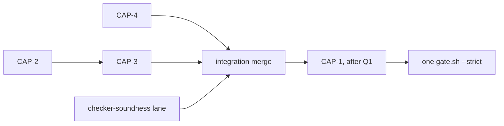

# Capability surface: verify-predicate effects, native effect rows, one program-wide walk — DRAFT spec

**Status: DRAFT (after Step 1 review). Not authorized for build.**
Base: `main` 7f110693 (worktree `/home/cklaus/projects/axon-lanes/specs-next`, branch `specs/next`).
Source: `tasks/opportunities.md` O-S1-19 (:2653-2654), O-S1-20 (:2656-2657), O-FU-05 (:2683-2684).
Precedent: FU-2 (ecf63dfc, `tasks/followup-spec.md:296-369`, `crates/axon-core/tests/predicate_capability_routes.rs`,
g01 M3760–M3764). g01 ids reserved for this spec: **M3800–M3819**.

Evidence binaries: `/var/tmp/r51-tmp/hx-bin/axon` (b789a8f6, no `crates/axon-core/src` change since). Scratch programs
under `/var/tmp/r51-tmp/specs-CapabilitySurface/` (`v/`, `imp/`, `deep/`, `r1/`). `$A` = the hx-bin axon;
`TMPDIR=/var/tmp/r51-tmp`.

## Step 1 review

Reviews: `agent://AuditCapSurface` (CAPA#1–12: 5 major, 7 minor) and `agent://DevloopCapSurface` (CAPD#1–16: 8 major,
8 minor). 0 blockers. 27 accepted, 1 partial (CAPA#6), 0 rejected. Every probe below was re-run or its line re-read
before acceptance unless marked "reviewer-cited".

| Id | Sev | Disposition |
|---|---|---|
| CAPA#1 / CAPD#10 | major | accepted: Main's cross-spec decision — CAP-1 is E1104 in `effects::check_effects`, independent of checker-soundness's `check_verify_predicate` (E1103 = names/types/binders). §1, CAP-1, §5 |
| CAPA#2 | major | accepted: re-ran `r1/verify_str.ax` (str return): check 0, run 0, no file, caps `fs:write`. Rationale re-derived (CAP-1, Q1) |
| CAPA#3 | major | accepted: re-ran `r1/time_row.ax`: check 0; `AXON_ALLOWED_EFFECTS=Pure` → `now_ms requires effect Time` rc 8. Closed-row rule added |
| CAPA#4 | major | accepted: re-ran `r1/vrl.ax`: check 0, file written, caps `fs:write`/`IO`. CAP-1 now runs the reach walker on the predicate |
| CAPA#5 | major | accepted: `effects.rs:334` reads `builtin_effect_row(name)` directly. CAP-4 change fixed |
| CAPA#6 | minor | partial: `sleep_ms` refused, message text accepted; `temporal_new` NOT excluded — it reads the clock (`program_now_ms()`, `interp/builtins.rs:3932`) |
| CAPA#7 | minor | accepted, superseded by design: E1104 is built from the reach result (callee name + its row), no E1310 re-coding |
| CAPA#8 / CAPD#11 | minor | accepted: `ALL_CODES` `error.rs:438`, uniqueness array `:751`, `AXON_REFERENCE.md:218`, `cli_run.rs:25717` |
| CAPA#9 | minor | accepted: re-ran `r1/userchan.ax`: caps effects `["Chan"]`. CAP-2 delta sentence + fixture |
| CAPA#10 | minor | accepted (the E0001 was in my own output) |
| CAPA#11 | minor | superseded by CAPD#6 (named closure keeps M3763's anchor; no re-anchor) |
| CAPA#12 | minor | accepted: `unattended-auth-spec.md:265` already re-anchored; drift sentence removed |
| CAPD#1 | major | accepted: verify checkout is 92152bfc; `git rev-list --count 92152bfc..7f110693` = 2236 |
| CAPD#2 | major | accepted: S16 path named; optional `main.rs` cfg pin decided against (Q7) |
| CAPD#3 | major | accepted: `gate.sh:933` is `--no-default-features`; 787 s is reviewer-cited (`gate-lane-spec.md:177,205`) |
| CAPD#4 | major | accepted: FU-2 record `/var/tmp/r51-tmp/fu-core-g01-fu2.json` mtime 12:24:15 checked; per-row seconds reviewer-cited |
| CAPD#5 | major | accepted: `v022_g01_mutations.py:8827` refuses on marker drift. Markers added per row |
| CAPD#6 | major | accepted: named closure; M3763 description updated; `effect_row` message kept byte-identical |
| CAPD#7 | major | accepted: `v022-pci-delta.md:561` "470 rows at this head" is hand-kept |
| CAPD#8, #9 | minor | accepted (harness_binaries scope reviewer-cited) |
| CAPD#12, #13 | minor | accepted: my sweep — `axon caps --json` over 248 tracked `examples/**`+`benchmarks/**` `.ax` (git pathspec count; reviewer counted 290): 1.5 s, 14 non-zero |
| CAPD#14, #15, #16 | minor | accepted |

## 1. Out of scope, and cross-spec dependencies

| Item | Why not here |
|---|---|
| How `@[verify]` predicates bind names, E1103 | owned by `tasks/checker-soundness-spec.md` (O-S1-23). `[REVISED: CAPA#1 — was "its hook … confirmed by CheckerSoundness"; Main's decision: CAP-1's E1104 lives in `effects::check_effects` and needs `inferred`/`invoked`, which the checker does not have; the two checks are independent]` |
| A codegen-built `.axmeta` observation | `[REVISED: dev-loop CAPD#1/#2 — was "no codegen-capable axon links on this host"]` No codegen binary at base was built for this review; the only one found (verify checkout, 92152bfc, 2236 commits behind) fails at link on its stale `libaxon_rt.a`. Gate evidence for `effect_union` is the `--no-default-features` `predicate_capability_routes` assertion on `program_effect_rows` (S16, `gate.sh:933`); `build_axmeta_manifest` copies it verbatim (`main.rs:8994`) |
| Native-module scopes, `exec` admission | NH-R1 E4/E11 (`tasks/unattended-auth-spec.md:265,272`) read `axon caps`, which CAP-2/3 do not change. `[REVISED: CAPA#12 — anchor-drift sentence removed; :265 already re-anchored]` |
| Refinement-predicate purity is shallow (F2) | language behaviour on refinements (E1209); logged, Q2 |
| Declared rows of impl methods missing from `effect_union` (F3) | low; `build_axmeta_manifest` unions declared rows of `Item::FnDef` only (`main.rs:8999-9014`) [by reading]. Logged, Q6 |

Dependencies: CAP-1 merges after checker-soundness (shared `error.rs`/`AXON_REFERENCE.md` append points; checker-soundness
E-1 makes every checked predicate run on every return, which CAP-1's rationale uses). NH-R1 is not blocked.

## 2. Findings made while specifying (Main to log)

- **F1 — effect rows ignore `@[verify]` predicates.** `check_effects` walks only `f.body` (`effects.rs:174-182`);
  `propagate_effects` collects calls from `f.body` only (`effects.rs:327`). `v/verify_row.ax` (`match write_file(..)`
  in the predicate of `fn f(n: i64) -> i64 | {}`, called from `g | {}`): check rc 0; run writes `out_row.txt`;
  under `AXON_ALLOWED_EFFECTS=Pure`: `sandbox violation: builtin write_file requires effect IO …` rc 8.
  `[REVISED: CAPA#3]` Same for a clock read: `r1/time_row.ax` (`@[verify(value >= 0 && now_ms() > 0)]` on `| {}`)
  check rc 0; under `Pure`: `builtin now_ms requires effect Time …` rc 8.
- **F2 — E1209 is shallow.** `reject_impure_refinement` passes an empty `pure_fns` and keeps only the `"impure
  builtin"` kind (`checker.rs:2555`, `:2557`); `collect_purity_violations` matches `Expr::Ident` callees only
  (`checker.rs:2588-2600`). `v/refine_launder.ax` (`type W = i64 where leak(_)`, `leak` writes): check rc 0, run writes
  the file. Control `is_ok(write_file(..))` directly → E1209 rc 2. `v/refine_row.ax` (`| {}`): check rc 0, file written.
  `[REVISED: CAPA#4]` The effect checker is blind to refinement hooks too: `r1/vrl.ax` (`fn h(n: W) -> bool`,
  `fn g(n: i64) -> bool | {} { h(n) }`, `@[verify(g(value))]`): check rc 0 (no E1310 on `g`), run writes `out_vrl.txt`;
  `axon caps` → `fs:write`/`IO` (the reach walker sees it).
- **F3** — §1 last row.
- **F4 — E1310 misses `ai_extract::<T>`.** `check_expr`'s StructLit arm resolves native calls only (`effects.rs:979-1001`);
  `collect_calls` records a StructLit callee only if `is_native_call` (`effects.rs:723-726`). `aix_row.ax`
  (`ai_extract::<i64>` in a `| {}` fn): check rc 0, no diagnostic. Control `aii_row.ax` (`ai_extract_i64(..)` there):
  two E1310 (`AI`, `Net`) `[REVISED: CAPA#10]` plus E0001 (`ai_extract_i64` is not in BUILTINS).

## 3. Priority tiers

| Tier | Item | Kind |
|---|---|---|
| P2 | CAP-2 native and turbofish calls in `program_effect_rows`, one program-wide note walk (O-S1-20 + O-FU-05 partial share) | engineering |
| P2 | CAP-1 `@[verify]` predicate effects (O-S1-19 + F1 + verify part of F2) | **needs-human** (Q1) |
| P2 | CAP-4 E1310 sees `ai_extract::<T>` (F4) | engineering |
| P3 | CAP-3 walkers: no full merge; agreement test (O-FU-05) | engineering, decided |

---

## CAP-1 (P2, needs-human) `@[verify]` predicate effects — O-S1-19, F1

**Problem.**
- Refinements get E1209 (`checker.rs:788-804`); a verify predicate gets only the sealed name check
  (`checker.rs:1391-1400`) and E1101/E1102.
- `[REVISED: CAPA#2 — was "the scalar gate is skipped when the SMT prover discharged the bound … effects run or not
  depending on the prover"]` Evaluation is conditional on the **return type**: Uncertain/Temporal (`interp.rs:6613-6615`,
  composite `:6665-6682`) and scalar (`:6703-6704`, composite `:6735-6742`); other returns never evaluate it
  (`r1/verify_str.ax`, `-> str`: run rc 0, no file, while caps says `fs:write`). The prover discharges only
  `ident OP literal` conjunctions (`verify.rs:254`, reviewer-cited `:254-283`), so a predicate with a call is never
  discharged. After checker-soundness E-1 refuses unsupported return types, every checked predicate runs on every return.
- Docs: `spec/axon-for-llms.md:238-240` "Runtime-checked postcondition on the scalar return value";
  `spec/compiler-phase5.md:390-394` admits `now_ms`, `env_var` as "side-effect-free reads" (example :386).
- Sees it today: `@[contained]` E1001 (`v/verify_contained.ax` rc 2), `axon caps`, G2/E1203/`effect_union` (FU-2,
  `capabilities.rs:838-841`). Does not: effect rows (F1), and nothing static refuses it.

**Reproduction** (hx-bin): `v/verify_write.ax` check 0, run writes then `panic: call to unknown function is_ok` rc 101;
`v/verify_match.ax`, `v/verify_launder.ax`, `v/verify_row.ax`: check 0, run rc 1, file written; `r1/vrl.ax`, `r1/time_row.ax` (§2).

**Options** (`[REVISED: CAPA#2–#4, #6]` re-derived). Blast radius: 349 `@[verify(` occurrences at 7f110693, 34 in `.ax`
files, none calls anything; the only checked effectful predicate is `caps_verb.rs:594/597` (`a_verify_predicate_is_reached`).

| Option | Rule | Holes left | Breaks in repo |
|---|---|---|---|
| (a1) E1209 parity | `collect_purity_violations`, impure-builtin kind | helper fn (`verify_launder` reproduced), refinement param (`vrl`), closed-row Time | 0; contradicts phase5's `now_ms`/`env_var` |
| **(a2)** clock reads only | reach walker on the predicate: refuse (E1104) any reached effect other than a clock read (`now_ms`, `now_ns`, `temporal_now`, `temporal_new`, `temporal_is_valid`), any `native:` call, `sleep_ms`, `unknown`; Time counts into the fn's row (E1310 on a closed row) and its callers' | none known | `caps_verb.rs:594` test; phase5 doc drops `env_var` |
| (a2′) | (a2) + `env_var` | a secret read (`env` capability) in a postcondition | `caps_verb.rs:594` |
| (b) allowed, counted | reach walker on the predicate; all its effects join the fn's row (E1310) and its callers' | none (deterministic after checker-soundness E-1) | 0 |
| (c) status quo | — | F1, F2-via-verify | 0 |

**Recommendation: (a2).** `[REVISED: CAPA#2 — prover rationale withdrawn]` After checker-soundness E-1 both (a2) and (b)
are deterministic and sound; the choice is intent: a postcondition should check, not act. (a1) is rejected outright:
two reproduced bypasses. Any option other than (c) must use the reach walker, not `check_expr` (CAPA#4).

**Change (a2).**
- `capabilities.rs`: `Reach` (:613-617) gains `pub builtins: BTreeSet<String>`, filled by `note` (:622-649) with each
  name that had a row, a label or a native module (no struct literal of `Reach` exists outside this file: `grep "Reach {"`
  over `crates/` → none). New `pub fn predicate_reach(program: &Program, pred: &Expr) -> Reach`: the map/hook setup of
  `reachable_capabilities` (:714-732, extracted into one private builder both use) with work = `push_exprs(&mut work,
  std::iter::once(pred))` and no module inits. It follows helpers (:1596-1600), refinement hooks (`Walk::Type`
  :1488-1505), methods, native, turbofish, and sets `unknown` (:1570-1572).
- `effects.rs` `check_effects` (:100-185), for every fn with `f.verify` (open or closed row; the `Allowed::Open` skip
  :171-173 does not apply): `r = predicate_reach(program, &v.predicate)`.
  - **E1104** per offending name: a name in `r.builtins` whose `builtin_effect_row` is not ⊆ `{Time}`, or `sleep_ms`,
    or a `native::` call; one E1104 if `r.unknown`. Message `[REVISED: CAPA#6/#7]`: "`@[verify]` predicate of `f`
    reaches `{callee}` (effect `{E}`) — a postcondition may only read the clock (reads advance a virtual
    `AXON_CLOCK`)".
  - **E1310** when `f`'s row is closed and `r.effects` ⊄ its declared row (`[REVISED: CAPA#3]`).
- `effects.rs` `infer_effects` (:225-252): seed `f` with `r.effects`, so callers inherit `Time` (closed-row callers E1310).
- `error.rs` `[REVISED: CAPA#8]`: const after :104; `ALL_CODES` row after :504; uniqueness array :751; regenerate
  `AXON_REFERENCE.md` (`cargo run -p axon-core --no-default-features --bin axon -- reference > AXON_REFERENCE.md`,
  pinned by `cli_run.rs:25717`).
- Docs: `compiler-phase5.md:390-394` drops `env_var`; `axon-for-llms.md` next to :238-240 adds "a `@[verify]` predicate
  may only read the clock (E1104)".
- **(b) instead:** same `predicate_reach`, `infer_effects` seed and E1310; no E1104, no `error.rs` change.

**Fail-first tests.** Killers in `effects.rs` `mod tests` (`--no-default-features --lib`); end-to-end in `cli_run.rs`.

| Test | Before |
|---|---|
| `verify_predicate_write_is_e1104` (lib; `verify_match` shape) | no error |
| `verify_predicate_write_through_a_refinement_typed_helper_is_e1104` (lib; `vrl` shape) | no error |
| `verify_predicate_sleep_is_e1104` (lib; `sleep_ms(1) == ()`-style predicate on an open-row fn) | no error |
| `a_time_read_in_a_closed_row_predicate_is_e1310` (lib; `time_row` shape) | no error |
| `a_callers_closed_row_inherits_a_predicates_time_read_e1310` (lib; `f | {Time}`, `g | {}` calls `f`) | no error |
| `a_time_read_in_an_open_row_predicate_is_admitted` (lib; guard, `[REVISED: CAPA#3]` open row) | passes |
| `an_effectful_verify_predicate_is_refused_e1104` (`cli_run.rs`; `verify_launder` shape: check rc 2, run writes nothing) | rc 0, file written |
| `caps_verb.rs:594` → `a_verify_predicate_route_is_refused_at_check` | existing test changes meaning |

`axon run` refuses on an effects error before evaluating: `r1/e1310_run.ax` (closed-row `write_file`) printed E1310 and
wrote nothing.

**Acceptance.** `verify_match`, `verify_launder`, `vrl`, `verify_row`: E1104; `verify_write`: E1103 (checker-soundness)
and E1104; `time_row`: E1310; guard passes. `[REVISED: CAPD#13]` Before/after `axon check` + `axon caps --json` diff over
the 248-program sweep is empty.

**g01** (`[REVISED: CAPD#4/#5/#14]` one killer each, `--no-default-features --lib`; an `ATTACK:` marker per row in
`scripts/v022_attack_markers.py`, killing assertion panics `ATTACK: <case>: …`; old/new strings written at
implementation, unique per `g01_anchors.py`; rows/markers of an unselected option are not added):
M3800 E1104 loop skipped → `verify_predicate_write_is_e1104`; M3801 `sleep_ms` admitted → `verify_predicate_sleep_is_e1104`;
M3802 `predicate_reach` seeds no type hooks → `verify_predicate_write_through_a_refinement_typed_helper_is_e1104`;
M3808 closed-row E1310 check skipped → `a_time_read_in_a_closed_row_predicate_is_e1310`; M3809 `infer_effects` seed
skipped → `a_callers_closed_row_inherits_a_predicates_time_read_e1310`. `unknown` gets a test
(`verify_predicate_dynamic_dispatch_is_e1104`, `scheduler_spawn(<non-literal>, 0)` per `capabilities.rs:1556-1557`)
but no row: `scheduler_spawn`'s own row may already trip E1104 [INFERENCE, not read].
Refusal coverage: unaffected — `SCOPE_FILES` is `interp/conform.rs` only and no function in `capabilities.rs`,
`effects.rs`, `error.rs` matches `SEAL_FN` (`v022_refusal_coverage.py:91-103`).

---

## CAP-2 (P2) Native and turbofish calls reach `effect_union` — O-S1-20 (+ O-FU-05 partial share)

**Problem.**
- `program_builtin_calls` (`capabilities.rs:950-965`) records only `Expr::Ident` callees that are `is_known_builtin`.
  A native call is `Call { callee: StructLit { name: "gfx::window_open", fields: [] } }` (`native.rs:591-594`;
  `effects.rs:979-985`); `ai_extract::<T>(p)` has the same shape (`capabilities.rs:1520-1528`). Neither reaches
  `program_effect_rows` (:928-942).
- Its one consumer is `build_axmeta_manifest` (`main.rs:8994`, `#[cfg(feature = "codegen")]` :8967) → `effect_union`,
  `syscall_hint` (:9076) → axon-vm admission (`axon-vm/src/admit.rs:100-101`, `axon-vm/src/main.rs:1261`). The
  declared-row union (`main.rs:8999-9014`) does not save it: un-annotated and `main` are open rows (`effects.rs:136-143`).
- Live gap under codegen: `gfx`, `platform` (`effects: &["IO"]`, `native.rs:289,545`; `modbus`/`fhir`/`fix` are
  codegen-refused, :496-498) and `ai_extract::<T>` (`AI, Net`, `builtins.rs:2652-2662`).
  `Reach::note` (:622-649) maps all three for `axon caps`.

**Evidence.** `$A caps --json gfx_main.ax` → `["native:gfx"]`/`["IO"]`; `aix.ax` → `["net"]`/`["AI","Net"]`;
`imp/imp_nat.ax` → E1004 + `E1203 … native:gfx`. `program_effect_rows` is not CLI-observable (codegen only, §1); the gap
stands on `capabilities.rs:950-965` and the in-repo admission `predicate_capability_routes.rs:35-37, 210-214` (`row: None`).

**Change.** Replace `program_builtin_calls` (:944-965) and `collect_caps_stmts`/`collect_caps_expr` (:1260-1407):

```rust
/// Everything `program_roots` can run, noted call by call with the reach
/// walker's own classifier (`Reach::note`).
fn program_reach(program: &Program) -> Reach {
    let mut reach = Reach::default();
    let mut visit = |e: &Expr| {
        if let Expr::Call { callee, .. } = e {
            match callee.as_ref() {
                Expr::Ident(n) => reach.note(n),
                Expr::StructLit { name, fields } if fields.is_empty() => reach.note(name),
                _ => {}
            }
        }
    };
    for root in program_roots(program) {
        crate::ast::walk_expr(root, &mut visit);
    }
    reach
}
```
`[REVISED: dev-loop CAPD#6 — named closure, so M3763's original `crate::ast::walk_expr(root, &mut visit);` stays unique]`
- `program_capabilities` = `program_reach(p).capabilities`; `program_effect_rows` = `program_reach(p).effects`.
- Capability set unchanged: `collect_caps_expr`'s call arm (:1270-1299) is `classify_call_paths` labels + `native:M`
  on Ident/empty-StructLit callees, as `Reach::note` (:623-636); `ast::children` (`ast.rs:721-803`) visits the variants
  it recursed into.
- Effects delta `[REVISED: CAPA#9]`: native module rows, the `ai_extract::<T>` row, and rows of effect-table names a
  user fn shadows or BUILTINS omits (`chan_*`, `ai_extract_{bool,f64,i64,str}`; `r1/userchan.ax` → caps effects
  `["Chan"]`) — accepted over-approximation, identical to `axon caps`.
- `Exec` comes from `classify_call_paths` (`Reach::note` :625-629) instead of `capability_of_builtin == "exec"` (:937).
  `[REVISED: dev-loop CAPD#16 — [INFERENCE] removed]` Equal for every builtin: `classify_call_paths` (:117-129) differs
  from `classify_call` only on `file_copy`/`file_rename`, neither Exec; `capability_of_builtin` = `classify_call(..)
  .map(cap_label)` (:1047-1048).
- Calls only, no value refs (CAP-3). `walk_expr` (`ast.rs:681-692`) is iterative; the old recursion did not crash on a
  200 000-term module (`deep/imp200000.ax` behind a contained importer: rc 0) — maintenance gain, not a fix.
- Docs: `capabilities.rs:814-821, 907-927, 944-949`; `[REVISED: CAPD#6]` stale names in
  `predicate_capability_routes.rs:8,36,211` and `multi_kind_capability_consumers.rs:11` (reviewer-cited).

**Fail-first tests** (`predicate_capability_routes.rs`, run `--no-default-features`):
- `[REVISED: CAPD#15]` `row: &'static str` (non-optional); `verify_native.row = "IO"`; new cases `body_native`
  (`use native::gfx` template, pred `gfx::window_open(1, 1, "x") > 0`, label `native:gfx`, row `IO`), `body_ai_extract`
  (pred `match ai_extract::<i64>("x") { Ok(k) => k > 0  Err(_) => false }`, label `net`, row `AI`), `body_userchan`
  (`[REVISED: CAPA#9]` user `fn chan_send`, label none, row `Chan`; the case table needs an empty-label form).
- `the_effect_union_carries_the_row_a_predicate_route_implies` runs every case (filter :210-214 dropped); `effect_row`'s
  panic text stays byte-identical (M3763's marker, `v022_attack_markers.py:3149`). Before: fails on `verify_native`,
  `body_native`, `body_ai_extract`.

**Acceptance.** Every fixture agrees across G2, E1203, `program_effect_rows`, reach; `capabilities.rs` `mod tests`
(:2239) and `caps_verb.rs` unchanged and green; the 248-program `axon caps --json` diff is empty.

**g01.** M3803 StructLit arm removed → `the_effect_union_carries_the_row_a_predicate_route_implies` (`body_native`);
M3804 `Reach::note` drops `self.effects.extend(m.effects…)` (:635) → same test (`verify_native`). M3763: anchor kept;
description → "program_reach walks no root: both the capability set and the effect rows are empty". Re-run
`--only=M3760,M3761,M3762,M3763,M3764,M3803,M3804,M3805` at the CAP-2 commit. Markers per CAPD#5.

---

## CAP-3 (P3, engineering — decided) Two traversals stay; one classifier; agreement pinned — O-FU-05

| Aspect | program-wide (`program_roots` + walk) | reach / `@[contained]` (`visit_expr` :1517-1762, `drain_walk` :1448-1514) |
|---|---|---|
| Roots | every body, verify, `let`, refinement and struct `where`, used or not (:822-844) | one fn (or all) and its hooks; predicates only when used (:850-905, :1488-1505) |
| Helpers / string dispatch | all fns are roots | followed (:1548-1600) |
| Builtin as a value | not counted | counted (:1735-1741), also a shadowing local: `localexec.ax` (`let exec = 2`) → `["exec"]`, `["Exec","IO"]` (W0002 only) |
| `unknown` | none | dynamic dispatch, `InlineAsm` (:1570-1572, :1756-1759) |
| Consumers | G2 (`improve.rs:164-165`), E1203 (:1232), `audit.rs:101,121`, `main.rs:2015, 9133`, `effect_union` (`main.rs:8994`) | E1001/E1004, `axon caps`, cortex fences, NH-R1, CAP-1's `predicate_reach` |

**Decision.** No full merge: program-wide consumers need ⊇ over everything that may run; the reach walker needs
use-driven, per-fn, path-scoped semantics. Merging would root unused predicates in `axon caps` (widening fences) or drop
them from G2/E1203 (FU-2's ⊇ rule). CAP-2 removes the duplicated part; both classify through `Reach::note`.
Builtin value refs stay out of the program-wide set: a checked program cannot have one (`imp/alias.ax` → E0306), and
counting them would mark a shadowing `exec` local critical (`main.rs:9134`). Residual: un-type-checked G2 output
(`improve.rs:160-166`) [INFERENCE: the interpreter cannot call a builtin through a value; only check-time E0306 observed].

**Tests** (`predicate_capability_routes.rs`): `the_program_wide_surface_agrees_with_the_reach_walker` (every case, with
predicate and with `true`: capabilities and effects equal; fail-first via CAP-2); `a_builtin_value_ref_is_reach_only`.

**g01.** M3805 `program_reach` also notes `Expr::Ident` builtins → `a_builtin_value_ref_is_reach_only`.

---

## CAP-4 (P2, engineering) E1310 sees `ai_extract::<T>` — F4

**Change** (`effects.rs`): one helper `fn effect_row_name(callee: &str) -> &str` (maps `ai_extract::<…` to
`ai_extract_i64`), shared with `Reach::note`'s mapping (`capabilities.rs:637-643`).
- `check_expr` StructLit arm (:979-1001): for an empty-field `ai_extract::<` callee, check `builtin_effect_row("ai_extract_i64")`
  as the Ident arm (:922) does (E1310, `handled` respected).
- `collect_calls` (:719-726) also records that callee; `[REVISED: CAPA#5 — was "make callee_effects map it"]`
  `propagate_effects`' direct-row loop (`effects.rs:334`) and `callee_effects` (:877) both look up
  `builtin_effect_row(effect_row_name(name))`.

**Blast radius.** `git grep 'ai_extract::<' -- '*.ax'` → only `tests/fixtures/ai_extract_generic.ax` (no closed row);
`cli_run.rs:27909` uses it in `main` (open row).

**Tests** (`effects.rs` tests, `--no-default-features --lib`): `a_turbofish_ai_extract_in_a_closed_row_is_e1310`,
`a_turbofish_ai_extract_reaches_callers_through_inference` (before: no error, both).
**Acceptance.** `aix_row.ax` → E1310 `AI` and `Net`, rc 2.
**g01.** M3806 `check_expr` turbofish arm removed → first test; M3807 `effect_row_name` dropped from `propagate_effects`'
loop → second test.

---

## 4. Gates and cost budget

| Gate | One-run cost | Re-run trigger | Skip rule |
|---|---|---|---|
| fmt, clippy (axon-core) | minutes | any Rust edit | never |
| `[REVISED: CAPD#3]` `cargo test -p axon-core --no-default-features` (S16) | 787 s (cli_run 544 s, refusal_coverage_gate 219 s; reviewer-cited) | full gate only | lanes run targeted targets: `--test predicate_capability_routes`, `--lib capabilities::tests`, `--lib effects::tests`, `--test caps_verb`, `--test cli_run <names>`; never whole `cli_run` in a lane |
| `[REVISED: CAPD#9]` `--test harness_binaries` | seconds after build (inside S16) | any `crates/*/tests/**` or `scripts/**` change (every CAP item) | never |
| `[REVISED: CAPD#8]` `python3 -B scripts/g01_anchors.py` | seconds | any registry or anchored-file commit | never |
| `[REVISED: CAPD#4]` g01 rows M3800–M3809 (+ M3760–M3764 re-run) | ≈15–45 s/row (FU-2/IA records, reviewer-measured); 10 rows ≈ 3–8 min + fixed overhead | committed tree only (`--only=` is lane feedback) | new rows use `--no-default-features` targets |
| `v022_refusal_coverage.py` | seconds | any axon-core src commit | never |
| `[REVISED: CAPD#7]` pci: theme json per `crates/axon-core/src` commit; `r51-pci-regen.py`; line `v022-pci-delta.md:561` (470 → 480 with all 10 rows); `pci_delta.py --check` | seconds | each axon-core src commit (theme) and each commit changing the axon-core row set (line 561) | regen + :561 once after the lane's last src commit and again at the integration head; integrate by merge, never rebase/squash |
| `[REVISED: CAPD#12]` caps/check sweep | ≈1.5 s each (248 programs) | CAP-1, CAP-2, CAP-4 | — |
| cortex lane `cargo test -p axon-cortex --features ai` | 10–15 min | only if the sweep diff is non-empty | otherwise the integration gate covers it |
| full `./scripts/gate.sh --strict` | ≈43 min (`gate.sh:1039` comment: 43m24s); plain 32–39 min | once at the integrated head (§5) | `--fast` is not evidence |
| paid receipt regress | ≈ $0.14 | repair-digest change | **not required**: no digest file changes (reviewer confirmed `scorecard.py:89-99`) |

## 5. Sequencing and batching with checker-soundness


- `[REVISED: Main item 5, CAPD#10]` **One integrated batch.** Lane A: CAP-2 → CAP-3, CAP-4 (`capabilities.rs`,
  `effects.rs`, tests). Lane B: checker-soundness (`checker.rs`, codegen, …; it does not touch `capabilities.rs` or
  `effects.rs`). One owner merges A and B, then lands CAP-1 on the merge.
- Textual conflicts: `error.rs` const band (:103-104), `ALL_CODES` after :504, :751 list; `AXON_REFERENCE.md:217-218`
  (regenerate, do not hand-merge); `cli_run.rs` tail; g01 registry and attack-marker tails (union); `v022-pci-delta.md:561`
  (recompute).
- Then once: pci regen + :561, `g01 --only=<both specs' rows>`, `g01_anchors.py`, and `gate.sh --strict`
  (checker-soundness touches codegen: its M3827 `codegen/mod.rs`, `pipeline_parity.rs`).

## 6. Open questions

| # | Question | Options | Recommendation | Class |
|---|---|---|---|---|
| Q1 | May a `@[verify]` predicate perform effects? | (a1) · (a2) clock reads only · (a2′) + `env_var` · (b) allowed, counted · (c) status quo | **(a2)**. `[REVISED: CAPA#2–#4]` Not a prover argument: after checker-soundness E-1, (a2) and (b) are both deterministic; a postcondition should check, not act. (a1) has two reproduced bypasses. Blast radius: 1 test (`caps_verb.rs:594`), 0 programs, 1 doc sentence (`compiler-phase5.md:391`). Both (a2) and (b) need the reach walker and the closed-row Time rule | **needs-human** |
| Q2 | Make E1209 deep for refinements (F2)? | now · separate spec · leave | **separate spec**: breaks 6–7 route tests (`caps_verb.rs:537-593, 617`) | **needs-human** |
| Q3 | Code for CAP-1 | reuse E1209 · E1104 | **E1104** (E1209's registered meaning is a constant violation, `error.rs:115`) | engineering — canon |
| Q4 | Full walker merge? | full · partial (CAP-2) · parity only | **partial + agreement test** | engineering — canon |
| Q5 | Count builtin value refs program-wide? | yes · no | **no** | engineering — canon |
| Q6 | Fix F3 here? | here · log | **log** | engineering — canon |
| Q7 | `[REVISED: CAPD#2]` Pin `effect_union` directly by `#[cfg(any(feature = "codegen", test))]` on `main.rs:8863,8967` + a `main.rs` test? | yes · no | **no**: `main.rs:8994` copies `program_effect_rows` verbatim, already asserted in S16; a codegen-only test runs in no gate stage | engineering — canon |
| Q8 | Is `temporal_new` a clock read (CAPA#6)? | admit · refuse | **admit**: it reads `program_now_ms()` (`interp/builtins.rs:3932`) | engineering — canon |
