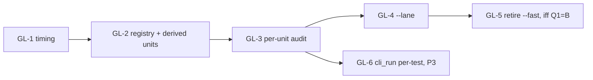

# gate-lane — spec

**Status: BUILT 2026-10-29 on `main` 0bd2b518 (GL-1..GL-5 plus implementation-review fixes; full `gate.sh --strict` at the integrated head). P3 (GL-6) deferred.** Implementation review (ImplAuditGL): 1 blocker (relative cargo dep-info dropped, so the lane skipped tests that link a changed lib; fixed in 0b29b054, audit regenerated, `--plan` proofs in the commit's report) and 3 minors (fixed). Lane savings are below §4's estimates: O-GL-01.
Base commit: `7f110693` (`main`). Source: `tasks/opportunities.md` **O-S1-17** (:2647-2648), with lessons `tasks/lessons.md:875`, `:882` (S1 missed suites) and `:853` (S6.1 lane missed a stage).
Build base: `main` 43e895d0 (harness `tasks/build-loop-gate-lane.md`). The gate.sh line numbers below are at 7f110693; SF-4 has since added the hardset `build.py --check` step after S04 (gate.sh:739-742 at 43e895d0), so every line reference is re-anchored at use. That step is stage **S04H** (cross-spec dependency below: this spec lands second, so it wraps it).

**Step 1 review** (`agent://AuditGateLane`, findings GLA#1–#18: 1 blocker, 12 major, 5 minor). All 18 were checked against the cited lines or by rerunning the check.
- Accepted as proposed: 14.
- Accepted with a different fix: 4 (#1, #3, #5, #10).
- Rejected: 0.

| GLA | Sev | Disposition |
|---|---|---|
| #1 | blocker | Accepted, variant. Compile inputs of every cargo unit now come from the **cargo package closure** of the packages it builds, tests or lints, not only from executed artefacts (GL-3 §A). Per package the set is cargo's own freshness inputs: dep-info of every target, build-script `rerun-if-changed`, manifests. The whole `crates/Q/**` is the fallback. Reason for the variant: `crates/axon-cortex/benchmarks/**` (Python/JSON) sits inside a package dir and would otherwise select every cortex consumer. |
| #2 | major | Accepted. Gate-definition files select everything (GL-4 rule G2). Events between units widen to both neighbours. |
| #3 | major | Accepted, variant. The audit runs in its own `git clone --shared` and watches *that clone's* `.git` (HEAD, index, packed-refs, refs), not the common dir. The common dir is shared by every worktree, so watching it would flag every unit. `pci_delta_note` becomes a fixture. |
| #4 | major | Accepted, superseded by redesign. The audit no longer attributes events inside a running gate: each unit runs **alone** with sentinel-drained windows. No `deps/` or `incremental/` watches, IN_CREATE re-watch, overflow → unit unaudited. Overhead measured (repro 7). |
| #5 | major | Accepted, different fix. The audit is a **separate non-ship run**, so the ship gate's managed command and receipt are untouched. The proposed `audited_gate_receipt_is_gate_run` test is not needed; `audit_never_writes_a_gate_receipt` replaces it. |
| #6 | major | Accepted: clean clone, key `<commit>-<toolchain>-<uid class>`, atomic write, C computed against A's tree. |
| #7 | major | Accepted: bin-dir watch list (GL-3 §B). |
| #8 | major | Accepted: build-script inputs are part of the compile set (§A). |
| #9 | major | Accepted: `CLIPPY_EXCUSED` stays (gate.sh:314, read at :901). |
| #10 | major | Accepted, partial. `g01_anchors.py`, `vm_parity.sh` and `test_harness_skip.sh` are fast-only, so they now feed Q1. **Rejected for `pci_delta.py --check`**: the full gate runs it via S16 `pci_delta_note` (`pci_delta_note.rs:16-26`). |
| #11 | minor | Accepted: fact fix (fast runs the axon-core suite, gate.sh:380) and full caller list in GL-5. |
| #12 | major | Accepted: banner test with exemptions, `fail()` writes the open stage's row, `if lane_runs …; then` form only. |
| #13 | major | Accepted, strengthened. `needs` is **derived** (latest build before the unit that produces each executed binary) and checked by the audit; it is no longer hand-written. |
| #14 | major | Accepted. Explicit added-path rule; the remaining blind spot is stated (GL-4 G5, §9). Deletions and mode changes select everything. |
| #15 | minor | Accepted: 617 s. |
| #16 | minor | Accepted: §3 relabelled; S21 row added. |
| #17 | minor | Accepted: mode change → everything; non-path inputs declared out of scope. |
| #18 | minor | Accepted; moot, because per-test windows come from the separate audit. |

**Problem in one line:** the only cheaper-than-gate profile, `--fast`, is a hand-copied stage list. It does not run every suite a change feeds; it has no fabric/loop suite (gate.sh:378-391), so the S1 `cortex_via_fabric` miss recurs. This spec adds a profile that derives *what to run* mechanically: from cargo's dependency graph, from cargo's own freshness inputs, and from runtime reads and execs observed per unit.

## 0. Scope

| In | Out (reason) |
|---|---|
| Serial stage timing in the full gate (GL-1) | Changing which commands the full gate runs. Example: the manifest re-runs crates already tested at gate.sh:699-717 (seen in `fu-gate-2.log`). Excluded because the full gate must not change. |
| `--lane` selection, registry, per-unit read-set audit, evidence output (GL-2…GL-4) | Strict-only stages (gate.sh:999-1346) and the `--profile` stage (:1378-1383); `--lane` refuses those flags |
| `--fast` cutover (GL-5, needs-human Q1) | O-FU-03/04 (`tasks/unattended-auth-spec.md` §6 E5); O-S1-24: its reproduced parts are owned by `tasks/checker-soundness-spec.md` (CS-5, CS-11, CS-12) [REVISED: cross-spec CSA#14 — was "O-S1-24 (not reproduced)"] |
| Per-test units for `axon-core --test cli_run` (GL-6, P3) | Non-path inputs: env, time, host capability (KVM image, uid), and the git SHA that `axon-core/build.rs:29-30,50` embeds. The lane inherits gate.sh's env. [REVISED: GLA#17] |

**Cross-spec dependencies.**
- `tasks/small-fixes-spec.md` SF-4 adds a full-gate step after the R1f fence sweep (gate.sh ~:726): `hardset/build.py --check` with the axon and cortex binaries, plus a binary-free `selftest_check.py`.
  - Whichever spec lands second wraps it in `stage_begin` and adds its registry row; `gate_lane.py check` fails until then.
  - Its compile set is the closure of axon-core + axon-cortex (exec edges); its runtime set comes from the audit.
- No dependency on `checker-soundness`, `capability-surface` or `hx2`.
- g01 block M3880–M3899 is reserved and stays unused (§2 end).

## 1. Priority tiers

| Tier | Items | Why |
|---|---|---|
| P1 | GL-1 timing; GL-2 registry + derived units; GL-3 per-unit audit; GL-4 `--lane` + evidence | The smallest lane that is mechanical and states its blind spots |
| P2 | GL-5 retire `--fast` | Removes the hand list; needs-human (Q1) |
| P3 | GL-6 per-test units for `cli_run` | 543.9 s of S16's 787.2 s. Cortex/core lanes select it via `claude_md_claims_are_true` (cli_run.rs:18586) and the refusal-coverage gate. |

## 2. Items

### GL-1 — Serial stage timing and a machine-readable stage log (P1)

**Problem.**
- Only `par` stages are timed: `par` (gate.sh:198-214) and `par_join` (:215-235), which prints `   (parallel stage '<name>': Ns)` at :220. This includes the background trust-root preflight, a `par` stage (:777) joined at :944-950.
- Serial stages print banners only. In `/var/tmp/r51-tmp/fu-gate-2.log` (real 38m51s, 6967 passed / 0 failed / 12 ignored), **about 617 s** of the 2331.2 s wall cannot be attributed to any stage: 2331.2 − 1550.4 (Σ libtest `finished in`) − 163.8 (Σ cargo `Finished`). [REVISED: GLA#15; was "about 592 s", which also subtracted ~25 s of par wall.] [INFERENCE: the gap is the fence sweep, stage5, PCI and the `-q` builds B1/B2, which print no `Finished`.]

**Change.**
- Add `stage_begin <ID> [banner]` / `stage_end` helpers. With no banner argument, `stage_begin` prints nothing, so S08, S09 and S10 can be wrapped without new banner lines. [REVISED: GLA#12]
- Wrap S01–S20 and S21 (table §3).
- `stage_end` prints `   (stage 'S16 axon-core tests': 794.2s, exit 0)` and appends `ID⇥start_ms⇥end_ms⇥exit` to `$CARGO_TARGET_DIR/gate-stages.tsv`, which is truncated at gate start.
  `[REVISED: implementation review 2026-10-29, ImplAuditGL minor 3: the log is per run, $CARGO_TARGET_DIR/gate-stages.<pid>.tsv, so two runs sharing a target dir do not truncate or interleave each other's rows.]`
- `fail()` (gate.sh:124-132) first writes the open stage's row with `exit 1`. [REVISED: GLA#12; `fail` exits, so without this every recorded exit is 0.]
- An end-of-run table is sorted by duration; par rows are `P:<name>`.
- Commands, order and guards are unchanged. The `release_manifest.rs:148-212` scanner requires every `cargo test|build|clippy` line to stay guarded, so wrappers never split those lines.

**Fail-first tests** (`scripts/test_gate_lane.py`; fail today because the script does not exist):
- `stage_ids_match_banners`:
  - every `^\s*echo "── gate:` line outside :999-1346 lies in a `stage_begin` pair or a P-group stage function (:413-640);
  - exempt: :947 join, :1369 coverage notice, :1380 profile;
  - IDs S08, S09 and S10 exist.
- `fail_records_open_stage`: a fixture stage that calls `fail` leaves a TSV row with exit 1.

**Acceptance.** The full gate log has one `(stage 'Sxx …': Ns, exit N)` line per serial stage that ran, plus the table. The `── gate:` banner sequence and every `→ cargo …` line are identical to `fu-gate-2.log`, except steps added by other landed specs.

### GL-2 — Registry `governance/gate-lanes.json` and derived units (P1)

The registry is committed and hand-edited. It holds only facts that cannot be derived:

| Field | Values |
|---|---|
| `id`, `banner`/`par` | stage identity |
| `class` | `always` (whole P group, S01, S15, S19: < 30 s total) or `selectable` |
| `split` | `none` \| `per-target` (S02, S03, S09-test, S16, S20) |
| `builds` | build steps B1 :699-700, B2 :714-715, B3 :770-775, B4 :783, B5 :811, B6 :942, each with its exact command line |

- [REVISED: GLA#13 — the hand-written `needs` field is superseded.] `needs` is now derived. For each binary a unit executes during the audit (GL-3 §B), `needs` is the latest registry build step *before the unit in full-gate order* whose package/`--bin` produces that binary (from `cargo metadata` targets).
  - The audit fails with `unit <U> executes <bin> that no preceding build step and not the unit itself produces`.
  - Effect: the feature set of `debug/axon` seen by each unit is the full gate's. B1 has codegen, S16 is no-default, S17/B6 restores. S17 runs iff S16 runs.
- **Units** are derived from `cargo metadata --no-deps --offline` (repro 3), never hand-listed.
  - `split: per-target` → one unit per target of each `-p` package in the stage's gate.sh line: `--lib`, each `--bin` (S16 has `axon`, `axon-run`), each `--test`, and `--doc` for libs with doctests.
  - Other stages → one unit.
  - If every unit of a stage is selected, the lane runs the stage's original command line unchanged.
- `scripts/gate_lane.py check` exits 1, naming the offender, when:
  - a stage ID, `par` name or manifest crate (`governance/release-verification.json`) has no row;
  - a row names a vanished stage;
  - a build command in the registry differs from gate.sh's text.

  `--lane` runs `check` first and exits 2 on failure.
- Lane logic stays in Python. Reason: the clippy-coverage check greps gate.sh's own text for `-p <crate>` (:898), so lane code in gate.sh naming crates would fake coverage.

**Fail-first tests:** `registry_covers_every_gate_stage`, `registry_rejects_orphan_row`, `registry_build_text_matches_gate`, `units_derived_from_metadata` (S16 units include `--lib`, `--bin axon`, `--bin axon-run`, `--test cli_run`).

### GL-3 — Per-unit read-set audit: `scripts/gate_lane.py audit` (P1)

[REVISED: GLA#1/#4/#5/#6/#18 — superseded design: "a passive inotify observer attached to the receipt-bearing full gate, with dep-info of executed artefacts as the only compile source, and windows from interleaved log lines". It was unsound three ways: linked-library and lint-only edges were missing; reader lag could not be detected; and wrapping the gate cost it its receipt.]

**Run shape.**
- The audit is a **non-ship** run. It never writes a gate receipt and is never cited as the gate.
- It works in a fresh `git clone --shared` of commit A under `$TMPDIR/axon-gate-lane-audit/<A>`, so it is clean by construction.
- It refuses unless `rustc -vV` and the uid class match the key.
- For each unit in gate order:
  1. run its derived `needs` builds, outside the window;
  2. open a begin sentinel in a watched dir;
  3. run `./scripts/gate.sh --lane-units=<U>`, an internal flag that runs only the listed units with the same command lines and no `always` stages;
  4. on exit, open an end sentinel and drain until it arrives.

  The inotify queue is FIFO within one instance, so every event before the sentinel belongs to that unit or earlier ones.
- Events between an end sentinel and the next begin sentinel (lingering children) are attributed to **both** neighbours. [REVISED: GLA#2]
- Units that exit 77/SKIP (S08 without a guest image) or overflow (`IN_Q_OVERFLOW`) are recorded `unaudited`. An unaudited unit is always selected.
- The audit is written atomically (tmp + rename) to `$(git rev-parse --git-common-dir)/axon-gate-lanes/<A>-<toolchain sha8>-<root|user>.json` (Q2). Contents per unit: status, compile set, runtime set, exec set, git-history flag, and the tracked-file universe of A.

**§A Compile set (mechanical, from cargo).** [REVISED: GLA#1, GLA#8]
- Closure(U) = the packages U builds, tests or lints, plus all workspace path dependencies of kinds normal, dev and build. These come from `dependencies[].path` in `cargo metadata --no-deps` (repro 3), applied transitively. Exec edges (§B) add the closure of each executed binary's package.
- For every package Q in the closure, the compile set includes:
  - every in-repo path in the dep-info files of Q's targets (`deps/<crate>-*.d`, `debug/<bin>.d`). Repro 5: `axon_cortex-*.d` lists 15 `crates/axon-cortex/src` files; `debug/cortex.d` adds `src/bin/cortex.rs`;
  - every path in `build/<Q>-*/output` `cargo:rerun-if-changed=` lines. axon-fabric/build.rs:96-106 watches every top-level repo entry except `.git` and the target dir;
  - `crates/Q/Cargo.toml` and `crates/Q/build.rs`.
- If a closure package has no dep-info in the audit target dir, the fallback is all of `crates/Q/**`.
- This set is cargo's own rebuild criterion, so build-only and lint-only units (S09-clippy, S11–S14, B*) are covered without executing anything. No workspace proc-macro exists (repro 3: 0 `proc-macro` targets in 29 packages).
- S05/S06 (row scripts that call `cargo test -p $pkg`, `v022_stage5_gates.sh:133-155`) and S07 take the **whole-workspace** compile set (canon; Q9).

**§B Runtime and exec set (inotify `IN_OPEN`, no ptrace).**

| Watch | Gives |
|---|---|
| every dir of the clone except `.git` and `target`, recursive, with IN_CREATE → add_watch (514 dirs at 7f110693; `max_user_watches` 65536) | files opened; directories opened (= enumerated) |
| non-recursive `debug/`, `debug/examples/`, `workspace-bins/debug/`, and `<T>/debug/` for each `CACHEDIR.TAG` dir `<T>` under `$CARGO_TARGET_DIR`, re-scanned on IN_CREATE. Never `deps/` or `incremental/`. [REVISED: GLA#7] | executed or copied workspace binaries, mapped by name to the package via `cargo metadata`. Covers psv examples, `production-build` (privileged_launcher.rs:1095), `rows2-production-verifier` (readiness.rs:1021), and S07's copy (cp opens `debug/axon-fabric`). |
| the clone's own `.git/` (top level) and `.git/refs/**` [REVISED: GLA#3] | a unit that opens HEAD, index, packed-refs or refs is flagged `git-history` (e.g. `pci_delta_note` → `pci_delta.py` `git diff/log BASE..` at :154, :162) |

- The static `workspace_bin` scan is a second exec source, combined by union: `"-p","<pkg>"` inside build arrays (`script_spawn/mod.rs:573`; `cortex_via_fabric.rs:17-23`). The audit reports any static edge it did not observe.

**Fail-first tests** (fixture event streams in `scripts/testdata/gate_lane/`):
- `audit_sentinel_bounds_window`
- `audit_between_units_goes_to_both`
- `audit_overflow_marks_unit_unaudited`
- `audit_skip_marks_unit_unaudited`
- `audit_exec_adds_package_closure`: an exec of `workspace-bins/debug/cortex` puts `crates/axon-cortex/src/bin/cortex.rs` in fabric `cortex_via_fabric`
- `audit_lint_unit_has_closure_compile_set`: S14 includes `crates/axon-ledger/src/**` via dep-info
- `audit_git_open_flags_history`
- `audit_undeclared_producer_fails`
- `audit_never_writes_a_gate_receipt`

### GL-4 — `gate.sh --lane` selection and evidence (P1)

[REVISED: GLA#6 — superseded `--lane[=REF]` and C = merge-base diff ∪ `A..HEAD`.]
- `--lane` takes **no ref**. A is the newest audit of the same toolchain and uid class whose commit is an ancestor of HEAD.
- **C** = `git diff --name-only --no-renames A` (A versus the working tree: committed, staged and unstaged) ∪ untracked files ∪ paths with a mode change in `git diff --summary A`.
- `--lane=…` exits 2 with `--lane takes no ref; the base is the newest audit (see --plan)`.
- Repro 6 shows the flag is absent today.

**Rules** (first match per path; a unit is selected if any rule selects it):

| # | Path p ∈ C | Selects | Reason printed |
|---|---|---|---|
| G0 | (no eligible audit) | every selectable unit | `no read-set audit for an ancestor of HEAD` |
| G1 | `Cargo.toml`, `Cargo.lock`, `.cargo/**`, `rust-toolchain.toml` | every cargo unit | `global build input` |
| G2 | `scripts/gate.sh`, `scripts/lib/**`, `scripts/gate_lane.py`, `governance/gate-lanes.json` [REVISED: GLA#2] | every selectable unit | `gate definition changed` |
| G3 | deleted, or mode change [REVISED: GLA#14, #17] | every selectable unit | `deleted/mode path 
` |
| G4 | modified, p ∈ compile ∪ runtime set of U | U | `compiles 
` / `reads 
` / `executes <bin> built from 
` |
| G5 | added [REVISED: GLA#14] | (a) U whose runtime set enumerated p's nearest existing ancestor dir; (b) U whose closure owns the package dir containing p, where a new `tests/*.rs` is a new target and runs; (c) U whose compile ∪ runtime set contains a file with p's repo path or basename as a literal | `added under enumerated <dir>` / `added in package <Q>` / `named by <file>` |
| G6 | in A's universe, matched by no U | nothing | listed `unread by any unit` |
| G7 | outside A's universe and none of G3/G5 applies | every selectable unit | `unclassified path 
` |
| — | U `git-history`, `unaudited`, or a target unseen by the audit | U | stated flag |

- **G5's stated blind spot:** a unit that probes, by `stat`/`exists`, a name built at runtime under a directory it never enumerated and that no file it reads names literally. `git grep` counts 314 `.exists()/.is_file()` probes in 60 test files, mostly tempdirs (GLA#14). Deletions are not blind: G3.
- **Execution.**
  - gate.sh calls `gate_lane.py select`, then guards each wrapped stage with `if lane_runs Sxx; then … fi`. [REVISED: GLA#12; the form `lane_runs … && cargo … || fail` would run `fail` when skipped. A test rejects `lane_runs [^;]*&&`.]
  - Per-target stages receive `$(lane_targets Sxx)`. Derived `needs` builds run in gate order.
  - `--lane` refuses `--strict`, `--profile`, `--nextest` and `--fast` (exit 2, like gate.sh:92-97).
  - `--lane --plan` prints the selection and runs nothing.
- **Evidence output.**
  - First line: `════ LANE — NOT THE GATE, NOT EVIDENCE · audit=<A> ════`.
  - Then C, then one `RUN U ← reason` or `SKIP U — reason` line per unit, then `NOT RUN (strict-only): …`.
  - If `crates/axon-core/src/codegen*` changed, the hint `parity is --strict only` is added.
  - Last line: `lane: N run / M skipped passed — not the gate; ship rule: full ./scripts/gate.sh on the integrated head`. The lane never prints `✅ gate PASSED` (:1385).
- **Receipt.** `run_managed.sh` (:587-608) records `gate_tier=lane gate_run=no`. `release_check.sh` :45 and :180-181 already require `gate_run=yes` and `gate_strict=yes`.

**Fail-first tests** (`scripts/test_gate_lane.py`, fixture audit built from repros 1–5; all fail today):

| Test | Fixture C | Must select |
|---|---|---|
| `lane_cortex_bin_change_selects_fabric_cortex_via_fabric` (lessons :875) | M `crates/axon-cortex/src/bin/cortex.rs` | S03 and S20 axon-fabric `--test cortex_via_fabric` |
| `lane_cortex_lib_change_selects_reverse_deps` (GLA#1) | M `crates/axon-cortex/src/runner.rs` | every target of axon-fabric, axon-loop, axon-loop-contracts, axon-reflex, cortex-policy-adapter |
| `lane_new_crate_test_selects_harness_binaries` (S1) | A `crates/axon-cortex/tests/fence_sweep.rs` | S16 `--test harness_binaries` (G5a) and the new axon-cortex target |
| `lane_cortex_src_selects_claims_gate` (S1) | M `crates/axon-cortex/src/runner.rs` | S16 `--test cli_run` |
| `lane_core_src_selects_pci_delta_note` (GLA#3) | M `crates/axon-core/src/lib.rs` | S16 `--test pci_delta_note` (git-history) |
| `lane_lint_only_change_selects_runtime_clippy` (GLA#1) | M `crates/axon-ledger/src/lib.rs` | S14 |
| `lane_gate_definition_selects_everything` (GLA#2) | M `scripts/lib/axon_bin.sh` | all selectable |
| `lane_deleted_or_mode_selects_everything` | D, or chmod +x | all selectable |
| `lane_unknown_path_selects_everything` | A `newdir/x.txt` | all selectable |
| `lane_without_audit_selects_everything` | any | all selectable |
| `lane_every_stage_reachable` | per selectable unit, also run by `check` on the real audit (GLA#1) | each U has a non-empty set |
| `lane_guard_form` | gate.sh text | no `lane_runs [^;]*&&` |
| `lane_plan_banner_never_claims_gate`, `lane_refuses_strict_fast_ref` | flags | banner / exit 2 |
| `run_managed_records_lane_tier` | receipt of `gate.sh --lane --plan` | `gate_tier=lane gate_run=no` |

**Acceptance:**
- All tests pass.
- On the real audit of the integrated head, `--lane --plan` for a branch touching only `crates/axon-cortex/src/bin/cortex.rs` lists fabric `cortex_via_fabric` as RUN.
- The full gate's command sequence is unchanged (GL-1 acceptance).

### GL-5 — Retire `--fast` (P2, decision Q1)

**Facts.** [REVISED: GLA#11]
- The fast tier (gate.sh:52-60 doc, :81-99 flags, :316-398 body) runs:
  - fmt, refusal coverage, `pci_delta.py --check`, `g01_anchors.py` and the receipt check in par (:330-336);
  - clippy on the changed crates;
  - `cargo test -p axon-core --no-default-features` (:380), then axon-cortex and axon-psv (:384-388);
  - `vm_parity.sh` and `test_harness_skip.sh` (:390-391).
- It has no fabric/loop suite, so `cortex_via_fabric` is missed. It does catch the harness_binaries and claims_gate S1 misses.
- **Fast-only checks** [REVISED: GLA#10]: `g01_anchors.py`, `vm_parity.sh` (no other caller in scripts/), and `test_harness_skip.sh` (otherwise only `parity_all.sh:80`, strict). `pci_delta --check` is *not* fast-only (S16 `pci_delta_note`).

**Change if Q1 = B.**
- Delete the fast body, `--fast`, `--base=`, `fast_crates`, the fast branch of `run_managed.sh:594-608`, and the text "the fast tier reads it too" (:885-886).
- **Keep `CLIPPY_EXCUSED`** (:314). `set -u` (:61) and the read at :901 would abort the gate without it. [REVISED: GLA#9]
- `--fast` then errors with `use --lane`.
- Update live docs: `CHANGELOG.md:77`; `scorecard.py:1508` together with its generated `benchmarks/scorecard/README.md:301` (`scorecard report --check`); `docs/CORTEX.md:871`; the comment at `scripts/test_harness_skip.sh:12`.
- Historical records stay as written: `governance/reviews/2026-10-11-…:80`, and `tasks/lessons.md`, `opportunities.md`, and completed briefs.

**Every `--fast` caller** (`git grep -- --fast` at 7f110693; `/root/.claude/skills` grep finds none):

| Kind | Callers |
|---|---|
| scripts | gate.sh, run_managed.sh:594-599, test_harness_skip.sh:12 (comment) |
| docs | CHANGELOG.md:77, docs/CORTEX.md:871, scorecard README.md:301 ← scorecard.py:1508, governance/reviews/2026-10-11-r51-postS7-implementation-review.md:80 |
| tasks | approval-residue-spec, build-loop-gaps, build-loop-gaps2, build-loop-r51, build-loop-repair, flight-plan-gaps, harness-hygiene-spec, killgroup-spec (:290 "Balanced mode, human decision: lanes run `gate.sh --fast`"), lessons, lsp-residue-spec, opportunities |

The hits in AXON_VM.md and TARGETS.md are `axon-vm launch --fast`, which is unrelated.

### GL-6 — Per-test units for `cli_run` (P3, Q3)

`cli_run` is 543.9 s and `refusal_coverage_gate` 219.3 s (fu-gate-2.log). Per-test units come only from the separate audit, which runs `cli_run <test> --exact` per test. [REVISED: GLA#18 — never from the receipt-bearing gate.] [INFERENCE: audit cost is several × 544 s; not measured.]

### g01 / refusal coverage / pci

- No `crates/axon-core/src` change, so no pci theme json, no regen and no `v022-pci-delta.md` row.
- No protected refusal site is touched.
- g01 rows need a cargo-test killer (`package/target/test`, `v022_g01_mutations.py:8947-8950`); this spec adds Python tests only. So no rows; M3880–M3899 stay reserved.

## 3. Stage inventory (fu-gate-2.log; warm sccache; loaded shared host) [REVISED: GLA#16]

| ID | Stage | gate.sh | Measured | Class |
|---|---|---|---|---|
| P:* | 21 par stages (opkit selftest 15.3, refusal 7.3, artifact 5.2, protected sets 3.8, ns_drift 3.4, fmt 2.4, rest < 2 s) | 642-663 (fns 413-640) | wall ≈ 15.3 s | always |
| S01 | managed-run | 674-675 | ~10 s (comment :669) | always |
| S02 | B1 + `cargo test -p axon-cortex -p cortex-policy-adapter -p axon-reflex` | 699-702 | 39.3 s tests + 7.3 s test compile; B1 untimed (`-q`) | per-target |
| S03 | B2 + `cargo test -p axon-loop-contracts -p axon-loop -p axon-fabric` | 714-717 | 374.1 s + 26.2 s test compile; B2 untimed | per-target |
| S04 | R1f fence sweep | 726-729 | unmeasured | one unit |
| S05 | stage5 gates | 739-740 | unmeasured | one unit |
| S06 | PCI gates, 94 rows | 743-744 | unmeasured | one unit |
| S07 | trust-root preflight; background `par` as root (:777), inline otherwise (:779); its B3 build (:770) has no `--locked` | 759-780, join 944-950 | 679.4 s, overlapped | one unit |
| S08 | PSV guest boot (no banner) | 783-789 | SKIP rc 77 (no image) | one unit |
| S09 | cortex `ai` clippy + tests (no banner; logged under the trust-root banner, log :3688-4110) | 797-800 | 32.9 s + 5.2 + 1.8 s compile | per-target |
| S10 | gate_verdict_is_read (no banner) | 806-807 | unmeasured | one unit |
| S11 | native build (B5) | 810-811 | 3.5 s | one unit |
| S12 | serde-json clippy + 3 tests | 819-838 | 67.2 s build | one unit |
| S13 | lib clippy | 840-841 | 5.8 s | one unit |
| S14 | runtime-crate clippy | 857-878 | 10.3 s | one unit |
| S15 | clippy coverage | 884-911 | < 1 s [INFERENCE] | always |
| S16 | `cargo test -p axon-core --no-default-features` | 929-934 | 787.2 s + 6.6 s (cli_run 543.9, refusal_coverage_gate 219.3, harness_integrity 9.1, rest ≤ 5.1) | per-target |
| S17 | codegen rebuild (B6) | 941-942 | unmeasured | iff S16 |
| S19 | lockfile | 969-970 | unmeasured | always |
| S20 | manifest per crate | 972-995 | ≈ 317 s tests + ≈ 29 s builds (fabric 166.1, psv 51.1, loop 35.3, cortex 23.2, os 19.2, intent 7.7, …) | per-target |
| S21 | v022-stage5 profile, `--profile` only | 1378-1383 | n/a | lane refuses `--profile` |

S18 is reserved for the trust-root join (:944-950), which is not a stage.

## 4. Lane-shape savings — all [INFERENCE], recomputed for the closure rule [REVISED: GLA#1]

| Lane shape | Likely RUN | Likely SKIP | Est. wall vs 39 min |
|---|---|---|---|
| cortex lib (`crates/axon-cortex/src/*.rs`) | always; S02; S03 all (reverse deps); S05–S07 (whole workspace); S09; S14; S16 cli_run + refusal_coverage_gate (both read cortex src: repro 1, 4); S20 for cortex/fabric/loop/contracts/reflex/adapter | S11–S13, S16 other targets (~24 s), S20 psv/os/intent/… (~90 s) | ≈ 34–36 min. The win is correctness over `--fast`, not time. |
| axon-core (`crates/axon-core/src`) | ≈ everything (binary consumers cortex/fabric/intent/os/psv) | S20 crates that neither depend on axon-core nor spawn it | ≈ 37–39 min |
| benchmarks Python (`crates/axon-cortex/benchmarks/**/*.py`, in no dep-info) | always; S04; units whose runtime set reads the file | most cargo units | ≈ 2–8 min |
| docs-only | always; S16 cli_run if `CLAUDE.md` changed (claims_gate.sh:46) | rest unless audited reads say otherwise | ≈ 1 min, or ≈ 10 min with `CLAUDE.md` |

## 5. Reproductions (7f110693, `TMPDIR=/var/tmp/r51-tmp`)

1. **claims_gate under strace.** `strace -f -qq -y -e trace=openat,execve` of `scripts/claims_gate.sh`.
   - Result: `7 passed, 0 failed … PASS`; 494 repo files opened (axon-core/src 94, axon-fabric/tests 47, axon-loop/tests 43, axon-cortex/src 16, `CLAUDE.md`).
   - Without `-y`, only 4. Untraced 0.19/0.22 s; traced 0.49/0.57 s.
2. **harness_binaries lint under strace.** Prebuilt fu-int `harness_binaries-23b8…` (also 7f110693, clean), `every_script_spawn_in_the_workspace_goes_through_the_helper --exact`: `1 passed … 1.66s`; 188 files read, including `crates/axon-cortex/tests/fence_sweep.rs`.
3. **cargo metadata.** `cargo metadata --no-deps --format-version 1 --offline`: rc 0; 29 packages, 0 proc-macro targets. axon-core ← axon-wasm only; axon-cortex ← fabric, loop-contracts, reflex, policy-adapter.
4. **inotify prototype** `/var/tmp/r51-tmp/specs-GateLane/inotify_reads.py`:
   - claims_gate: `watched_dirs=514 rc=0 opened=804 dirs_enumerated=310`. 494 files, equal to strace, including `src/bin/cortex.rs`, `CLAUDE.md` and the dir `crates/axon-cortex/src/`.
   - `v022_refusal_coverage.py`: `opened=294`, including 16 axon-cortex/src files.
   - exec of a watched `/bin/true` copy: `opened=1`.
5. **Dep-info** (fu-int target):
   - `axon_cortex-*.d`: 15 `crates/axon-cortex/src` files + `env-dep:CARGO_PKG_VERSION`.
   - `debug/cortex.d`: adds `src/bin/cortex.rs`.
   - `deps/cortex_via_fabric-a4f2….d`: fabric test files + `script_spawn/mod.rs` only. So the edge needs exec or closure (GLA#1 confirmed).
6. **Flag absent.** `./scripts/gate.sh --lane main` / `--lane=main`: `gate: unknown flag --lane…`, exit 2.
7. **Recorder overhead (bounded real run)** [REVISED: GLA#4]. The fu-int `harness_binaries` binary, all 10 tests, run 3× bare versus 3× under the prototype watching 514 dirs.
   - Bare: 1.97/1.75/1.77 s. Watched: 2.03/1.98/2.25 s, including Python startup and the walk to set up 514 watches.
   - About 1485 events per run, `overflow: 0`.
   - Both modes exit 101: `a_building_harness_runs_the_binary_cargo_built_not_one_left_in_target` fails outside cargo. So this is a timing check only.
   - `max_queued_events` = 16384.

## 6. Gates and cost budget (for building this spec)

| Gate | One-run cost | Re-run trigger | Skip rule |
|---|---|---|---|
| `python3 -B scripts/test_gate_lane.py` | seconds, CPU | any change to gate_lane.py, gate.sh, registry, fixtures | never |
| `gate_lane.py check` + `gate.sh --lane --plan` | seconds | as above | never |
| `gate_lane.py audit` at the integrated head (non-ship) | [INFERENCE] ≈ 50–55 min: ≈ 39 min of units, plus S07's 679 s now serial, plus per-unit cargo freshness checks. Must run alone on the host (shared target dir: lessons :891). | once at the integrated head, to validate the fixtures against real data | never for this build. Afterwards on demand; stale audits are safe (G-rules use C versus A). |
| Full `./scripts/gate.sh` on the integrated head (ship gate, unwrapped) | ≈ 32–39 min (last 38m51s) | final head | never |
| Banner/command-sequence diff versus `fu-gate-2.log` | seconds | after the full gate | never |
| `scorecard report --check` | seconds | only if GL-5 edits `scorecard.py:1508` | skip if Q1 ≠ B |
| Cortex lane `cargo test -p axon-cortex --features ai` | 10–15 min | — | skip: no `crates/axon-cortex` source change. `scorecard.py`/README are benchmarks, not the repair digest. |
| Paid `scorecard.py regress` | ≈ $0.14 | — | not required: no repair-digest file touched |
| pci regen / `pci_delta.py --check` | — | — | not required: no `crates/axon-core/src` change |

## 7. Sequencing

GL-1 to GL-4 ship in one batch. Order of the final runs: full gate (ship), then the audit at the same head.

## 8. Open questions (Step 2 classified)

| # | Question | Options | Recommendation | Class |
|---|---|---|---|---|
| Q1 | What happens to `--fast`? | A keep both; B `--lane` replaces `--fast` (GL-5); C alias | **B**, with the three fast-only checks (GL-5 Facts) moved into the full gate's par group, so the lane derives them. `g01_anchors.py` and `test_harness_skip.sh` are cheap; `vm_parity.sh` cost is unmeasured. Without the move, B drops those three checks from the inner loop. | **needs-human** → `[DECIDED by human 2026-10-29: B - --lane replaces --fast (GL-5), with the three fast-only checks moved into the full gate's par group first]` |
| Q2 | Where does the audit live? | A git common-dir cache keyed `<commit>-<toolchain>-<uid>`; B committed json; C `$CARGO_TARGET_DIR` | **A**. B puts a commit after the gated head; C is per-worktree and is lost on clean. No audit → G0 runs everything. | engineering, canon A |
| Q3 | Build GL-6? | A no; B audit-only per-test units; C split `cli_run.rs` | **B, deferred to P3** until GL-1 timing exists; C changes the full gate's layout | engineering, canon defer: GL-6 is not built in this run |
| Q4 | Should `test_gate_lane.py` + `check` join the full gate's par group (~1 s)? | A no; B yes | **B**: a stale registry would otherwise fail only for lane users. It changes the full gate. | **needs-human** → `[DECIDED by human 2026-10-29: B - test_gate_lane.py + check join the full gate's par group]` |
| Q5 | Is strace needed for stat/ENOENT probes? | A inotify only + G3/G5/G7; B add a strace audit (ptrace drops setuid in the privileged-launcher tests, so the audit diverges) | **A**; the residual is stated in G5 | engineering, canon A |
| Q6 | Added-path rule | A G5 (enumeration + package + literal; residual stated); B every added path selects everything | **A**. B makes every branch that adds a file, including docs/specs, a full run. The lane is not evidence; a miss costs one full-gate re-run under the unchanged ship rule. | engineering, canon A |
| Q7 | Compile-set source | A cargo dep-info + rerun-if-changed per closure package, fallback `crates/Q/**`; B all of `crates/Q/**` | **A**. B makes any `benchmarks/**/*.py` edit select every cortex consumer. A is cargo's own rebuild criterion. | engineering, canon A |
| Q8 | Audit cadence | A on demand, at an integrated main head, alone on host; B nightly; C after every merge | **A**. Stale audits stay sound (C is computed versus A); they only widen C. | engineering, canon A |
| Q9 | S05/S06/S07 compile set | A whole workspace; B parse row tables for packages | **A** until GL-1 shows their cost matters. B needs a parser per row format. | engineering, canon A |

**Human decisions** `[DECIDED by human 2026-10-27: both recommendations accepted]`, re-confirmed `[DECIDED by human 2026-10-29]` (Q1 = B, Q4 = B above). Q2 and Q5–Q9 are engineering canon as stated; Q3 defers GL-6 (P3).
- **Q1 → B** `--lane` replaces `--fast`, and `g01_anchors.py`, `vm_parity.sh` and `test_harness_skip.sh` move into the full gate's parallel group (also closes O-SP-07). This supersedes the `--fast` lane-acceptance decision at killgroup-spec.md:290.
- **Q4 → B** the ~1 s lane self-check joins the full gate's parallel group.

## 9. What remains unsafe, and what covers it

| Gap | Covered by |
|---|---|
| `stat`/ENOENT probe of an *added* name, built at runtime under a dir the unit never enumerated, and named in no file it reads | **not covered**. A miss surfaces at the full gate (ship rule). Q6 states this trade. |
| Probe of a *deleted* path, or of a mode bit | G3 → everything |
| Path outside A's universe that no G5 clause matches | G7 → everything |
| Non-path inputs: env, time, host, uid, embedded git SHA (`axon-core/build.rs:29-30,50`) | out of scope. The audit is keyed by uid and toolchain; the lane inherits gate.sh's env. |
| A unit depending on state left by a preceding non-build unit in the full gate | **not covered**. The lane and the audit both use derived `needs` only; the full gate is the ship rule. |
| inotify overflow, SKIP, unseen target, missing audit | unit unaudited / G0 → runs |

**Not verified:**
- Audit wall time and overhead at full scale; only one bounded 2 s run was measured (repro 7).
- Times for S04, S05, S06, S10, S17 and S19.
- Whether `build/*/output` holds absolute or relative `rerun-if-changed` paths.
- The §4 estimates.
