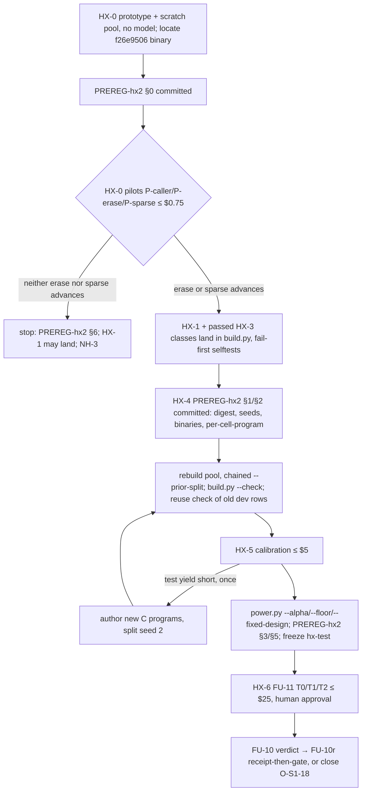

# hx2: a held-out set with headroom — DRAFT spec

**Status: DRAFT (after Step 1 review). Not authorized for build.**

Base: `main` 7f110693. Source: `tasks/opportunities.md` O-FU-08 (`:2701-2706` in the post-commit file) [REVISED:
HXA#13 — was `:2697-2701`, which ran past O-FU-08] and O-S1-18 (`:2650-2651`, FU-10 keep/remove). Prior design:
`tasks/followup-spec.md` FU-1 (`:40-293`), FU-10 (`:531-560`), FU-11 (`:562-593`). Evidence: `B/headroom/PREREG.md`
§1, §2, §6 (`B` = `crates/axon-cortex/benchmarks`), the committed rows in `B/headroom/calibration-2026-10-18/`, and the
built pool `/var/tmp/r51-tmp/hx-build-1/hx-pool.json` (not committed, `README.md:99-100`; its sha256 `c5e9f812…a426`
equals the pin in `PREREG.md:22`, re-hashed here). Scratch scripts: `/var/tmp/r51-tmp/specs-HeadroomRecipe/{analyse,
knobs,pinfeas,pin2,pilot_oc,fu10power,verify_review}.py` (read-only over the rows, the pool and the prebuilt axon; no
model call).

## Step 1 review

| Reviewer | blocker | major | minor | accepted | partly accepted | rejected |
|---|---|---|---|---|---|---|
| AuditHx2 (HXA#1–19) | 2 | 8 | 9 | 17 | 2 (#2, #3) | 0 |
| DevloopHx2 (HXD#1–19) | 0 | 7 | 12 | 17 | 2 (#4, #5) | 0 |

Every finding was re-checked (cited line read, or the computation re-run). Where the two reviewers proposed different
fixes for one defect, the choice and its reason are in the item.

| Id | Disposition |
|---|---|
| HXA#1 | accepted: chained `--prior-split`, pilots only on the 18 recorded dev programs (HX-4 split row, Seeds). Verified: 56 split entries, the 7 dropped programs absent |
| HXA#2 | partly: the missing arguments, `CORTEX_BIN`, `--grade-axon` and `--ranker` adopted; the single $0.15 shared cap replaced by HXD#1/#2's per-class spend root and cap (HX-0) |
| HXA#3 | partly: the defect is accepted; the band is HXD#3's ceil/floor form, with the eligible-cell rule in place of "fewer than 12 not piloted" (the stronger rule implies it) |
| HXA#4 | accepted: stop unless erase or sparse advances (HX-0, DAG) |
| HXA#5 | accepted: node N0b commits PREREG-hx2 §0 before any pilot row |
| HXA#6 | accepted: pin rule excludes tests that call another path to g; wording narrowed. Re-scanned: 6 test pins affected, dev 0 |
| HXA#7 | accepted: erase/sparse appended after `multi`; reuse decided per task by the reuse script |
| HXA#8 | accepted: per-cell ceiling stated; NH-4 reasoning corrected |
| HXA#9 | accepted: NH-3 reworded as a new decision (also Main's instruction 4) |
| HXA#10 | accepted, merged with HXD#8: `power.py --floor`, `--fixed-design` |
| HXA#11 | accepted: sparse uses `caller_pin` only; 47 tasks / 11 programs (verified) |
| HXA#12 | accepted: F4 cites the in-place correction; anchors moved |
| HXA#13 | accepted |
| HXA#14 | accepted: `check` recomputes the pin |
| HXA#15 | accepted: truncated-pilot rule; cost basis raised |
| HXA#16 | accepted: probe row added to F7 (verified: `hx-caller-40e94fc37f`, dev, $0.00044) |
| HXA#17 | accepted |
| HXA#18 | accepted, = HXD#10 |
| HXA#19 | accepted |
| HXD#1 | accepted (per-class spend root, `--parallel 1`), plus HXA#2's binary/ranker pins |
| HXD#2 | accepted: cap $0.25 per pilot; expected cost on the observed failure cost |
| HXD#3 | accepted (adopted band) |
| HXD#4 | partly: three-way screen with escalation adopted, OC re-computed by resampling DEV-H55 rows; knob-stratified draws rejected (per-knob counts reported instead) |
| HXD#5 | partly: cap scope, re-pass limit and cost basis adopted; the "96 sparse tasks" count corrected to ≤ 22 dev sparse tasks, so the estimate is re-derived (≈ $3.0) |
| HXD#6 | accepted: 2× rule; FU-11 design ≤ $20; per-model sub-caps |
| HXD#7 | accepted: FU-10 route-1 power re-computed (0.39 at σ_g = 1.0) and carried into NH-3/NH-5 |
| HXD#8 | accepted (merged with HXA#10) |
| HXD#9 | accepted: fixture named (verified 0.233 vs 0.117; mde 0.30 saturates at 1.0) |
| HXD#10 | accepted |
| HXD#11 | accepted: `--sims 5000` + Monte Carlo SE |
| HXD#12 | accepted: h45 runs regardless |
| HXD#13 | accepted: wall + scarce-resource columns |
| HXD#14 | accepted: one re-pilot per class |
| HXD#15 | accepted: redraw rule |
| HXD#16 | accepted: false success in calibration drops the class |
| HXD#17 | accepted: cap $1, citation fixed |
| HXD#18 | accepted: arms pinned at freeze |
| HXD#19 | accepted, option "describe the in-place note" (same as HXA#12); the uncommitted `PREREG.md` edit is not this spec's file to revert |

## 1. Scope

**In scope.** HX-0 pilot gate; HX-1 caller hidden pin (O-FU-08 a); HX-2 cortex callee preference (O-FU-08 b), deferred
with reasons; HX-3 harder classes (O-FU-08 bullet 2); HX-4 the hx2 pre-registration; HX-5 calibration, power and
freeze; HX-6 FU-11 and FU-10 on hx2 (O-S1-18).

**Out of scope.**
- Any change to `crates/*/src`: HX-2 is deferred (§HX-2), so no item here changes the repair digest, needs a pci
  theme, or adds g01 rows. Block **M3860–M3879** is reserved for HX-2 if it is ever authorized. [REVISED: Main step-1
  instruction 5] Any row placed there needs an ATTACK marker in `scripts/v022_attack_markers.py` (the mutation run
  refuses to start unless every active row has one, `v022_attack_markers.py:11-13`) and exactly one (crate, target,
  test) killer in its `scripts/v022_g01_mutations.py` tuple.
- hard-once: stays unspent (`followup-spec.md:197`); this spec authorizes no hard-once row.
- New generator models: weaker ones are unreachable (`followup-spec.md:51-56`).

**Rule for any repair-digest change** (HX-2 if ever built; FU-10r under NH-3/HX-6) [REVISED: Main step-1 instruction
6]: the paid receipt (`scorecard.py regress`) is run and its `history.jsonl` row committed BEFORE the full gate.
`stage_cortex_receipt` (`scripts/gate.sh:614-616`) runs `scorecard.py receipt --check` and fails the gate otherwise.

**Cross-spec dependencies.**
- `tasks/small-fixes-spec.md` SF-2 (O-FU-02) changes `cortex locate` rank and reach. The builder uses `cortex locate`
  (`build.py:303-311`, `:629-637`) with a pinned binary whose sha256 `--check` enforces (`build.py:819-821`), so SF-2
  does not move hx2 tasks while the pin holds. If SF-2 lands before the freeze, T1 includes it (see HX-6).
- `tasks/capability-surface-spec.md` (O-S1-20 `effect_union`) can change `axon caps`. `caps` eligibility uses the
  pinned builder axon; grading uses one `--grade-axon` for all arms (`followup-spec.md:162-163`), so it is fair.
- `tasks/gate-lane-spec.md`: if `gate.sh --lane` lands first, the B/-only lane replaces the hand-listed stages in §5.

## 2. Priority tiers

| Tier | Items |
|---|---|
| P0 (gate, first node) | HX-0 pilot gate on a scratch pool, recorded dev programs only |
| P1 | HX-1 caller hidden pin; HX-4 PREREG-hx2 (its §0 precedes the pilots) |
| P2 (only for classes that pass HX-0) | HX-3a `erase`, HX-3b `sparse` landed in `build.py`; HX-5 calibration, power, freeze |
| eval | HX-6 FU-11 + FU-10 on hx2 (needs-human spend approval) |
| deferred | HX-2 cortex callee preference / workaround report; HX-3 excluded classes (table in HX-3) |

## 3. Findings this spec rests on (all re-measured at 7f110693)

| # | Claim | Evidence (command → output, trimmed) |
|---|---|---|
| F1 | Dev h55: 546 rows, 517 clean, $0.4363; outcomes 545 `verified_done`, 1 `adjudicated_not_clean`; 28 false successes | `python3 analyse.py` → `rows 546 clean 517 cost 0.4363`, `false_success 28` |
| F2 | Not clean by cell: caller:2 18, caller:1 10, multi:3 1. All 28 caller ones: `false_success` true, `true_symbol_changed` false; every `regressed` set ⊆ the task's `cut_tests` | `('caller:2', True, False): 18, ('caller:1', True, False): 10`; `FS regressed subset of cut_tests Counter({True: 28})` |
| F3 | 10 tasks, deterministic per task: caller solved/k = 0/3 on 9 tasks, 2/3 on 1 | `('caller:1', 0, 3): 3, ('caller:1', 2, 3): 1, … ('caller:2', 0, 3): 6` |
| F4 | 18 of 28 were first proposals. Of the 10 second proposals, 9 followed a rejected attempt on a non-target candidate, **1 on g itself** (`hx-caller-744b244e8b` trial 3: `['contains', 'find_containing']`). [REVISED: HXA#12/HXD#19 — was "HX-4 corrects it in the hx2 file"] Corrected in place in `PREREG.md` §6 (`:156-161`, bracketed "[Corrected 2026-10-19 …]" note; uncommitted in this worktree, following the 7f110693 in-place §2/§6 precedent; no freeze has happened, `PREREG.md:5-6`) | `FS … proposals Counter({1: 18, 2: 10})`; `FS symbol in attempted Counter({False: 27, True: 1})`; `git diff PREREG.md` → +4/−1 at `:158` |
| F5 | h45 on the 12 kept caller:2 dev tasks: 12 clean, 12 `true_symbol_changed`, $0.124 | `12 12 12 0.124` |
| F6 | Outside caller, no observed knob moves the FINAL solve rate; each moves only the first-proposal rate (table in HX-3) | `python3 knobs.py` |
| F7 | Every model-run id is a dev id: DEV-H55 182 ids, DEV-H45 12, both pilots 20 each, all split `dev`; [REVISED: HXA#16] plus one uncommitted probe row (`/var/tmp/r51-tmp/hx-pilot/probe-h55.jsonl`: `hx-caller-40e94fc37f`, dev, $0.00044) | `DEV-H55.jsonl 182 {'dev'}` … `pilot-h45.jsonl 20 {'dev'}`; `HXA16 probe [('hx-caller-40e94fc37f', 'dev', 0.00044, 'claude-haiku-5-5')]` |
| F8 | The spent ledger is empty and `hx-test` is unpinned | `wc -l heldout-spent.jsonl` → `0`; `protected.py:40` `"hx-test": None` |
| F9 | A caller workaround passes because the hidden check is a caller test: the hidden test defaults to the last failing test (`ab/corpus.py:170-171`), `finish` passes no hidden for caller (`build.py:568`, `:613`), and g's direct tests are all cut (`build.py:411-413`, `:578-579`) | read |
| F10 | The hidden check is sealed from localization and from the model: the spectrum excludes it (`bin/cortex.rs:849-850`, `:1744-1753`), the generator sees the file without it (`bin/cortex.rs:1420-1423`), feedback comes from a run with it cut out (`feedback.rs:9-12`) | read |
| F11 | [REVISED: HXD#2/#13] Cost and wall of DEV-H55 rows: clean mean $0.00076 / 4.8 s; rows with ≥ 6 proposals (n = 3) mean $0.00926 / 76.1 s; one-row max $0.0138 | `python3 pilot_oc.py` → `rows proposals>=6 3 mean cost 0.00926 mean wall 76.1`; `clean mean cost 0.00076 wall 4.8` |

## HX-0 (P0) Pilot gate — first DAG node

**Problem.** The FU-1 pool was built, extended by 24 programs and calibrated before any model ran on it; the dev
calibration then showed no headroom (`tasks/lessons.md:893`). hx2 pilots every new recipe before committing builder
code or authoring programs.

**Change.**
1. Prototype HX-1, HX-3a and HX-3b on a scratch branch (`hx2/proto`, never merged; it lands only the classes that pass).
2. Build a scratch pool with the PREREG §1 pinned binaries (`/var/tmp/r51-tmp/hx-bin/`), seeds 1/1, and
   `--prior-split /var/tmp/r51-tmp/hx-build-1/hx-pool.json --allow-short-split`, into `/var/tmp/r51-tmp/hx2-scratch/`.
   No model runs here. Last build wall time: 444.5 s at `--jobs 16` (`report.json` `wall_s.total`).
3. **Commit PREREG-hx2 §0** (node N0b) [REVISED: HXA#5 — the pilot rule was "fixed before the pilots" but committed
   after them]: this decision table, pilot seed 2 and the drawn id lists, the scratch-pool sha256, the `hx2/proto`
   commit, the incumbent path + sha, and the exact pilot command. No pilot row may predate this commit.
4. Run pilots on the **18 programs recorded `dev` in `/var/tmp/r51-tmp/hx-build-1/hx-pool.json` `meta.headroom.split`**
   [REVISED: HXA#1 — was "dev-split programs"; a program first dealt in the scratch build could later be dealt test]:
   P-caller (HX-1), P-erase (HX-3a), P-sparse (HX-3b). Ids: `random.Random(2).sample(sorted(ids), 20)` over the class's
   tasks on those programs; [REVISED: HXD#15] redraw from the same rng until the sample covers ≥ 5 programs, and record
   the number of draws. An escalation draw (below) takes 20 more ids from the same rng, disjoint from the first.
   [REVISED: HXA#2 + HXD#1 — the old command could not run: no corpus, `--out` or `--reserve-usd`, and the default
   spend root already holds $36.75] Command, one empty spend root per class:
   ```
   CORTEX_BIN=<f26e9506 cortex, sha256_16 957e5343529712b7> python3 B/ab/run_ab.py \
     /var/tmp/r51-tmp/hx2-scratch/hx-pool.json --arm B --generator real --transport micode \
     --model claude-haiku-5-5 --trials 1 --parallel 1 --only IDS \
     --grade-axon /var/tmp/r51-tmp/hx-bin/axon --ranker openrouter:anthropic/claude-haiku-5.5 \
     --spend-root B/headroom/hx2-pilot-<date>/<class>/ --out B/headroom/hx2-pilot-<date>/<class>/pilot.jsonl \
     --reserve-usd 0.03 --cap-usd 0.25
   ```
   Anchors: corpus positional and `--out` required (`run_ab.py:880`, `:897`); micode needs `--reserve-usd`
   (`:962`); the cap check sums every row under `--spend-root` (`:808-819`, `:1060`); the binary comes only from
   `CORTEX_BIN` (`:74`). Per-class roots (HXD#1) over HXA#2's one shared $0.15 root: a shared root lets one class's
   spend stop the next class's pilot, which the decision table would then misread.
5. Triage every not-clean row by hand: `attempted`, `true_symbol_changed`, `regressed`, and [REVISED: HXA#6] whether
   the accepted patch edits a callee of g.

**Decision per class (committed in §0 before the pilots).** [REVISED: HXA#3/HXD#3/HXD#4 — the absolute 4..16 band had no
upper bound below n = 20; no grey zone; Bin() was not the real operating characteristic]

| Class | Advances iff (n = pilot size; c = clean rows) |
|---|---|
| erase, sparse | 0 false successes **and** a three-way screen on the first 20: ceil(0.2n) ≤ c ≤ floor(0.8n) (4..16) → advance; c ≤ 3 or c ≥ 19 → reject; c ∈ {17, 18} → escalate: 20 more ids, advance iff ceil(0.2·40) ≤ c₄₀ ≤ floor(0.8·40) (8..32). A class with no knob holding ≥ 12 dev tasks from ≥ 3 dev programs does not advance (no eligible cell is possible, `calibrate.py:51`); below 20 tasks the pilot uses all of them with the proportional band |
| caller (HX-1) | 0 false successes. Informational only: caller stays in the pool either way, and alone it never continues the DAG |

Choice: HXD#3's band (proportional, plus the eligible-cell rule, which subsumes HXA#3's "< 12 tasks: not piloted"), and
HXD#4's escalation. Knob-stratified draws (HXD#4) are **rejected**: knob cells of a 20-task pilot hold ~7 tasks, too
few to decide on, and the cell decision belongs to calibration; per-knob counts are reported instead.

**Operating characteristic, by resampling recorded DEV-H55 rows** (`python3 pilot_oc.py`, 20 000 replicates per real
cell, 10 000 per mixture; each pilot task's k = 1 outcome is one of its 3 recorded trials). No recorded class has rates
across the band, so the p-rows are 60-task populations mixed from the 11 dev tasks with a not-clean trial and the
clean tasks, the mix chosen so the expected rate is p:

| Population | P(advance) 3-way (E tasks) | 2-way (old rule) | Bin(20, p) |
|---|---|---|---|
| mixture p = 0.3 / 0.5 / 0.7 | 0.889 / 0.999 / 0.963 (≤ 22.0) | 0.889 / 0.998 / 0.898 | 0.893 / 0.997 / 0.893 |
| mixture p = 0.8 / 0.85 / 0.9 / 0.95 | 0.694 / 0.409 / 0.147 / 0.016 (≤ 29.5) | 0.590 / 0.346 / 0.139 / 0.015 | 0.589 / 0.352 / 0.133 / 0.016 |
| real cell caller, all (38 tasks, 13 programs, rate 0.754) | 0.996 | 0.854 | 0.761 |
| real cell caller:1 (26 tasks, rate 0.872) | 0.107 | 0.110 | 0.249 |
| all 182 dev tasks (rate 0.947) | 0.012 | 0.013 | 0.019 |

- A false success in any pilot means the recipe admits a workaround (the O-FU-08 pattern). The class is fixed and
  re-piloted under a new pilot seed recorded in PREREG-hx2; it never advances on that pilot. [REVISED: HXD#14] At most
  one re-pilot per class, inside that class's $0.25 grant; a second false success parks the class in the excluded table.
- [REVISED: HXA#15/HXD#2] A pilot stopped by the cap or by `RATE_LIMIT_STOP` (`run_ab.py:875`) before all its ids ran is
  **not decided**; after review its remaining ids run once under the same seed. Spend beyond the class's $0.25 needs
  NH-1 approval.
- [REVISED: HXA#4 — was "if **no** class advances", which let a caller-only pass continue] If **neither erase nor
  sparse advances: stop.** Append the pilot rows and the verdict to PREREG-hx2 §6. HX-1 may still land as a recipe fix;
  no HX-5 run. FU-10 goes to NH-3.

**Acceptance.** PREREG-hx2 §0 is committed before the first pilot row. Then three pilot row files plus a pilot verdict
table, committed in `B/headroom/hx2-pilot-<date>/` with the PREREG-hx2 §2 rows, before any HX-3 code lands on main.

**Unverified prerequisite.** No file with sha256_16 `957e5343529712b7` was found (`find /var/tmp /home/cklaus/projects
-name cortex` → only `93b545b3…` and `e052ea81…`). N0 must locate or rebuild the f26e9506 binary and match the sha;
`[INFERENCE]` a debug rebuild may not reproduce it, in which case the incumbent pin is re-decided before §0.

## HX-1 (P1) Caller tasks pin g's contract with a hidden direct test (O-FU-08 a)

**Problem.** F2, F9: the hidden check of a caller task reaches g only through a caller, so cortex accepted
caller-side workarounds 28 times. Grading catches them (`run_ab.py:280-307`: every pristine test, the cut ones
included). But the adjudicator the incumbent ran against was too weak, so "not clean" there means "workaround
accepted", not "repair refused" (`PREREG.md:162-168`) [REVISED: HXA#12 — was `:159-165` before the in-place
correction].

**Options.** (A) Hidden = one direct test of g that fails on the mutant, kept in the broken file and sealed (F10). (B)
Hidden = a test of a second caller of g: it needs ≥ 2 callers, and a workaround in that second caller still passes.
(C) A synthesized hidden test that calls both: it changes `pristine`, which `corpus.load` takes from `meta.sources`
(`ab/corpus.py:283-285`) and `build.py --check` requires to equal the program file (`build.py:829-830`).
**Chosen: A** (engineering): [REVISED: HXA#6 — was "no single-body caller edit can pass the hidden check"] with the
call-path rule below, no edit to a caller of g can change the hidden test's calls into g; it reuses existing fields.

**Feasibility (repro).** `python3 -B pinfeas.py` rebuilds each pool caller task before the test cut
(`build.rebuild`) and runs the pinned axon `test --json`:

```
('dev', '1', 'pin_ok') 23   ('dev', '1', 'no_failing_direct_test') 3
('dev', '2', 'pin_ok') 11   ('dev', '2', 'no_failing_direct_test') 1
('test', '1', 'pin_ok') 53  ('test', '1', 'no_failing_direct_test') 9
('test', '2', 'pin_ok') 26  ('test', '2', 'no_failing_direct_test') 7
```

All 10 false-success tasks have a pin, and each pin is a test in that task's observed `regressed` set (for example
`hx-caller-7d18624da4` → `['test_weight_band_heavy']`). Only axon ran on the test tasks; no model was called.
[REVISED: HXA#6] `direct_tests` is any test whose text contains `g(` (`build.py:345-346`), so a pin can also call a
caller of g. Re-scan with the call-path rule (`python3 -B pin2.py`): `('dev','first') 34, ('dev','none') 4,
('test','first') 73, ('test','later') 1, ('test','rejected') 5, ('test','none') 16`. Dev pins are unaffected, so the
pilot cannot observe this shape; on test 74 of 95 caller tasks keep a pin.

**Change** (`B/headroom/build.py`, caller only):
- New pure helper `caller_pin(direct, failing, calls, reach) -> str | None`: the first name in `sorted(direct)` that
  is in `failing` (the single mutant's failing tests, `eval_single` `:372`) **and whose test block calls no function
  other than g in `reach`** (`calls[t]` = functions the block calls; `reach` = functions h ≠ g with
  `call_depth(graph, h, g)` not None) [REVISED: HXA#6]; none → reject.
- `candidates` (`:411-413`): a caller candidate carries `hidden = caller_pin(...)` and
  `cut = [n for n in direct if n != hidden]`.
- `finish` (`:568-648`):
  - take `hidden = hidden or cand.get("hidden")`;
  - for caller, reject a candidate with no pin, with reason `caller: no direct test of g fails on the mutant; its
    contract cannot be pinned`;
  - choose `visible` from `failing` minus `hidden` (`:593`);
  - keep the ≥ 2-failing rule (`:591`), the call-depth rule (`:598-601`) and `names_symbol(res, hidden, fn)`
    (`:639-641`; it already skips the hidden test, `:543-547`).
- `check` (`:834-835`): the caller cut is `direct_tests[symbol]` minus `t["hidden"]`. [REVISED: HXA#14 — `check`
  passes `t["hidden"]` into `finish` (`:839`), and `task_from_broken` only requires `hidden ∈ failing`
  (`ab/corpus.py:172`)] New refusal: `check` recomputes `caller_pin(…)` on the rebuilt pre-cut file and refuses a
  caller task whose `t["hidden"]` differs.
- [REVISED: HXA#7 — was "leaving them alone keeps their tasks byte-identical"] Scope: the pin applies to caller (and
  sparse, HX-3b). The other classes had 0 false successes in 432 task-trials (F2). Their tasks are expected unchanged,
  but `used` keys on the shared single-mutation broken file across classes (`build.py:666`, `:681`; `CLASSES` order
  `:107` = refine, caps, caller, subtle, multi), and 3 of the 4 dev caller tasks HX-1 rejects come from subtle ops
  (`bound`, `argswap-typed`, `wrong-field`; the 4th is `operator`), so subtle tasks can move. The reuse script decides
  per task (HX-4). Caller ids change, because `task_id` hashes `broken` (`:188-189`) and the pin stays in `broken`.

**Fail-first tests** (`B/headroom/selftest.py`, binary-free, beside `test_build` `:291`):
- `test_caller_pin`: `caller_pin(["t_b","t_a"], ["t_a","t_x"], {}, set()) == "t_a"`;
  `caller_pin(["t_b"], ["t_x"], {}, set()) is None`; `caller_pin(["t_a","t_b"], ["t_a","t_b"], {"t_a": {"h"}}, {"h"})
  == "t_b"`. Fails before: `AttributeError`.
- `test_caller_check_rule`: the extracted pure rule `caller_hidden_ok(task, direct, calls, reach)` refuses a caller task
  whose hidden is a caller test, or is not the recomputed pin, and accepts a pinned one. Fails before: missing.

**Acceptance.**
- The scratch rebuild's caller tasks all have `hidden == caller_pin(…)`.
- `build.py --check` on the rebuilt pool reports 0 failures.
- The P-caller pilot has 0 false successes.

[REVISED: HXA#6 — was "a caller workaround fails the hidden pin"] A caller workaround fails the hidden pin; a
callee-of-g workaround can still pass it (g has callees in 15 dev and 32 test pinned tasks) and is caught only at
grading (`regressed`).

[INFERENCE] With the workaround rejected, cortex walks on to g (rank ≤ 5 in all 28 rows; the clean caller rows show g
found at rank ≤ 4 within ≤ 4 proposals; h45 walked to g 12/12). So caller probably saturates, and hx2 loses its
only in-band FU-1 cell. P-caller measures this.

## HX-2 (deferred) Cortex prefers the callee or reports the workaround (O-FU-08 b)

**Recommendation: defer (NH-2).** [REVISED: HXA#19 — was labelled "Decision"] The case:
- **No measurement need.** After HX-1, a caller workaround fails the hidden pin on hx2, so HX-2 could only change
  efficiency (proposals), not correctness, on this set.
- **It moves the thing being measured.** HX-2 edits `crates/axon-cortex/src` (rank or report), which changes the repair
  digest. That needs one paid receipt regress (≈ $0.14, cap $1, no waiver; `followup-spec.md:624`, `lessons.md:864`,
  `build-loop-followup.md:96`) [REVISED: HXD#17 — was cited to `followup-spec.md:25-28`], committed before the full
  gate (§1 rule). Landed before FU-11, T1 would no longer be "the FU batch", and FU-11's T1 − T0 would mix FU-2..9 with
  HX-2. T2 (`fu/r4-ablation` 5d257b75, cut against e2f5fb48) would also need a re-cut. Calibration is unaffected either
  way, because it runs the f26e9506 incumbent (T0).
- **It changes what users see.** Callee preference changes which function cortex edits; a workaround report adds a
  verdict field.

**If authorized later:** a separate spec, measured on frozen hx2 as its own candidate arm after FU-11, with g01 rows in
M3860–M3879 (each with an ATTACK marker and one killer, §1), refusal-coverage anchors and one receipt regress.

## HX-3 Harder classes with headroom (O-FU-08 bullet 2)

**What the dev rows say** (`python3 knobs.py`, the 432 non-caller h55 rows; buckets are approximate: `n_fns` counts
every `fn` including tests, `sym_lines` uses a naive brace scan):

| Knob | Bucket: clean/n (first-proposal clean rate) |
|---|---|
| spectrum rank of the symbol | 1: 389/390 (0.97); >1: 42/42 (0.05) |
| failing tests on broken | 2: 143/144 (0.91); 3–4: 135/135 (0.95); ≥5: 153/153 (0.80) |
| program lines | <150: 203/204 (0.92); 150–299: 228/228 (0.85); none ≥ 300 (largest pool program 294 lines) |
| program `fn` count | <10: 51/51 (0.98); 10–19: 158/159 (0.92); ≥20: 222/222 (0.83) |
| symbol lines | <8: 209/210 (0.83); 8–15: 165/165 (0.91); ≥16: 57/57 (1.00) |
| stratum | C 368/369 (0.86); D 63/63 (0.98) |

Localization difficulty, program size and the number of mutations cost proposals but not solves: cortex walks the
ranked candidates (`--candidates 6`, `run_ab.py:82`), with unlimited proposals by default (`bin/cortex.rs:74-76`),
and the hidden check judges every attempt. So headroom needs defects where the generator **keeps failing on the right
function**: too little information (sparse), or too much to rebuild (erase).

Both classes are appended after `multi` in `CLASSES` [REVISED: HXA#7], so they cannot take a broken file from an
existing class. Per-cell ceiling [REVISED: HXA#8]: `--per-cell-program 2` (`PREREG.md:22`) caps each (class, knob) per
program (`build.py:656-680`); on the 38 test programs (32 C) sparse:1 ≤ 76 tasks, each erase knob ≤ 64 (C only), all
three erase knobs ≤ 192.

**HX-3a `erase` (body re-synthesis).** The symbol's body is replaced by the typed default of its return type.
- Mapping: `i64`/integer types → `0`, `f64` → `0.0`, `bool` → `false`, `String` → `""`, `[T]` → `[]`; any other
  return type is rejected. Repro: a file with those four stub bodies passes `axon check` (`rc=0`), and its tests fail
  with `"assertion failed"`. `panic(...)` does not exist (`E0001 cannot find name panic`).
- Builder: new `M.erase(body, ret)` and `M.return_type(src, fn)`; class `erase`.
- erase is NOT in `M.ALL_OPS` (`mutators.py:249`), so `multi` never composes it. `rebuild` (`build.py:513-519`)
  accepts `ops == ["erase"]` only for class erase, with the edit equal to `M.edit_of(body, M.erase(body, ret))`.
- Knob: pristine body lines `<8 | 8-15 | ≥16`. Usual FU-1a checks (≥ 2 failing; restore passes; locatable).
- **Stratum C only:** public stratum-D bodies may be memorized (FU-1b).
- Fail-first: `test_erase` (defaults per type; `None` for a struct return type; `rebuild` refuses erase under another
  class).

**HX-3b `sparse` (one visible failure).** A single mutation (any `ALL_OPS` operator) whose broken file fails ≥ 3
tests.
- `sparse_cut(failing, direct, calls, reach)` picks `hidden` = `caller_pin(direct, failing, calls, reach)`; none →
  reject [REVISED: HXA#11 — was "else the last failing test", which re-creates the O-FU-08 shape]; `visible` = the
  first other failing test; every other failing test is cut (restored at grading, as for caller).
- Knob `1`. The model then sees one failing test. `axon check`-clean.
- Eligible dev base [REVISED: HXA#11 — was "96 tasks", which counted multi]: 47 single-mutation non-caller dev tasks
  with ≥ 3 failing tests, 11 programs (`verify_review.py` → `HXA11 singles>=3 47 programs 11`; an indicator only:
  sparse is built from singles, ≤ 2 per program, so ≤ 22 dev sparse tasks).
- Fail-first: `test_sparse_cut`.

**Excluded or deferred, with reasons (none silently dropped).**

| Candidate | Disposition | Reason |
|---|---|---|
| Visible tests do not fail | excluded | cortex exits `no_target` when no visible check fails (`bin/cortex.rs:875-879`), so the rate is 0 by construction; FU-1a needs ≥ 2 failing tests |
| Multi-file | excluded | `run_ab` writes only `task["file"]` (`run_ab.py:692-696`), cortex takes one `--file`, and `corpus.load` has no extra-files field (`followup-spec.md:82-84`); needs its own harness spec |
| Larger programs (≥ 300 lines) | deferred | dev ≥ 20 fns: 222/222 clean. Size costs proposals, not solves (table). Needs authoring; revisit only if erase/sparse pass and the yield falls short |
| Cross-function invariant (sibling pair) | deferred | it is the rank > 1 case (42/42 clean) plus a sibling workaround, which a pin rule extended to that class would reject [REVISED: HXA#11 — the pin is scoped to caller and sparse] |
| multi:4–5 | excluded | multi:2 108/108, multi:3 104/105; A#17 early-stop confound (`PREREG.md:114-118`) |
| `--max-proposals 1` budget | excluded | it changes the incumbent's configuration, and FU-10's feedback only acts after a rejected attempt, so FU-10 could not be measured |

## HX-4 (P1) PREREG-hx2

New file `B/headroom/PREREG-hx2.md` (§0 at N0b, §1/§2 at N3). `PREREG.md` gets one appended §6 row pointing to it.
Set names stay `hx-dev`/`hx-test`; nothing was frozen (F8), so `protected.py` and `SETS` need no change.

**Contamination argument.**

| Material | Reuse? | Why |
|---|---|---|
| 38 test-split programs (`PREREG.md:23`) | yes, as test | No model ran on them (F7). They were touched only by builder binaries, `calibrate.py` cell membership, and axon-only pin scans. No outcome on them exists. |
| 18 dev-split programs | dev only, forever | Models ran on them (F7); "no program run on dev ever enters test" (`PREREG.md:33-35`). Every HX-0 pilot draws only from them. |
| Old split | kept | [REVISED: HXA#1 — was "`--prior-split` keeps every program's side"; the 7 dropped programs are not in the recorded split (`verify_review.py` → `split entries 56 … dropped in split [False ×7]`), and `split_programs` deals every unrecorded program afresh (`build.py:130-142`)] Every build after HX-0 passes `--prior-split` = the pool whose dev tasks a model last ran on (scratch pool → N4 pool → each N5a rebuild, chained), so `recorded_split` (`build.py:150-154`) pins every program ever dealt. Programs new to the split are dealt once, and that dealing is recorded in PREREG-hx2 before any model run on the pool. |
| New programs (only if HX-5 yield is short) | new | Split seed **2**, authored after HX-0 passes. Authoring rules as FU-1b (`followup-spec.md:99-105`). |
| Dev rows of multi/subtle/caps/refine | reusable per task | Same mutation seed 1, same pinned binaries and same incumbent sha. Valid only where the rebuilt task's `id` and `sha256` match the old pool (checked by a script, recorded). [REVISED: HXA#7] |
| Dev rows of caller (114) and all pilot rows | not reusable | HX-1 changes caller tasks; [REVISED: HXA#17 — was "pilot tasks are not the calibration population", but they are drawn from it] pilot rows are k = 1 on prototype code. |
| Designer exposure | stated | Class designs use dev outcomes only. Test-split inspection: cell counts, axon-only pin counts, and (HXA#6, `pin2.py`) the call sets of test pin bodies; reviewer HXA printed 6 test ids with pin and caller names. No test outcome exists. |

**Seeds.** [REVISED: HXA#1] Mutation 1; split 1 for every program first dealt in the scratch build; split 2 only for
programs authored in N5a; cross-fit 1; cap draw 1; HX-0 pilot sample 2. All are recorded in PREREG-hx2 before the run
they govern.

**Thresholds (unchanged).**
- kept cell: shrunk rate in [0.3, 0.7];
- eligible cell: ≥ 12 dev tasks from ≥ 3 programs;
- test set: ≥ 150 tasks from ≥ 20 programs, ≤ 8 per program;
- cross-fitted predicted test rate in [0.2, 0.8]; [REVISED: HXA#17] also reported with the pilots' ids excluded;
- h45 informative band [0.1, 0.9].

These are `calibrate.py:50-54`. **No gate changes after the FU-1 miss**: the miss came from the recipe and the cells,
not from the thresholds. The only new gate is the HX-0 screen, fixed before any hx2 outcome. `power.py`'s chosen n
binds whenever it exceeds 150 (FU-1f, `followup-spec.md:226`).

**Also recorded:** the builder-input digest (it changes with HX-1/HX-3); the pinned binaries (unchanged: axon
`819e0460…`, cortex `e052ea81…`). [REVISED: HXA#12 — "the F4 correction" removed: it is already in `PREREG.md` §6, F4]

## HX-5 (P2) Calibration, power, freeze

- **Calibration.** `calibrate.py`, unchanged:
  - h55 k = 3 on every dev task whose `id` or `sha256` differs from the old pool (any class), plus the reusable rows
    [REVISED: HXA#7 — was "(caller, erase, sparse)"];
  - h45 k = 1 on the kept dev cells (it runs regardless of informativeness; FU-10's guard needs Δ̂₂, HXD#12);
  - incumbent f26e9506;
  - cap **$5 per pass**, fresh spend root `hx2-cal-<date>/` shared by h55 and h45; at most one N5a re-pass,
    cumulative ≤ $10 with NH approval [REVISED: HXD#5];
  - [REVISED: HXD#16] any false success in an erase or sparse calibration row removes that class from the cells
    before power and freeze (logged).
- **Yield.** [REVISED: HXA#8] Ceiling = 2 × test programs per kept cell (erase: C programs only), §HX-3.
  PREREG-hx2 §1 fixes `--per-cell-program` before N4; raising it is a recipe change recorded there. A single kept cell
  yields ≤ 76 test tasks from the 38 programs, so it alone triggers N5a authoring.
- **Power.** `power.py --dev-rows … --calibration REPORT` with the HX-0/HX-5 measured costs, `--sims 5000`, reporting
  the Monte Carlo SE [REVISED: HXD#11 — first-crossing n moves by 16–32 tasks with the seed at 1000 sims]. New flags
  [REVISED: HXA#10/HXD#8 — `--alpha` alone kept the FU-1h(i) +5-point floor, `power.py:121`, `:152-153`]:
  `--alpha` (default 0.05; hard-coded today, `power.py:54`, `:156`), `--floor` (default 0.05) and `--fixed-design n,k`
  (power at a given design; `choose_design` only searches, `:176-177`). Fail-first, on
  `simulate_power(rates, sigma_g=1.0, mde=0.10, n=48, k=3, sims=60, seed=4, min_programs=8, per_program=6)` (the
  `test_power` fixture, `selftest.py:263-268`) [REVISED: HXD#9 — the mde 0.30 call saturates at 1.0]: power(α = 0.025)
  < power(α = 0.05) (patched-Z repro: 0.117 < 0.233), and `--floor -1` power ≥ floor-0.05 power.
- **FU-10 route-1 power** [REVISED: HXD#7]: committed in PREREG-hx2 §3 before the freeze, at the chosen design, σ_g ∈
  {0, 0.5, 1}, α 0.025, no floor, times the h45-guard pass rate. Planning repro (`python3 fu10power.py beta`, Z patched
  to 1.96, floor −9, 2000 sims; MDE 0.07, h55 part only):

| Design (shape) | σ_g = 0 | σ_g = 0.5 | σ_g = 1.0 |
|---|---|---|---|
| 288 / 3 (Beta(2,2)) | 0.852 | 0.646 | 0.395 |
| 192 / 3 (Beta(0.5,0.5)) | 0.791 | 0.646 | 0.375 |
| 144 / 3 (Beta(0.3,0.3)) | 0.757 | 0.640 | 0.375 |

  At 288/3, σ_g = 1.0: MDE 0.10 → 0.709, 0.12 → 0.857, so MDE₈₀ ≈ 11–12 points. Times the guard pass rate (1 − 0.19,
  `PREREG.md:132-134`) route-1 power is ≈ 0.30–0.32. FU-10 does not resize hx2 (that needs n ≈ 800 from ≈ 100
  programs, ≈ $55 per HXD#7, not re-run here); the REMOVE wording uses the computed MDE₈₀ (NH-5).
- **Planning numbers** ([EST]; synthetic, replaced by the real run). Command: `python3 power.py --synthetic A,B,60,3
  --cost-success 0.0008 --cost-failure 0.005 --cost2-success 0.0044 --cost2-failure 0.0224 --k2 1 --arms 3
  --cap-usd 25 --seed 1 --n-grid 80:481:16`:

| per-task rate shape | chosen n / programs / k | power σ_g = 0 / 0.5 / 1.0 | cost |
|---|---|---|---|
| Beta(2, 2), mean 0.47 | 288 / 36 / 3 | 0.983 / 0.948 / 0.805 | $19.86 (h55 $7.84, h45 $12.04) |
| Beta(0.5, 0.5) | 192 / 24 / 3 | 0.976 / 0.948 / 0.827 | $13.23 |
| Beta(0.3, 0.3) (bimodal, like F3) | 144 / 20 / 3 → the 150-task floor binds | 0.975 / 0.954 / 0.806 | $10.70 |

  [REVISED: HXD#2/#5 — the "$15.03 at the observed dev costs $0.00076 / $0.00151" alternative is withdrawn: $0.00151
  is the cost of accepted workarounds, not failures (F11)] At Beta(2, 2), n = 160 reaches only 0.588 (k = 3) or 0.641
  (k = 5). hx2 must plan for **150–290 test tasks from 20–36 programs**. The 38 test programs supply at most 304 at 8
  per program, so the kept cells need about 4–8 tasks per test program. A shortfall triggers new-program authoring.
- **Freeze.** As FU-1c step 5: `hx-test.json` committed, sha pinned in `PROTECTED_SETS`, k per model fixed first.

## HX-6 (eval) FU-11 and FU-10 on hx2

Reuse `followup-spec.md:562-593` and `PREREG.md` §4–§5: arms T0 f26e9506 / T1 merged head / T2 merged head + R4
revert, three concurrent arms at `--parallel 1`, trial-major, FU-1h criterion, FU-10 routes (p < 0.025). Changes:
- [REVISED: HXA#18/HXD#10] k per model is `power.py`'s chosen design, fixed in PREREG-hx2 §3; `followup-spec.md:583`'s
  k = 5 does not apply.
- [REVISED: HXD#18 — was "if any src change lands before FU-11, T2 is re-cut"] T1 and T2 are the shas pinned in
  PREREG-hx2 §5 at the freeze. Today: `main` 7f110693, cortex `e052ea81…` (= `/var/tmp/r51-tmp/hx-bin/cortex`,
  `sha256sum` → `e052ea815762ad13…`); `git diff --stat b789a8f6 main -- crates/axon-cortex/src
  crates/axon-cortex/benchmarks/drivers` → empty. A `crates/axon-cortex/src` change landing before the freeze (for
  example SF-2) is in T1, and T2 is re-cut against that head before the freeze; the 5d257b75 patch sha `f0209bfc…`
  (`PREREG.md:171-172`) is then void. A later landing changes neither arm.
- [REVISED: HXD#6] FU-11 runs on one spend root per model, sub-caps h55 = 1.5 × expected and h45 = $25 − the h55 cap.
  Before FU-11 the design cost from HX-5's measured per-outcome costs must be ≤ $20 (0.8 × cap); otherwise `power.py`
  re-sizes at `--cap-usd 20`, or NH.
- FU-10 power: HX-5's route-1 row replaces the unverified "MDE₈₀ ≈ 7 points" (`followup-spec.md:555`). A REMOVE verdict
  is worded with the computed MDE₈₀; REMOVE executes as FU-10r (`followup-spec.md:557-559`) under the §1 receipt rule,
  with g01 rows M3717–M3719 and their ATTACK markers (`v022_attack_markers.py:3120-3122`) updated or retired together.

## 5. Gates and cost budget

| Gate | One run | Re-run trigger | Skip rule |
|---|---|---|---|
| `selftest.py` + FU-1e gate stage + `check_docs` + `scorecard selftest` | seconds, CPU | any B/ commit | none |
| `build.py --check` on the hx2 pool | ≈ 7–8 min at `--jobs 16` (build 444.5 s) [EST] | builder inputs change | no builder-input change |
| full `./scripts/gate.sh` | 32–39 min (last 38m51s, 6967/0/12) | commit after it | `--fast` is not evidence; a `gate.sh --lane` B/-only lane replaces it once gate-lane-spec lands |
| `cargo test -p axon-cortex --features ai` | 10–15 min | `crates/axon-cortex/src` change | skipped: no item changes it |
| receipt regress (paid) | ≈ $0.14, ≈ 5 min, cap $1 (`followup-spec.md:624`, `lessons.md:864`, `build-loop-followup.md:96`) | repair digest change | not triggered here; HX-2 or FU-10r trigger one each, committed BEFORE the full gate (§1) |
| pci regen / `pci_delta --check` | — | `crates/axon-core/src` change | not triggered |

[REVISED: HXD#2/#5/#13 — caps, cost bases, wall and scarce-resource columns]

| Paid run | Cap (`--cap-usd`) | Expected | Wall | Scarce resource | Basis |
|---|---|---|---|---|---|
| HX-0 pilots (3 × 20, escalation to 40; h55 k = 1) | $0.25 each (reserve $0.03), $0.75 total | ≈ $0.10 each at p = 0.5; ≈ $0.08 at p = 0.85 with escalation | ≤ 14 min per 20 at `--parallel 1` [EST] | OAuth rate limit (`RATE_LIMIT_STOP` 3, `run_ab.py:875`); OpenRouter ranker | F11: success $0.00076 / 4.8 s, failure $0.00926 / 76.1 s (n = 3 rows); FU-1 model $0.003–0.007 (`followup-spec.md:265`) |
| HX-5 calibration | $5 per pass, ≤ $10 cumulative (NH) | ≈ $3.0 [EST] | 1–2 h at 3 in flight [EST] | as above; shared host, `--parallel` ≤ 3 (`run_ab.py:930-931`) | h55 ≤ 138 tasks × 3 × $0.00288 + h45 ≤ 138 × $0.0134, at rate 0.5 |
| HX-6 FU-11 incl. T2 and h45 | $25 (prior cap kept); design ≤ $20 | $11–20 per HX-5 table [EST] | ≈ 5 h (`followup-spec.md:275`) to ≈ 10 h [EST] | as above | power.py; real OpenRouter ranker spend ≈ $1.5 (`flight-plan-followup.md:56-57`) |
| hard-once | $0, not spent | — | — | — | NH-R2 = A |

[REVISED: HXD#6] **Overrun rule:** any paid run above 2× its expected cost or wall stops for review (cause, then fix
or re-plan) before the next paid run (build-loop skill "Gate cost budget"; `build-loop-followup.md:99`).

## 6. Sequencing



## 7. Open questions

**Engineering (resolved here; canon).**
- E1 Pin mechanism: A direct hidden test / B second caller / C synthesized test → **A** (HX-1), with the call-path rule.
- E2 Pin scope: caller only / caller and sparse / all classes → **caller and sparse** [REVISED: HXA#11]. 0 false
  successes elsewhere; sparse needs it to avoid the O-FU-08 shape.
- E3 New PREREG file / in-place edit of `PREREG.md` → **new file** plus an appended pointer row [REVISED: HXA#12 —
  reason was "append-only after its §6 result"]: PREREG-hx2 is a new design; PREREG.md keeps the FU-1 record.
- E4 Pin choice among several qualifying direct tests: sorted-first / seeded → **sorted-first**. Deterministic, with no
  new seed; `check` recomputes it (HXA#14).
- E5 Set names: reuse `hx-dev`/`hx-test` / new `hx2-*` → **reuse**. Nothing frozen (F8), so there is no code churn.
- E6 Pilot screen: two-way absolute band / proportional band / three-way with escalation → **three-way, proportional,
  eligible-cell rule** (HX-0), OC by resampling DEV-H55 rows.
- E7 Pilot spend roots: one shared root ($0.15) / one per class ($0.25 each) → **per class** (HX-0 step 4 reason).
- E8 Knob-stratified pilot draws: yes / no → **no**, per-knob counts reported (HX-0).
- E9 Power tool: `--alpha` only / plus `--floor`, `--fixed-design`, `--sims 5000` → **all** (HX-5).

**Needs-human (recommendation, not adopted).**
- **NH-1 Spend.** [REVISED: HXD#1/#2/#5 — amounts] Options:
  - (a) authorize HX-0 $0.75 now, the rest later;
  - (b) authorize HX-0 + HX-5 ($5.75) now, FU-11 $25 at freeze;
  - (c) all $30.75 now.

  → **b**. The pilots are the cheap gate. FU-11's size is known only after `power.py` runs on real rows. Note: FU-10
  route-1 power on hx2 is ≈ 0.3–0.4 at a real 7-point gain (HX-5), so most of FU-11's value is FU-1h, not FU-10.
- **NH-2 HX-2 cortex behaviour.** Options:
  - (a) defer;
  - (b) report-only verdict field, in a separate spec measured after FU-11 (§HX-2 "If authorized later");
  - (c) re-rank toward the callee, likewise.

  → **a**, for the reasons in HX-2. b and c change user-visible output or edits, and need a receipt regress.
- **NH-3 R4 if hx2 is not built (neither erase nor sparse passes HX-0).** [REVISED: HXA#9 + Main step-1 instruction 4
  — was "(b) REMOVE R4 (FU-10r)… matches the 2026-10-18 decision"] The pre-registered REMOVE is a verdict on a measured
  FU-11 run (`followup-spec.md:546-560`; `PREREG.md:128-142`, `stats.fu10_verdict`). Without hx2 there is no
  measurement, so either option below is a **new human decision**, not that verdict. The 2026-10-18 decision
  (`opportunities.md:2651`): "`[DECIDED by human 2026-10-18]`: R4 shipped without a demonstrated benefit. Its
  keep/remove criterion (measured capability gain on the new held-out evaluation, against its implementation cost and
  complexity) is fixed in tasks/followup-spec.md BEFORE the measurement runs; typed feedback is not kept indefinitely
  without demonstrated benefit." Options:
  - (a) keep R4 unmeasured: O-S1-18 stays open, PREREG records "FU-10 not evaluated: no set with headroom";
  - (b) retire R4 unmeasured: PREREG.md §5/§6 and PREREG-hx2 §6 record "FU-10 not evaluated: no set with headroom";
    the revert and the O-S1-18 closure say "retired without measurement" and cite no `fu10_verdict`. Mechanics reuse
    FU-10r (revert, anchors 2756-2762 / 1840-1841, rows M3717-M3719 and their markers, one receipt regress committed
    before the full gate);
  - (c) a route-2-only (efficiency) pre-registration on a named saturated set: route 2 is a pre-registered KEEP route
    defined on hx-test (`followup-spec.md:551-552`), so on another set it needs its own pre-registration; it can only
    keep, never show a capability gain.

  → **b**: the decision's last clause sets the direction when no gain can be demonstrated, the revert is reversible,
  and even on hx2 route 1 would detect a 7-point gain with probability ≈ 0.3. The wording must not claim a measured
  REMOVE.
- **NH-4 Scope of the claim.** If erase or sparse is the only kept cell, a FU-1h "gain" means re-synthesis or
  sparse-signal repair, not mutation repair. Options:
  - (a) accept, with the claim worded by class;
  - (b) require ≥ 2 kept classes.

  → **a**. [REVISED: HXA#8 — was "requiring a second class re-introduces the yield failure"] A single kept cell yields
  ≤ 76 test tasks from the 38 programs, so it also triggers N5a authoring; (b) adds no yield protection, only a second
  way to stop.
- **NH-5 FU-10 power on hx2** [REVISED: HXD#7 — new]. Options:
  - (a) run FU-10 as pre-registered on the FU-1h-sized design; REMOVE worded "no gain of ≥ MDE₈₀ (≈ 11–12 points at
    σ_g = 1.0) shown";
  - (b) size hx2 for FU-10 (≈ 800 tasks, ≈ 100 programs, ≈ $55, mostly new authoring);
  - (c) drop FU-10 from FU-11 and decide R4 under NH-3.

  → **a**: (b) costs ≈ 2× the FU-11 cap plus ~60 new programs; (a) keeps the pre-registered route with an honest MDE.

**Human decisions** `[DECIDED by human 2026-10-27: all five recommendations accepted]`:
- **NH-1 → (b)** HX-0 + HX-5 authorized now, $5.75 total; FU-11's $25 is approved at freeze, once `power.py` has run on real rows.
- **NH-2 → (a)** HX-2 deferred.
- **NH-3 → (b)** if neither erase nor sparse passes HX-0, R4 is retired unmeasured, worded "retired without measurement", never as a measured REMOVE.
- **NH-4 → (a)** one kept class is acceptable; the claim is worded by class.
- **NH-5 → (a)** FU-10 runs as pre-registered; any REMOVE states the MDE (≈ 11–12 points).
Building hx2 still needs its own Step 0; this records decisions only.

**Not verified here:** what cortex tells the generator after an attempt passes the visible tests but fails the hidden
pin (affects erase/sparse; `[INFERENCE]`: feedback is visible-only, `feedback.rs:9-12`). The erase and sparse yields
on the 38 test programs (measured by N4). Where the f26e9506 binary (`957e5343…`) lives (HX-0). The h45 guard pass
rate on hx2 (0.81 is the `PREREG.md` k₂ = 1 figure; HXD#7's ≈ 0.90 at n = 288 is `[INFERENCE]`). The ≈ $55 /
n ≈ 800 FU-10 sizing (HXD#7's figure, not re-run).
