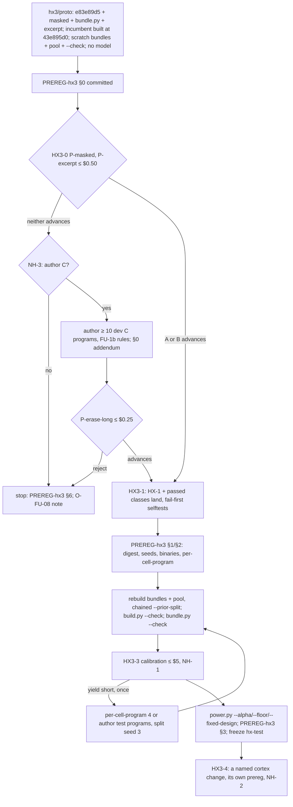

# hx3: a held-out repair set with headroom — DRAFT spec

**Status: DRAFT (after Step 1 review). Not authorized for build.** Nothing in it has been built, and no model has run
on it. The Step 1 review (audit HX3A-1…11, devloop HX3D-1…8) is applied below with `[REVISED: …]` markers; the
dispositions are in "Step 1 review".

Base: `main` 43e895d0. `B` = `crates/axon-cortex/benchmarks`. Why hx3 exists:
- hx2 stopped at HX-0. Its pilots (PREREG-hx2 §6, `B/headroom/PREREG-hx2.md:117-151`) gave caller 20/20, erase 19/20,
  sparse 20/20, 0 false successes. Single-function defects with failing visible tests saturate at haiku-5.5 k = 1.
- O-FU-08 bullet 2 and its 2026-10-28 note (`tasks/opportunities.md:2712`, `:2715`): held-out headroom "still needs
  multi-function or non-test-visible defects".
- O-S1-18 (`:2651-2654`) is RESOLVED. R4 was retired without measurement, and "Whether R4's code is removed is a
  separate change". `crates/axon-cortex/src/feedback.rs` is still in the tree at 43e895d0.
- Main's framing: R4/FU-10 keep-or-remove is blocked on a set with headroom, and NH-R1 unattended repair is held until
  repair quality can be measured. This is a brief statement; no file says it.

Prior design reused: `tasks/hx2-spec.md` (HX-0 to HX-6, with every [REVISED] marker) and PREREG-hx2 §0
(`:10-115`).

Scratch evidence lives in `/var/tmp/r51-tmp/specs-Hx3/`. Every script there is read-only over committed rows,
`hx-build-1`, the hx2 scratch pool and the pinned builder axon. No model and no cortex were called.

| Script | What it does |
|---|---|
| `fu10n.py` → `fu10n.out` | FU-10 route-1 n per band |
| `masked_scan.py` → `masked_scan.out` | axon-only class-A feasibility on the 18 dev programs, with the `hx2/proto` builder from `git archive e83e89d5` |
| `power_<a,b>.json` | `power.py` CLI runs |
| `fu10cost.out` | `power.design_cost` at the fu10n n values |

Timings were taken under load average 31–54 (micode CI, not ours): `fu10n.py` took 7.9 s and `masked_scan.py` 4 min
38 s.

## Step 1 review

Each finding was checked before it was accepted. Re-checks are in `/var/tmp/r51-tmp/specs-Hx3/`:
- `bundle_sim.py`: the HX3-B filler rule, text-only.
- `cat_probe.ax`, `cat_probe2.ax`: one concatenation checked with the pinned builder axon.
- `fu10n_fix.py` → `fu10n_fix.out`: the FU-10 row whose confirm run fell under 0.80.
- The cited lines at 43e895d0.

| Id | Severity | Disposition | Check |
|---|---|---|---|
| HX3A-1 | blocker | accepted | `bundle_sim.py`. The original rule reaches 26,000 characters in dev 0/18 and test 0/39 (largest 10,200 and 14,343). The revised rule reaches it in 18/18 and 39/39, with 5–8 and 3–8 fillers. `fn main` is missing from only 1 dev and 12 test programs. `cat_probe.ax` gives E0002 (duplicate `main`), rc 2. `cat_probe2.ax` (filler `main` stripped) passes `axon check` rc 0 and `axon test` 12/12 |
| HX3A-2 | blocker | accepted | `build.py:128-142`: new programs are shuffled and dealt `round(n/3)` to dev. `recorded_split` (`:151-155`) keeps that split in every chained pool |
| HX3A-3 | major | accepted | `calibrate.py` clusters by `meta[i]["program"]` in `cell_evidence` and `crossfit`, and counts `test_programs` by `program`. `build.cap_per_program` keys on `t["program"]` (`build.py:157-167`) |
| HX3A-4 | major | accepted, resolved differently | `drop_thin` (`build.py:170-172`, applied at `:738`) drops programs with fewer than 3 tasks. Resolution (E12): `drop_thin` keys on the cluster, not on the bundle file |
| HX3A-5 | major | accepted | Re-read: row 2 of the decision table contradicted itself, and the redraw loop had no bound |
| HX3A-6 | major | accepted (merged with HX3D-3) | `run_ab.py:996-998` skips `(id, trial)` rows already in `--out`. `:1013` refuses a run when spent + reserve > cap |
| HX3A-7 | minor | accepted, extended | `false_success` = claimed and not `verified_clean` (`run_ab.py:336-339`). In `masked_scan.out`, 36 of 58 tasks have cut tests. Under a cut_n = 0 restriction, the s/o knobs keep only 10/7 and 9/7, both below 12, so the pre-registered fix merges them into one knob |
| HX3A-8 | minor | accepted | `rank.rs:216` is the doc comment; the field is at `:217`. The claim about field names is reworded |
| HX3A-9 | minor | accepted | Over the cap, the ranker's source is the joined candidate bodies (`rank.rs:666-668`) |
| HX3A-10 | minor | accepted | Recomputed: `o` with a non-OPAQUE j is 22 tasks / 15 programs. The fu10n excerpt-erase row confirmed at 0.794. Stepped to n 352 / 44 programs, it confirms 0.882 ± 0.006 at $46.64 (`fu10n_fix.out`) |
| HX3A-11 | minor | accepted [INFERENCE] | `multi` precedes `masked` in `CLASSES`, and `used` (`build.py:666`, `:681`) gives a shared composite to `multi` first |
| HX3D-1 | major | accepted | `run_ab.py:1060`: a new row launches only while spent + (in flight + 1) × reserve ≤ cap. Per-proposal cost is $0.0196 / 19 = $0.00103. Ceiling: 6 candidates × 8 steps |
| HX3D-2 | major | accepted | `git worktree list` has no `hx3-rec` |
| HX3D-3 | major | accepted (merged with HX3A-6) | as HX3A-6 |
| HX3D-4 | major | accepted | `ai` is an `axon-cortex` feature (`crates/axon-cortex/Cargo.toml:27`). `axon` is a `[[bin]]` of `axon-core` (`crates/axon-core/Cargo.toml:8-10`). The root `Cargo.toml` is a virtual `[workspace]`. `.doc-build/` exists with 85 dirs and none named `hx3-inc` |
| HX3D-5 | minor | accepted | `hx-pool.json` mtime 16:11:44 and `check.log` mtime 16:15:01 put the hx2 `--check` at ≤ 197 s |
| HX3D-6 | minor | accepted [EST] | the scan's 4 min 38 s covered 18 programs with 4–6 composites each and none of the builder checks |
| HX3D-7 | minor | accepted | §0.3's "$0.10" did not match the c-dependent table |
| HX3D-8 | minor | accepted [INFERENCE] | `artifact_admission_gate.sh:27`: `MAX_BYTES` = 2 MiB. The hx2 scratch pool is 2,273,653 bytes |

No finding was rejected: 19 accepted, two of them resolved differently or extended (HX3A-4, HX3A-7).

## 1. Scope

**In scope:**
- HX3-0: pilot gate (P0).
- HX3-A `masked`: a visible fault plus a masked fault in one function.
- HX3-B `excerpt`: the target sits in a file over the generator's view cap, so cross-function facts are out of view.
- HX3-C `erase-long`: re-synthesis of a long body in authored programs.
- HX3-1: landing the builder for the classes that pass.
- HX3-2: PREREG-hx3.
- HX3-3: calibration, power and freeze.
- HX3-4: evaluation of a named cortex change, which needs a human decision.

**Out of scope:**
- Any change to `crates/*/src`. No item changes the repair digest, so there are no g01 rows, no ATTACK markers and no
  receipt regress. The one exception is HX3-4, which measures a change that has its own spec and its own receipt.
- Reopening R4. NH-3 (b) of hx2 is decided (`opportunities.md:2654`). hx3 measures R4 only under NH-2 (b) below.
- hard-once stays unspent.
- New generator models.

**Cross-spec dependencies:**
- **`hx2/proto` e83e89d5 (unmerged).** It holds the helpers hx3 reuses: `caller_pin` / `caller_hidden_ok` (build.py
  `:231-250` at e83e89d5) and `M.typed_default`, `M.return_type`, `M.erase` (mutators.py `:261`, `:277`, `:300` at e83e89d5).
  HX3-1 lands those helpers. It does not land the `erase` and `sparse` classes, because both were rejected at HX-0.
- **`tasks/small-fixes-spec.md` SF-2** changed `cortex locate`, and it is in 43e895d0. The builder uses the pinned
  e052ea81 cortex, and `--check` enforces that sha256, so SF-2 does not move hx3 tasks. It does change the incumbent
  (E7).
- **`tasks/gate-lane-spec.md`:** a `gate.sh --lane` B/-only lane replaces the hand-listed stages in §5 once it lands.

## 2. Priority tiers

| Tier | Items |
|---|---|
| P0 (gate, first node) | HX3-0 pilots of A and B on a scratch pool, using only the 18 recorded dev programs |
| P1 | HX3-2 PREREG-hx3 §0 (it comes before the pilots); HX3-1 for the classes that pass |
| P2 | HX3-C (authoring, then its own pilot), only under NH-3; HX3-3 calibration, power, freeze |
| eval | HX3-4 (needs a human decision on what is measured, and spend approval) |
| deferred / excluded | the table in §HX3-X |

## 3. Findings this spec rests on (re-measured at 43e895d0)

| # | Claim | Evidence |
|---|---|---|
| F1 | hx2 pilots: 60 rows, 59 clean, $0.0713. Clean rows average $0.00100 and 6.6 s, and the dearest clean row cost $0.0062. Mean proposals: caller 2.00, erase 1.60, sparse 1.65; the maximum is 12. The one not-clean row (erase) cost $0.01257 and took 95.5 s | rows in `B/headroom/hx2-pilot-2026-10-28/*/pilot.jsonl`; PREREG-hx2 `:125-137` |
| F2 | Mutations with visible failing tests saturate, whatever the knob. FU-1 dev h55 was 517/546, multi:2 108/108 and multi:3 104/105. Outside caller, knobs moved only the first-proposal rate | `hx2-spec.md:109`, `:298-310`, `:348` |
| F3 | Authored single-body defects that need a fact from outside the body saturate when the whole file is in view. hard-dev in scope was 24/25 for both arms: caller-contract 6/7, documented-constant 8/8, struct-field 5/5, enum-convention 2/2, param-meaning 2/2, sibling-unit 1/1. On two-functions, cortex scored 0/9, by design | `B/hardset/results/hard-dev/{a,b-spectrum}.jsonl` per-`cls` counts; `results/hard-dev/README.md:3-40` |
| F4 | Cost of B's 14 not-clean hard-dev rows: mean $0.0064, max $0.0196; proposals mean 8.1, max 19; wall mean 40.6 s, max 106.1 s | `b-spectrum.jsonl` |
| F5 | The view cap is 24,000 characters (`rank.rs:46`). Over it, the view is an excerpt of the eligible candidates (`rank.rs:655-668`). The generator's eligible list is `[symbol]` (`runner.rs:2493`), so over the cap it sees the target alone, plus the visible failing checks. The ranker's candidates carry only `(name, signature)` (`rank.rs:217`) [REVISED: HX3A-8 — was `:216`, the doc comment] | read |
| F6 | No pool program reaches the cap. The largest of the 57 is 9,300 characters (`semver.ax`, test). The 18 dev programs total 74,972 characters, between 1,108 and 6,951 each. So no FU-1 or hx2 row ever ran with an excerpt | `meta.sources` of `/var/tmp/r51-tmp/hx2-scratch/hx-pool.json` |
| F7 | After an attempt passes the visible checks and fails the hidden check, the generator learns only that it was rejected and what the visible checks said. A visible-clean attempt gets "it compiled but did not fix the problem" | `runner.rs:2148-2153` (the attempt is recorded WITHOUT the hidden check's output); `generate.rs:166` |
| F8 | Neither stop rule cuts short a walk whose attempts pass visible and fail hidden. The structural stop fires only when no function is reached by every failing visible check. The inert rule needs a non-empty baseline and counts only attempts that leave the failing visible set unchanged. The step budget is 8 per candidate, and pass 1 allows 1 proposal per candidate | `earlystop.rs:14-21`, `:86-92`; `bin/cortex.rs:65`, `:1049` |
| F9 | Long bodies are rare. Dev stratum C has 128 functions: 7 of ≥ 16 lines, 1 of ≥ 24 (max 27). Test stratum C has 316: 32 of ≥ 16, 7 of ≥ 24 in 6 programs, 2 of ≥ 30 (max 46) | text scan over `meta.sources` (`erase_knob`'s line count) |
| F10 | Dev tasks in the hx2 scratch pool, as tasks / programs: subtle `argswap-typed` 11/6, `wrong-field` 14/7, `bound` 24/12, `drop-else` 4/3; erase `<8` 22/13, `8-15` 19/11, `>=16` 4/3 | `hx-pool.json` tasks × the `hx-build-1` split |
| F11 | **Class A is feasible on dev.** The scan (Change rule of HX3-A, capped at 2 per program per knob, distinct symbols first) found `o` 32 tasks / 16 programs and `s` 26 / 13; no program was rejected. Leaving out the opaque masked ops (E2), `o` keeps 22 / 15 [REVISED: HX3A-10 — was "≥ 22" over 16]. That is from the first draws only, so it is a lower bound for `o`. Masked ops: bound 13, wrong-field 12, constant 8, operator 6, comparison 6, wrong-var 4, other 9. Visible failing tests: 1 in 37 tasks, 2–6 in 21. 22 tasks need no cut, because the masked fault fails only the pin. With no cut and no OPAQUE op: s 10 / 7, o 9 / 7 [REVISED: HX3A-7] | `python3 -B masked_scan.py` (18 programs, 4–6 composites tried per program) |
| F12 | Erase singles that fail ≥ 2 tests, on dev (the base of HX3-B's `erase` knob): `<8` 36 / 14 programs, `8-15` 28 / 12, `>=16` 5 / 3 | `masked_scan.out` `erase` |
| F13 | Sets: nothing is frozen. `B/protected.py:40` has `"hx-test": None`, and `B/heldout-spent.jsonl` has 0 lines. Every model-run id so far is a dev id (`hx2-spec.md:115`, PREREG-hx2 0.4) | read |
| F14 | `power.py` exposes no `--alpha`, `--floor` or `--fixed-design` (argparse `:228-252`). `Z95` is hard-coded (`:54`), and the floor is a `simulate_power` parameter only (`:120`). hx2 HX-5 planned all three flags; they never landed | read |

## HX3-0 (P0) Pilot gate — first DAG node

**Problem.** Two held-out sets were designed and built before any model ran on them, and both saturated (FU-1:
`hx2-spec.md:123-125`; hx2: PREREG-hx2 §6). hx3 pilots each class on a scratch pool first. It writes no builder code
on main and authors no programs before that.

**Change.**
1. **Prototype.** On scratch branch `hx3/proto`, cut from `main` 43e895d0 and never merged:
   - cherry-pick e83e89d5;
   - add HX3-A `masked`, `bundle.py` and HX3-B `excerpt` (Change lists below), with their fail-first selftests green.

   e83e89d5's erase and sparse classes stay on the prototype. They come after `multi` in `CLASSES`, and masked and
   excerpt are appended after them. A masked broken file has 2 edits, and an excerpt broken file lives only in a bundle
   program. Neither can therefore take a broken file from erase or sparse through `used` (`build.py:666`, `:681` at 43e895d0).
2. **Incumbent (E7).** Build from 43e895d0, the receipt-PASS head for repair digest cb7f132e (82dc8de5), in a
   detached worktree with a target dir no other checkout uses [REVISED: HX3D-4 — there was no command and no target
   dir; `ai` is an `axon-cortex` feature, and the root is a virtual workspace]:
   ```
   git -C /home/cklaus/projects/axon worktree add --detach /var/tmp/r51-tmp/hx3-inc-src 43e895d0
   cd /var/tmp/r51-tmp/hx3-inc-src
   export CARGO_TARGET_DIR=/home/cklaus/projects/axon-lanes/.doc-build/hx3-inc
   nice -n 10 cargo build --locked -p axon-core --bin axon
   nice -n 10 cargo build --locked -p axon-cortex --features ai --bin cortex
   mkdir -p /var/tmp/r51-tmp/hx3-inc-bin && cp $CARGO_TARGET_DIR/debug/{axon,cortex} /var/tmp/r51-tmp/hx3-inc-bin/
   ```
   - Record both sha256 values and the build wall in §0 before any pilot.
   - This is the only cargo build in the spec.
   - `run_ab.py:74` defaults `CORTEX_BIN` to a debug build, so a debug profile matches it.
   - [EST] 10–20 min cold at load 30–55.
3. **Scratch pool, no model.** Run from `hx3/proto`, `B/headroom`:
   ```
   nice -n 10 python3 -B bundle.py --pool /var/tmp/r51-tmp/hx2-scratch/hx-pool.json --seed 1 --min-chars 26000 \
     --out /var/tmp/r51-tmp/hx3-bundles/
   nice -n 10 python3 -B build.py --axon /var/tmp/r51-tmp/hx-bin/axon --cortex /var/tmp/r51-tmp/hx-bin/cortex \
     --out /var/tmp/r51-tmp/hx3-scratch/hx-pool.json --seed 1 --split-seed 1 --stratum all \
     --bundles /var/tmp/r51-tmp/hx3-bundles/manifest.json \
     --prior-split /var/tmp/r51-tmp/hx2-scratch/hx-pool.json --allow-short-split --jobs 16 \
     --report /var/tmp/r51-tmp/hx3-scratch/report.json
   nice -n 10 python3 -B build.py --check /var/tmp/r51-tmp/hx3-scratch/hx-pool.json \
     --axon /var/tmp/r51-tmp/hx-bin/axon --cortex /var/tmp/r51-tmp/hx-bin/cortex --jobs 16
   ```
   - The builder binaries are the `PREREG.md` §1 pins (axon `819e0460…`, cortex `e052ea81…`).
   - `--prior-split` chains from the hx2 scratch pool. That is the last pool a model ran on, and it already deals
     `should_fail_test.ax` → test (PREREG-hx2 `:21`).
   - `--bundles` is new (HX3-B). The hx2 scratch build took 429.1 s at `--jobs 16`. [EST] Expect ≈ 15–25 min
     [REVISED: HX3D-6 — was "≈ 2×"]. Masked runs on all 57 programs with the full builder checks, where the scan's
     4 min 38 s covered 18 programs and skipped those checks. The ≈ 57 bundles of ≥ 26,000 characters each run every
     test once per mutant. The real wall goes in §0.1.
4. **Commit PREREG-hx3 §0 (node N0b)** with the template below. No pilot row may predate this commit.
   - 4a. [REVISED: HX3D-2 — the worktree did not exist and no step created it] Create it first:
     `git -C /home/cklaus/projects/axon worktree add -b hx3/rec /home/cklaus/projects/axon-lanes/hx3-rec 43e895d0`.
   - §0 is committed on `hx3/rec`, never merged before §6, and its sha goes in §0.1.
   - The pilots run at that commit. `--out` and `--spend-root` are relative to that tree, and `run_ab` records its
     `ROOT`/HEAD.
5. **Pilots.** Pilots use only tasks whose `program` is one of the **18 programs recorded `dev` in
   `/var/tmp/r51-tmp/hx-build-1/hx-pool.json` `meta.headroom.split`**. For excerpt, the test is on `target_program`.
   - Ids: `rng = random.Random(3)`, then `ids = rng.sample(sorted(ids), min(20, len(ids)))` over the class's tasks.
   - Redraw from the same rng until the sample covers ≥ min(5, #programs of the class) programs (target programs for
     excerpt), at most 100 draws [REVISED: HX3A-5 — the loop had no bound]. If no draw qualifies, use the first draw
     with the most programs. Record the number of draws.
   - Classes: P-masked (A) and P-excerpt (B). P-erase-long (C) runs only under NH-3.
   - Each class has its own empty spend root. Run from the `hx3/rec` worktree at the §0 commit:
   ```
   cd /home/cklaus/projects/axon-lanes/hx3-rec && \
   AXON_BIN=/var/tmp/r51-tmp/hx3-inc-bin/axon CORTEX_BIN=/var/tmp/r51-tmp/hx3-inc-bin/cortex \
   nice -n 10 python3 crates/axon-cortex/benchmarks/ab/run_ab.py \
     /var/tmp/r51-tmp/hx3-scratch/hx-pool.json --arm B --generator real --transport micode \
     --model claude-haiku-5-5 --trials 1 --parallel 1 --only <IDS> \
     --grade-axon /var/tmp/r51-tmp/hx-bin/axon --ranker openrouter:anthropic/claude-haiku-5.5 \
     --spend-root crates/axon-cortex/benchmarks/headroom/hx3-pilot-<date>/<class>/ \
     --out crates/axon-cortex/benchmarks/headroom/hx3-pilot-<date>/<class>/pilot.jsonl \
     --reserve-usd 0.05 --cap-usd 0.25
   ```
   Anchors at 43e895d0:
   - the corpus positional and `--out` (`run_ab.py:880`, `:897`);
   - `--cap-usd`, `--spend-root`, `--reserve-usd` (`:900-903`);
   - the cap sums every row under the root (`spent`, `:808`);
   - the arms' cortex comes only from `CORTEX_BIN` (`:74`);
   - `RATE_LIMIT_STOP` (`:875`).

   **Reserve** [REVISED: HX3D-1 — was 0.03]: 0.05 ≈ 6 candidates × 8 steps × $0.00103 per proposal (F4 max / 19). So
   no row starts once spent > $0.20.

   Before each run, check that `sha256sum` of the pool, both `hx3-inc-bin` binaries and the grading axon equal §0.

   The spend-root rules [REVISED: HX3A-6 / HX3D-3 — "no `*.jsonl` before each run" blocked both re-runs]:
   - (i) The first run of a class uses `<class>/pilot.jsonl`, in a spend root holding no `*.jsonl`.
   - (ii) A remaining-ids resume reuses `--out <class>/pilot.jsonl` and the same root. `run_ab` skips the rows already
     done (`run_ab.py:996-998`). It runs with `--cap-usd 0.25 + <NH-1 grant>`, because at the plain $0.25 it exits at
     BUDGET CAP (`:1013`).
   - (iii) A re-pilot uses `--out <class>/pilot-s4.jsonl` in the same root, with `--cap-usd 0.25 + <NH-1 grant>`. Its
     ids are drawn under seed 4 over the fixed recipe, and none is skipped for having a seed-3 row.
6. **Triage every not-clean row by hand:**
   - `attempted`, `true_symbol_changed`, `regressed`, and whether the accepted patch edits a callee of g;
   - for masked: did any attempt pass every visible check and fail the hidden one (the masked-only state)?
   - for excerpt: did the excerpt view make attempts fail to compile (unknown name, field or arity)?
   - for every class: is the missing fact inferable from what the generator saw? This is recorded, not decided on.

**Decision per class (committed in §0 before the pilots).** n = the rows run (20, or all eligible tasks when fewer) and
c = the rows with `verified_clean` true.

| Class | Advances iff |
|---|---|
| masked, excerpt, erase-long with ≥ 20 eligible dev tasks | 0 false successes **and** 4 ≤ c ≤ 16 of 20; in addition, the class has at least one eligible knob, meaning ≥ 12 dev tasks from ≥ 3 dev programs (`calibrate.py:51`) |
| a class with 12 ≤ n < 20 eligible dev tasks | the pilot runs all n; advances iff 0 false successes **and** ceil(0.2n) ≤ c ≤ floor(0.8n) [REVISED: HX3A-5 — was a self-contradicting "no pilot … applies"] |
| a class with n < 12, or with no knob of ≥ 12 dev tasks from ≥ 3 programs | does not advance; nothing is run |

**Decided early** [REVISED: HX3D-1 follow-on; this is curtailment, not a new statistic]. A pilot stopped by the cap or by
`RATE_LIMIT_STOP` is decided when its rows already fix the result:
- any false success → handled as a false success;
- ≥ ceil(0.2n) clean and ≥ n − floor(0.8n) not clean, with 0 false successes → advance;
- > floor(0.8n) clean, or > n − ceil(0.2n) not clean → reject.

Otherwise it is not decided.

- **No escalation (E6).** c ∈ {17, 18} rejects. This deviates from hx2's three-way screen (`hx2-spec.md:162`). The
  brief fixes the band at "4-16 of 20". A class near 0.85 also has little headroom: under P(advance) = P(4 ≤
  Bin(20, p) ≤ 16), p = 0.85 advances with probability 0.352.
- **Operating characteristic**, P(advance) = P(4 ≤ Bin(20, p) ≤ 16). This is the same Bin column as `hx2-spec.md:176-177`:

  | p | 0.1 | 0.15 | 0.2 | 0.3 | 0.5 | 0.7 | 0.8 | 0.85 | 0.9 | 0.95 |
  |---|---|---|---|---|---|---|---|---|---|---|
  | P(advance) | 0.133 | 0.352 | 0.589 | 0.893 | 0.997 | 0.893 | 0.589 | 0.352 | 0.133 | 0.016 |

  hx2's resampled OC was within 0.01 of Bin on its mixtures (`hx2-spec.md:176-177`); hx3 has no rows to resample.
- **A false success.** The recipe admits a workaround. The class is fixed and re-piloted once, under pilot seed 4
  recorded in §0 first, inside the class's NH-1 grant (spend-root rule iii). A second false success parks the class in
  §HX3-X.
  - Masked's fix is pre-registered [REVISED: HX3A-7]. If the final of a masked false success fails only cut tests, the
    re-pilot restricts masked to cut_n = 0 tasks under one knob `c0`. On F11 the counts are s 10 / 7 and o 9 / 7, each
    under 12, and together 19. So the fix does not depend on the rows.
- **A pilot stopped early** and not decided (above) is **not decided**. After review, its remaining ids run once under
  the same seed (spend-root rule ii). Any spend beyond $0.25 needs NH-1.
- **Neither A nor B advances:** stop A and B. Record the rows and the verdict in PREREG-hx3 §6, and go to NH-3 (class
  C).
- **A or B advances:** HX3-1.

**Expected cost per pilot** [REVISED: HX3D-7 / HX3D-1 — was one column at $0.0093]. Each pilot is 20 rows, with clean
rows at $0.00100 (F1, n = 59). Not-clean rows are costed at x:
- $0.0064 and $0.0196: F4's mean and max;
- $0.0093: `hx2-spec.md:119` F11, n = 3;
- $0.049: the 48-proposal ceiling.

"stop" means no row starts once spent > $0.20.

| c | x = $0.0064 | x = $0.0093 | x = $0.0196 | x = $0.049 |
|---|---|---|---|---|
| 16 | $0.042 | $0.053 | $0.094 | $0.21, stop |
| 10 | $0.074 | $0.103 | $0.206, stop | stop |
| 4 | $0.106 | $0.153 | stop | stop |
| 0 | $0.128 | $0.186 | stop | stop |

- At the spec's basis of $0.0093, every c completes inside $0.20.
- At F4's max per failure, a c ≤ 10 pilot stops. It is still decided if its rows fix the result ("Decided early").
- At most $0.05 can overshoot $0.25: the cap is checked only when a row starts.
- Wall per pilot: 2.2 min with every row clean. At c = 0 it is 13.5 min at F4's mean of 40.6 s per row, 25 min at
  hx2 F11's 76.1 s, and 35 min at F4's max.
- **Overrun rule per class**, defined after the run [REVISED: HX3D-7]: an overrun iff spend > 2 · (c · $0.0010 +
  (20 − c) · $0.0093), or wall > 2 · (c · 6.6 s + (20 − c) · 76 s).

## HX3-A `masked` — the visible fault and the masked fault in one function

**Construction (mutator; existing programs, strata C and D).** Take two disjoint singles of g (`M.disjoint`; the
singles of `singles_of`, e83e89d5 `:449-460`):
- fault i is the visible fault;
- fault j is the masked fault, and its operator is not in OPAQUE = {`constant`, `float-constant`, `string-typo`} (E2).

Define:
- F_i, F_j = the failing tests of each single mutant (`eval_single`'s `failing`);
- F_ij = the failing tests of the composite (`M.compose`);
- **hidden** h = `caller_pin(direct(g), F_j, calls, reach)`, and h must be in F_ij;
- **cut** C = F_j − {h};
- **visible** V = F_ij − F_j, and |V| must be ≥ 1. The task's `visible` is V[0], and the other tests in V stay in the
  file.

A new pure helper `masked_split(f_i, f_j, f_ij, direct, calls, reach) -> (visible, hidden, cut) | None` computes this.
In `finish`, the **masking witness** must hold:
- on the composite with C cut, the failing set is exactly V ∪ {h} (sorted equality, as sparse's at e83e89d5 `:714`);
- on the fault-j-only file with C cut, the failing set is exactly {h}.

The witness is the class's defining property. An attempt that repairs only fault i passes every visible test and fails
the hidden one. The usual FU-1a checks then apply:
- `task_from_broken(visible = V[0], hidden = h)`;
- the blocks can be cut;
- restoring the pristine body passes every pristine test (`graded_view`);
- `cortex locate` ranks g ≤ 6 and lists it in `reached_by_all`.

Builder details:
- **Knob:** `s` when fault j's operator is in `SUBTLE_OPS`, else `o`.
- **Order:** `ops`/`edits` are stored in [i, j] order, and `how` is `masked:<how_i> ; <how_j>`.
- **Candidates:** ordered pairs per fn, shuffled with seed `{seed}:{file}:{fn}:masked`, at most `--multi-tries` per fn.
  The prefilter is F_j has a pin and F_i − F_j ≠ ∅.
- **`rebuild`:** masked takes exactly 2 edits, with `ops[1] ∉ OPAQUE`.
- **`check`:** recomputes the pin and the split on the rebuilt files, and refuses any mismatch. This is the HX-1
  pattern, e83e89d5 `caller_hidden_ok`.
- **Task fields:** `cut_tests`, `masked_op`.

**Why the visible tests do not reveal fault j.** By construction, every test that fails with fault j alone is either
the sealed hidden test or cut from the model's file. After fault i is fixed, no visible test fails (the witness). Then:
- cortex records the attempt as rejected and passes on only the visible report (F7);
- the inert rule does not stop the walk (F8);
- the generator keeps proposing for g, with only the code, the names and the comments to find fault j.

**Why the hidden check stays honest (O-FU-08 a).**
- The hidden test is a direct test of g, with HX-1's call-path rule: no block calling a caller of g. So no edit to a
  caller of g can change the hidden test's calls into g.
- Grading runs every pristine test, cut ones included (`run_ab.py:279-280`). A callee-of-g workaround that passes h is
  caught there as `regressed` (`hx2-spec.md:268-270`).
- [REVISED: HX3A-7] A repair that fixes only fault i cannot become a false success: h still fails, so cortex makes no
  claim. A *partial* fix of fault j is different. If it passes h but fails a cut test, cortex never ran that test, so
  it claims; grading then gives `verified_clean` false. `false_success` (`run_ab.py:336-339`) counts that row as a false
  success. 36 of the 58 scan tasks have cut tests (F11). The pre-registered fix is HX3-0's `c0` restriction.
- The cut tests are gone from the broken file. The hidden check is sealed from the spectrum, the view and the feedback
  (`hx2-spec.md:118` F10), and the leak guard refuses a view that names it (`rank.rs:32-34`).
- OPAQUE is excluded because a changed literal with no visible test cannot be inferred from the file: the task would
  measure guessing, not repair.

**What it can measure.** It responds to anything that changes what happens after an attempt is rejected while every
visible check passes: the message, the walk and step budget, or a "visible passes, a hidden check refused"
instruction. [INFERENCE] R4's typed feedback has little to carry here. The masked-only state has no failing visible
check, so its typed feedback holds only the tally note (`feedback.rs:33-35`).

**Expected band [INFERENCE]: 0.3–0.7.**
- Risk upward: the model fixes both faults in its first proposal when fault j reads as wrong. Bound and wrong-field
  are 25 of the 58 scan tasks (F11). With both faults visible, multi:2 is 108/108.
- Risk downward: fault j is not inferable even outside OPAQUE, for example an `operator` swap in an unexplained formula.

**Eligible cells** (`calibrate.py:51`, ≥ 12 dev tasks from ≥ 3 dev programs): (masked, s) and (masked, o). F11 is an
upper bound on dev, because it ran none of the locate, cuttable, restore or witness checks, but both are eligible with
room: s 26/13; o 22/15 after OPAQUE [REVISED: HX3A-10].

[REVISED: HX3A-11, INFERENCE] The scan is an upper bound in one more way. `multi` precedes `masked` in `CLASSES`, so
where multi:2 draws the same 2-edit composite, `used` (`build.py:666`, `:681`) gives the broken file to `multi`.

Test side [INFERENCE from the dev ratio of 58 / 18]: ≈ 125 tasks from the 39 test programs, capped at 2 × 2 × 39 = 156.

**Fail-first tests** (`B/headroom/selftest.py`, binary-free):
- `test_masked_split`:
  - `masked_split(["v","h"], ["h","c"], ["v","h","c"], ["h"], {}, set()) == ("v", "h", ["c"])`;
  - None when F_ij − F_j is empty;
  - None when no direct test of g fails on F_j;
  - None when the pin is not in F_ij.

  Fails before with `AttributeError`.
- `test_masked_rebuild`: `rebuild` refuses masked with 1 or 3 edits, refuses an OPAQUE masked op, and refuses 2-edit
  masked edits under another class.

## HX3-B `excerpt` — the target in a file over the view cap

**Construction.** This class is mechanical: per-target bundles of existing programs. A new file, `B/headroom/bundle.py`,
builds one bundle per program P (C or D, either split side):
- The bundle is P's source followed by filler programs **from P's recorded split side only**.
- Fillers come in `random.Random(f"{seed}:{P}:bundle")` order. [REVISED: HX3A-1 — the earlier rule, which skipped a
  filler on any collision, built 0 of 57 bundles (`bundle_sim.py`), because nearly every program defines `fn main`.]
  - Each filler is added with its top-level `fn main` removed.
  - Each top-level fn whose text equals an already-included definition is also removed (`load_text` is one text in 6
    dev and 18 test programs).
  - A filler is skipped only if a remaining top-level name (fn, test, type, enum, struct, trait) collides with the
    bundle so far. Remaining collisions seen on dev: `area`, `reachable_count`, `sample`, `test_reachable_count`,
    `Shape` (sum_types / traits_demo).
  - P's own source is never edited.
  - Simulated reach (text-only): dev 18/18 at 5–8 fillers (max 31,139 characters); test 39/39 at 3–8 fillers.
- Fillers are added until the bundle is at least `--min-chars` (26,000) long.
- Output: `<out>/<side>/<P stem>.ax` plus `manifest.json` (P, fillers in order, sha256 of each input and of the bundle).
- `--check` regenerates every bundle and compares the sha256.
- `Program()` must accept the bundle: `axon check` rc 0 and every test passes.

**Builder (`build.py --bundles MANIFEST`).**
- A bundle program has stratum `X` and builds only class `excerpt`. Non-bundle programs never build `excerpt`.
- Target functions are only those inside P's segment. The task's `program` is the bundle, and its `target_program` is
  P.
  - [REVISED: HX3A-2] A bundle program's split is **forced to P's recorded split**, never dealt by `split_programs`.
    Otherwise `build.py:128-142` deals new paths by a fresh shuffle, and `recorded_split` (`:151-155`) would make that
    permanent. `--check` refuses a bundle task whose `split` ≠ the split of its `target_program`.
  - [REVISED: HX3A-3 — was "P is the cluster unit in `power.py` (`programs_for`, `:109`)", which is synthetic] The
    cluster is `cluster(t) = t.get("target_program", t["program"])`. Masked tasks on P and excerpt tasks on
    bundle(P) are one cluster. Every per-program use keys on it: `calibrate.py` `cell_evidence` programs, `crossfit`
    folds and `test_programs`; `build.cap_per_program`; `drop_thin` (E12). So `calibrate.py` is no longer unchanged
    (HX3-1).
  - [REVISED: HX3A-4] `drop_thin` (`build.py:170-172`, `:738`) counts tasks per cluster, not per bundle file. A
    bundle alone has ≤ 2 tasks per knob, and a stratum-D bundle builds only `xfn`, so per file every D bundle would be
    dropped. Per cluster, a D target survives when P has ≥ 1 other task.
- **Knobs:**
  - `xfn`: one `argswap-typed` or `wrong-field` single. The fix needs a callee's parameter order or a struct's field
    set, and both are defined outside g.
  - `erase`: `M.erase` of a fn when P is stratum C. Re-synthesis needs helper names, types and constants that are out
    of view. Stratum D is excluded because its public bodies may be memorized (`hx2-spec.md:325`).
- **Hidden and visible:**
  - hidden = `caller_pin(...)`; no pin rejects the task (no last-failing fallback; see hx2 HXA#11);
  - visible = the first other failing test;
  - the other failing tests stay visible.
- **Excerpt witness:** len(broken − the hidden block) > 24,000 characters. That is sufficient for the full view to
  overflow, because `fits` adds `CHAT_SYSTEM.len()` and the prompt headers (`rank.rs:655-658`). The builder refuses
  the task otherwise and records `view: "excerpt"`.

**Why the visible tests do not reveal the fix.** The visible tests do fail, and they point at g. The fact the repair
needs is mostly outside the excerpt, though [REVISED: HX3A-8 — was "is outside the excerpt"]. The excerpt is the
target function alone (F5): callee signatures and type definitions are never shown (`rank.rs:217`). The visible test
bodies (struct literals) and g's own field accesses may still show field names [INFERENCE], so `wrong-field` is
partly inferable. With the full file in view, the same defects saturate: subtle cells were 0.99–1.0 raw on FU-1
dev (`opportunities.md:2710`), and hard-dev struct-field was 5/5 and sibling-unit 1/1 (F3). The excerpt removes
exactly that context. This is the cross-function invariant the brief names (call order, field set), made invisible.

**Why the hidden check stays honest.**
- The pin rule is the same as A's, and grading runs every pristine test of the bundle, fillers' tests included.
- A bundle never mixes split sides, so no test-side program text enters a dev task, and the reverse. Its split
  label is forced to P's [REVISED: HX3A-2].
- The fillers' tests pass on the pristine bundle, and the restore check covers them.
- [INFERENCE] Unrelated fillers make localization easier than in a real large file, because the spectrum skips
  unreached functions. So excerpt rates are an upper bound for real large files. The claim is worded "files over the
  view cap, built by concatenation" (NH-4).

**What it can measure.** Changes to the generator's view, such as callee signatures, the type definitions g uses, or a
larger cap. Also [INFERENCE] R4-style typed diagnostics, since excerpt erase attempts that guess a helper name fail to
compile with a typed error.

**Expected band [INFERENCE].**
- `xfn`: 0.3–0.7.
- `erase`: 0.1–0.5 (re-synthesis without types). The lower end falls under the calibration band, so it is a separate
  knob.

**Eligible cells.**
- `xfn` dev ≤ 25 tasks / ≤ 13 programs (F10, as subtle cells in full-size files; the bundle cap is 2 per P).
- `erase` dev ≤ 28 (2 × 14 programs, F12).
- These are the counts before the builder checks. With `drop_thin` per cluster (E12), no D target is lost for being
  thin alone [REVISED: HX3A-4]. Both knobs reach the 12 / 3 floor only if the bundle build keeps ≥ 12 per knob. N0
  measures this; it is unverified.

**Fail-first tests:**
- `test_bundle`, which is pure:
  - side-only fillers;
  - `fn main` stripped and identical fns deduplicated, and a remaining collision skips the filler [REVISED: HX3A-1];
  - deterministic order for a seed;
  - stops at `--min-chars`;
  - `--check` detects a changed filler.
- `test_excerpt_rules`:
  - `rebuild` refuses `excerpt` on a non-`X` program, and any other class on an `X` program;
  - an `xfn` op outside {argswap-typed, wrong-field} is refused;
  - `erase` is refused for a stratum-D target;
  - the witness refuses a 23,999-character broken-minus-hidden file;
  - [REVISED: HX3A-2] a bundle task's `split` equals its target program's recorded split, even when the bundle path
    is new to the prior split; `--check` refuses a mismatch;
  - [REVISED: HX3A-3] `cluster(t)` returns `target_program` when present; `cap_per_program` and `drop_thin` count
    masked-on-P plus excerpt-on-bundle(P) as one cluster.

## HX3-C `erase-long` — re-synthesis of a long body (authored programs)

**Construction.** `M.erase` (e83e89d5) on stratum-C functions whose pristine span is ≥ 24 lines (knob `>=24`, one
cell).
- Hidden = `caller_pin`, and no pin rejects. Visible = the first other failing test.
- The pool cannot supply it. Dev has 1 function ≥ 24 lines and test 7 (F9). So C needs **≥ 10 new dev programs**,
  each with ≥ 2 functions of 24–60 lines, authored under FU-1b's rules (`followup-spec.md:99-105`):
  - neutral problem statements;
  - the author never sees benchmark sources, prompts or results;
  - tests are committed before any defect is derived.
- Split: these programs are dealt **dev** by construction, and that is recorded in PREREG-hx3 §0 before any model run.
  Test-side authoring (split seed 3) happens only at HX3-3 N5a.

**Why the visible tests underdetermine it [INFERENCE].** The visible failing test exercises one path. The hidden pin
exercises another. A ≥ 24-line body has several independent paths, and the erased body gives no hint of any of them.

**Honesty.** It uses the A/B pin rule and the FU-1a restore and locate checks.

**Expected band [INFERENCE]: 0.5–0.9.** This is the weakest prior of the three. hx2 erase was 19/20 overall and
`>=16` 1/1. FU-1 symbol lines `≥16` were 57/57.

**Eligible cell:** (erase-long, >=24) needs ≥ 12 dev tasks from ≥ 3 programs, so ≥ 10 authored programs at ≤ 2
tasks each.

**Fail-first test:** `test_erase_long`. The knob comes from the span line count, and `rebuild` refuses `erase-long` on
a span of < 24 lines.

**Sequencing:** only under NH-3.

## HX3-X Excluded or deferred (none silently dropped)

| Candidate | Disposition | Reason |
|---|---|---|
| Visible tests do not fail | excluded | cortex exits `no_target` (`bin/cortex.rs:876`). The rate is 0 by construction |
| Two-function / multi-site across functions | excluded | cortex repairs one body per episode. hard-dev two-functions: B 0/9 (F3). The incumbent rate of 0 is outside the band. It becomes measurable only after a multi-body cortex change, in its own spec |
| Multi-file | excluded | `run_ab` writes only `task["file"]` (`run_ab.py:693`); `hx2-spec.md:345` |
| erase, sparse, caller in full view | excluded | 19/20, 20/20, 20/20 (PREREG-hx2 §6) |
| multi:k in full view | excluded | 108/108, 104/105 (F2) |
| Cross-function invariant in full view (caller, sibling) | excluded | With the pin, caller was 20/20. hard-dev caller-contract 6/7, sibling-unit 1/1. The in-band form is HX3-B `xfn` |
| Authored outside-context defects in full view | excluded | hard-dev in scope 24/25 (F3) |
| Property-style hidden check with one visible example | excluded [INFERENCE] | sparse already shows one failing visible test and was 20/20 |
| OPAQUE masked ops | excluded (E2) | not inferable from the file; F11 has 10 such tasks among the first `o` draws |
| masked × excerpt (masked fault in a bundle) | deferred | escalation only if A saturates (c ≥ 17) and B is eligible. It stacks both information gaps |
| Changing the incumbent's configuration (`--budget`, `--max-proposals`) | excluded | it changes what is measured (`hx2-spec.md:349`) |
| Larger authored programs over the cap (instead of bundles) | deferred (NH-4) | needs ~24k-character programs, about 2.6× the largest pool program (F6). Only if an excerpt cell is kept and the yield falls short |

## HX3-1 (P1) Builder landing — classes that passed HX3-0 only

`B/headroom/build.py` on main (anchors at 43e895d0):
- `CLASSES` (`:107`), `candidates` (`:394`), `rebuild` (`:506`), `finish` (`:568`), `build_program` (`:651`), `check`
  (`:813`);
- the `mutators.py` helpers.

**What lands:**
- HX-1 from e83e89d5 (`caller_pin`, `caller_hidden_ok`, `Program.pin_inputs`, `--check` recompute) and its two
  selftests. hx2 left HX-1 unmerged (`opportunities.md:2715`).
- `M.erase` / `M.return_type` / `M.typed_default`, if B-erase or C passed.
- The passed classes' code and fail-first tests, as in each class section.
- [REVISED: HX3A-3] `calibrate.py` and `build.cap_per_program` / `drop_thin` key on `cluster(t)`. The fail-first is
  `test_calibrate_cluster` (`B/headroom/selftest.py`): two tasks with one `target_program` and different `program`
  count as one program in `cell_evidence`, `crossfit` and `test_programs`. It fails before, because they count 2.
- `bundle.py` plus the committed bundles under `B/headroom/bundles/{dev,test}/`, if B passed. `build.py --check` reads
  program files, so the bundles must exist in the tree.

**What does not land:** e83e89d5's `erase` and `sparse` classes. Leaving them off changes no masked or excerpt task,
because neither class can share a broken file with them (HX3-0 step 1). `multi` can share one with masked
[REVISED: HX3A-11], and it keeps priority.

**Acceptance:**
- `selftest.py` passes, with every new test red before.
- `build.py --check` on the N4 pool reports 0 failures.
- `bundle.py --check` reports 0 differences.

## HX3-2 (P1) PREREG-hx3

New file `B/headroom/PREREG-hx3.md`. §0 is written at N0b, §1/§2 at N3, and §6 after the pilots. `PREREG-hx2.md` gets
one appended pointer line.

Set names stay `hx-dev`/`hx-test` (F13: nothing frozen, so no code changes).

**§0 template** (every `<…>` is filled in and committed before the first pilot row):

```
## 0. HX3-0 pilot gate (node N0b)
### 0.1 What is piloted
| field | value |
|---|---|
| prototype | branch `hx3/proto` commit <sha> (cut from main 43e895d0 + e83e89d5): masked, bundle.py, excerpt; selftest.py green (<k> new tests, red before) |
| bundles | `/var/tmp/r51-tmp/hx3-bundles/manifest.json` sha256 <…>; <n_dev> dev / <n_test> test bundles; min-chars 26000; bundle seed 1 |
| scratch pool | `/var/tmp/r51-tmp/hx3-scratch/hx-pool.json` sha256 <…>; <tasks> tasks, <programs> programs; split_ok <…>; build wall <s>; `build.py --check`: <tasks>, 0 failures |
| scratch build commands | the three commands of HX3-0 step 3, verbatim |
| builder binaries | axon 819e0460…ddda, cortex e052ea81…433a (`/var/tmp/r51-tmp/hx-bin/`) |
| builder-input digest | <…> |
| split | chained from `/var/tmp/r51-tmp/hx2-scratch/hx-pool.json`; programs new to the split: <list or none> |
| incumbent (arm B) | main 43e895d0: `cargo build --locked -p axon-cortex --features ai --bin cortex` in `/var/tmp/r51-tmp/hx3-inc-src`, `CARGO_TARGET_DIR=.doc-build/hx3-inc`, sha256 <…>, build wall <…>, at `/var/tmp/r51-tmp/hx3-inc-bin/cortex` [REVISED: HX3D-4] |
| bundle split | every bundle task's `split` = its target program's recorded split: <checked, 0 mismatches> [REVISED: HX3A-2] |
| rec worktree | `/home/cklaus/projects/axon-lanes/hx3-rec`, branch `hx3/rec`, §0 commit <sha> [REVISED: HX3D-2] |
| arms' axon (AXON_BIN) | same build, sha256 <…> |
| grading axon | `/var/tmp/r51-tmp/hx-bin/axon` (819e0460…) |
| model, ranker, k | claude-haiku-5-5 over micode (driver sha256 <…>), ranker openrouter:anthropic/claude-haiku-5.5, k = 1, --parallel 1 |
Dev tasks on the 18 recorded dev programs (excerpt: by target_program): <per class counts>.
### 0.2 Eligible-cell rule (checked before the pilots)
| class | dev tasks / programs | knob: tasks / programs | eligible knobs |
| masked | <…> | s: <…>; o: <…> | <…> |
| excerpt | <…> | xfn: <…>; erase: <…> | <…> |
### 0.3 Decision per class
the HX3-0 table verbatim [REVISED: HX3A-5 / HX3A-7 / HX3D-7]: 0 false successes and 4 <= c <= 16 of 20 (12 <= n < 20: ceil(0.2n)..floor(0.8n) over all n; n < 12: not run); no escalation; decided-early rule; re-pilot seed 4, masked `c0` fix; not-decided rule; spend-root rules i-iii; stop rule; triage list; per-knob counts reported; overrun iff spend > 2(c*$0.0010 + (20-c)*$0.0093) or wall > 2(c*6.6 s + (20-c)*76 s)
### 0.4 Ids (pilot seed 3)
rng = random.Random(3); ids = rng.sample(sorted(ids), min(20, n)), redrawn until >= min(5, #programs) (target) programs, at most 100 draws, else the first draw with the most programs [REVISED: HX3A-5]. Draws: masked <n>, excerpt <n>.
| class | pilot ids (20) | programs | knobs |
### 0.5 Pilot commands
the HX3-0 step 5 command (--reserve-usd 0.05 --cap-usd 0.25), with (<class>, <IDS>) = (masked, …), (excerpt, …); the pre-run sha256 check and spend-root rule (i).
```

**Contamination.**

| Material | Reuse? | Why |
|---|---|---|
| 39 test-split programs (38 + `should_fail_test.ax`) | test | No model has run on them (F13). This spec's scans of them were text-only: function line counts (F9) and character sizes (F6). No outcome on them exists |
| 18 dev-split programs | dev only, forever | Models ran on them. Every HX3-0 pilot draws only from them, and dev bundles hold only dev text |
| Bundles | the side of P | Fillers come from P's side only, and the bundle's split label is forced to P's (HX3-B) [REVISED: HX3A-2] |
| Authored C programs (NH-3) | dev | Dealt dev by construction and recorded before any model run. Test-side authoring uses split seed 3 |
| hx2 rows and FU-1 rows | not reusable | different classes; a different incumbent (E7) |
| Designer exposure | stated | Class designs used dev outcomes (F1–F4) and the axon-only dev scan (F11, F12). No test outcome exists |

**Seeds.**
- Mutation 1; bundle 1; split 1, inherited; split 3 for test programs authored at N5a; cross-fit 1; cap draw 1.
- HX3-0 pilot 3; re-pilot 4.
- Each is recorded before the run it governs.

**Thresholds (unchanged, `calibrate.py:50-54`):**
- kept cell: shrunk rate in [0.3, 0.7];
- eligible cell: ≥ 12 dev tasks from ≥ 3 programs;
- test set: ≥ 150 tasks from ≥ 20 programs;
- predicted test rate in [0.2, 0.8];
- h45 informative band [0.1, 0.9].

## HX3-3 (P2) Calibration, power, freeze

- **Calibration.** Run `calibrate.py`, unchanged except for the `cluster(t)` key (HX3-1) [REVISED: HX3A-3 — was
  "unchanged"]:
  - h55 k = 3 on every dev task of the passed classes;
  - h45 k = 1 on the kept dev cells;
  - the E7 incumbent;
  - cap $5 per pass in a fresh spend root `hx3-cal-<date>/`, with at most one N5a re-pass (≤ $10 cumulative, NH).

  Any false success in a calibration row removes that class's cells before power is computed (hx2 HXD#16).
- **Power tool.** Add `--alpha`, `--floor` and `--fixed-design n,k` to `power.py` (F14; hx2 HXA#10 design). The
  fail-first is the one hx2 specified (`hx2-spec.md:404-407`): on the `test_power` fixture, power(α = 0.025) <
  power(α = 0.05), and `--floor -1` power ≥ floor-0.05 power. Report `--sims 5000` with its Monte Carlo SE.
- **Planning numbers** ([EST]: synthetic rates, replaced by the real rows).

  The tasks needed at σ_g = 1.0, k = 3, 3 arms, h45 k₂ = 1, with costs h55 $0.0010 / $0.0093 and h45 $0.0044 /
  $0.0224 (hx2's h45 basis, `hx2-spec.md:422`):

  | Class at band (shape → posterior mean) | FU-1h design: MDE 0.10, α 0.05, floor 0.05 (`power.py` CLI) | FU-10 route 1: MDE 0.07, α 0.025, no floor (`fu10n.py`) |
  |---|---|---|
  | excerpt-erase ≈ 0.15 (Beta(0.2, 0.8) → 0.143) | 112 / 20 programs, $14.84 | 352 / 44 programs, $46.64 (confirm 0.882 ± 0.006, `fu10n_fix.out`) [REVISED: HX3A-10 — was 288 / 36, $38.16, whose confirm was 0.794 < 0.80] |
  | excerpt-xfn ≈ 0.35 (Beta(1.6, 2.4) → 0.36; Beta(0.4, 0.6) → 0.365) | 304 / 38, $31.77 | 736 / 92, $76.96 (concentration 4); 544 / 68, $56.53 (concentration 1) |
  | masked ≈ 0.55 (Beta(2.2, 1.8) → 0.54; Beta(0.55, 0.45) → 0.554) | 304 / 38, $24.76 | 736 / 92, $59.91 (c4); 480 / 60, $38.21 (c1) |
  | erase-long ≈ 0.75 (Beta(2.8, 1.2) → 0.741; Beta(0.7, 0.3) → 0.744) | 176 / 22, $9.77 | 544 / 68, $30.21 (c4); 288 / 36, $15.88 (c1) |

  - **Commands.** The FU-1h column: `python3 power.py --synthetic A,B,60,3 --cost-success 0.0010 --cost-failure
    0.0093 --cost2-success 0.0044 --cost2-failure 0.0224 --k2 1 --arms 3 --cap-usd 60 --seed 1 --n-grid 80:801:32
    --ks 3` (outputs `power_<A,B>.json`). The FU-10 column: `python3 fu10n.py` (Z patched to 1.96, floor −9, 600
    sims to search and 3000 to confirm, n-grid 96:2001:64). Its cost is `power.design_cost` (`fu10cost.out`).
  - **h55 only.** The FU-10 n values are for h55 alone. Route 1 also needs h45's Δ̂₂ ≥ −5 points, which passes ≈ 0.81
    of the time at k₂ = 1 (`PREREG.md:132-134`). So the real n is larger [INFERENCE].
  - **Spread across σ_g.** At σ_g = 0, the FU-10 n is 96–288 across the bands (`fu10n.out`).
  - **Which concentration.** FU-1 per-task outcomes were near-deterministic (`hx2-spec.md:111` F3). So the
    concentration-1 (bimodal) rows are the likelier ones [INFERENCE].
- **Yield against need.**
  - The cap is 2 per (class, knob) per program. With 2 knobs, one class gives ≤ 4 tasks per program, ≤ 156 from the 39
    test programs.
  - FU-1h at a mid band needs 176–304 tasks from 22–38 programs. That takes **both A and B kept**, or
    `--per-cell-program 4` (a recipe change recorded in §1 before N4), or N5a authoring.
  - FU-10 at MDE 0.07 needs 288–736 tasks from 36–92 programs. Beyond the 39 programs, that is ≈ 0–53 new test
    programs (NH-5).
  - Program counts are clusters (`cluster(t)`), so masked-on-P and excerpt-on-bundle(P) count once [REVISED: HX3A-3].
    Keeping "both A and B" adds tasks per cluster, not clusters. The per-cluster test cap stays 8 (2 per cell × 4
    cells).
- **Freeze.** As FU-1c step 5: commit `hx-test.json`, pin its sha in `PROTECTED_SETS` (`B/protected.py:40`), and fix k
    per model first.
  - [REVISED: HX3D-8, INFERENCE] Check `hx-test.json` against artifact admission's 2 MiB limit first
    (`scripts/artifact_admission_gate.sh:27`, `MAX_BYTES`). The hx2 scratch pool was 2,273,653 bytes, and 39 test
    bundles add ≈ 1 MB of source.
  - If it is over the limit, the bundle texts live only under `B/headroom/bundles/test/` and `hx-test.json` refers to
    them by path and sha256. There is no allowlist entry.

## HX3-4 (eval) What hx3 measures

A frozen hx3 is a measurement set. It is not itself a verdict. Each cortex change measured on it gets its own
pre-registration:
- arms: T0 = main at the freeze (the E7 incumbent if nothing changed), T1 = the candidate;
- three arms only if an ablation is named;
- the k and design chosen by `power.py` on hx3 rows, fixed before the run;
- a REMOVE/KEEP or ship rule that states MDE₈₀.

Under the §1 rule, a repair-digest change needs its paid receipt committed before the full gate. Which change goes
first is NH-2.

## 5. Gates and cost budget

| Gate | One run | Re-run trigger | Skip rule |
|---|---|---|---|
| `selftest.py` + the FU-1e gate stage + `check_docs` + `scorecard selftest` | seconds, CPU | any B/ commit | none |
| `bundle.py --check` | ≈ 1 min [EST] (one `axon check` + test per bundle, ≈ 57 bundles) | bundle inputs change | no input change |
| `build.py --check` on the hx3 pool | ≈ 4–8 min [EST]: hx2's `--check` of 868 tasks took ≤ 197 s, scaled to ≈ 1,300 tasks, and bundle tests are heavier [REVISED: HX3D-5 — was ≈ 15 min, from the build wall] | builder inputs change | no builder-input change |
| incumbent build (N0) | the HX3-0 step 2 commands (`-p axon-core --bin axon`; `-p axon-cortex --features ai --bin cortex`; own target dir), 10–20 min cold under load [EST] [REVISED: HX3D-4] | once | done once, sha pinned |
| full `./scripts/gate.sh` | 32–39 min (`hx2-spec.md:462`) | a commit after it | the `gate.sh --lane` B/-only lane replaces it once gate-lane-spec lands |
| `cargo test -p axon-cortex --features ai` | 10–15 min | a `crates/axon-cortex/src` change | skipped: no item changes it |
| receipt regress (paid) | ≈ $0.14, cap $1 | a repair-digest change | not triggered by hx3; HX3-4 changes bring their own |

| Paid run | Cap | Expected | Wall | Scarce resource | Basis |
|---|---|---|---|---|---|
| HX3-0 P-masked, P-excerpt (h55 k = 1, 20 each) | $0.25 each (reserve $0.05, so no row starts once spent > $0.20; overshoot ≤ $0.05) [REVISED: HX3D-1], $0.50 total | ≈ $0.05–0.19 each at x = $0.0093 (HX3-0 cost table) | 2.2–35 min per 20 at `--parallel 1` [EST] [REVISED: HX3D-7] | OAuth rate limit (`RATE_LIMIT_STOP` 3); the OpenRouter ranker, whose spend is recorded as $0 on rows (PREREG-hx2 `:131-132`). Over the cap, ranker prompts hold only the candidate bodies (`rank.rs:666-668`) [REVISED: HX3A-9 — was "run to ≈ 24,000 characters"] | F1 / F4: success $0.00100 / 6.6 s, failure $0.0093, max $0.0196 / 106 s; 48-proposal ceiling ≈ $0.049 |
| HX3-0 P-erase-long (NH-3) | $0.25 | as above | as above | as above, plus agent authoring time for ≥ 10 programs (no harness spend) | as above |
| HX3-3 calibration | $5 per pass, ≤ $10 cumulative (NH-1) | ≈ $2.2–2.6 [EST] [REVISED: HX3D corrected table — was ≤ 100 tasks, $1.2–3.0]: ≤ 111 dev tasks × 3 × $0.00515 ≈ $1.71, plus h45 ≈ $0.0134 per task on kept cells | 1–2 h [EST] | as above | power.py cost model |
| HX3-4 eval | per change, NH | $10–32 (FU-1h design) or $16–77 (FU-10-grade) [EST], from the table in HX3-3. Both rest on the $0.0093 failure cost, which masked failures may exceed (HX3D-1) [INFERENCE] | 5–10 h [EST] | as above | `power.py`, `fu10cost.out`, `fu10n_fix.out` |
| hard-once | $0 | — | — | — | unspent |

**Overrun rule.** Any paid run above 2× its expected cost or wall stops for review before the next paid run
(`build-loop-followup.md:99`). For HX3-0, "expected" is the per-class formula of HX3-0, evaluated at the observed c
[REVISED: HX3D-7].

## 6. Sequencing



## 7. Open questions

**Engineering (resolved here; canon).**
- **E1 Hidden check of A, B and C.** Options: `caller_pin` direct test / the last failing test / a second caller.
  → **`caller_pin`.** It is HX-1's rule, and it admitted 0 false successes on 20 caller rows (PREREG-hx2 `:127`). The
  last failing test re-creates O-FU-08 (hx2 HXA#11).
- **E2 Masked operator set.** Options: all ops / no OPAQUE / subtle only. → **No OPAQUE** (`constant`,
  `float-constant`, `string-typo`). A changed literal with no failing test cannot be inferred. Subtle-only would drop
  the `o` cell (22/15 in F11) [REVISED: HX3A-10 — was ≥ 22/16].
- **E3 Masked knob.** Options: op family `s`/`o` / |V| / cut size. → **`s`/`o`.** Both are eligible on dev (F11).
  |V| = 1 holds 37 of the 58 tasks, which leaves the other bucket thin.
- **E4 Larger files.** Options: per-target bundles / padding with filler text / authored large programs / one shared
  bundle. → **Per-target bundles from same-side programs.** They are mechanical, every filler is real tested code,
  the cluster stays the target program, and the split cannot mix. One shared bundle would collapse 18 dev programs
  into 3 clusters (74,972 characters / 26,000).
- **E5 Excerpt witness.** Options: a Python port of `rank.rs` `fits` / the sufficient length rule. → **Length rule**
  (> 24,000 characters after the hidden block is cut) plus a 26,000 bundle floor. It is exact as a sufficient
  condition, and nothing can drift against `rank.rs`.
- **E6 Pilot screen.** Options: hx2's three-way screen with escalation / two-way 4..16. → **Two-way.** The brief fixes
  the band "4-16 of 20", and the OC is in HX3-0. This is a recorded deviation from `hx2-spec.md:162`.
- **E7 Pilot and calibration incumbent.** Options: f26e9506 (hx2's T0, binary on disk) / main 43e895d0 (receipt-PASS
  digest cb7f132e). → **43e895d0.** The set exists to measure the next change against today's main. f26e9506 predates
  the small-fixes batch, including SF-2's locate change. Cost: one N0 build.
- **E8 Pilot seeds.** → 3, with re-pilot 4. Seeds 1 and 2 are spent (mutation/split, hx2 pilot).
- **E9 Spend roots.** → One per class. A shared root lets one class's spend stop another's pilot (hx2 E7).
- **E10 Power flags.** → `--alpha`, `--floor` and `--fixed-design` land at HX3-3 (F14).
- **E11 Class order.** → masked and excerpt are appended after `multi` (after erase and sparse on the prototype), so no
  existing class loses a broken file. Masked may lose composites to multi:2 [REVISED: HX3A-11]. That is accepted: the
  reverse order would change existing multi tasks.
- **E12 Cluster unit** [REVISED: HX3A-3 / HX3A-4]. Options: bundle file / target program; `drop_thin` exempting
  bundles / keyed on the cluster. → **`cluster(t) = t.get("target_program", t["program"])` everywhere a program is
  counted: calibrate, cross-fit, `cap_per_program` and `drop_thin`.** One program's text must be one cluster.
  Exempting bundles from `drop_thin` would keep 1–2-task clusters for the excerpt knobs only.
- **E13 Bundle split** [REVISED: HX3A-2]. Options: dealt / forced to P's recorded split. → **Forced.** Dealing mixes
  sides at calibration (`calibrate.py` selects by `split`).
- **E14 Bundle filler rule** [REVISED: HX3A-1]. Options: skip on any collision / strip `fn main`, deduplicate
  identical fns, skip on remaining collisions / rename colliding names. → **Strip and deduplicate.** Skipping builds
  0/57 bundles. Renaming edits filler code that its tests then exercise differently.
- **E15 Masked false success through cut tests** [REVISED: HX3A-7]. Options: pre-registered `c0` restriction / decide
  after the rows / no cut. → **`c0`, pre-registered**, so the re-pilot's recipe does not depend on the rows. A no-cut
  design would expose fault j.
- **E16 Stopped pilots** [REVISED: HX3D-1 / HX3A-6 / HX3D-3]. → Reserve $0.05; decided early when the rows fix the
  result; otherwise not decided, with spend-root rules ii/iii.

**Needs-human (recommendation, not adopted).** Product, irreversible or spend beyond the HX3-0 pilot envelope.

- **NH-1 Spend beyond the HX3-0 pilot envelope.** The envelope is $0.25 per class for A and B, $0.50 in all, with at
  most $0.05 overshoot each. Options:
  - (a) a $0.25-per-class contingency, used only for a resume or re-pilot (spend-root rules ii/iii); calibration is
    asked for only when a class advances;
  - (b) (a) plus calibration now, ≤ $5;
  - (c) (b) plus C's pilot, $0.25.

  → **a.** Two sets saturated after design-first builds. With F4-max failure costs, a low-c pilot stops at $0.20
  (HX3-0 cost table), so a resume grant may be needed. Calibration spend waits for a class rate in the band.
- **NH-2 What hx3 measures first.**
  - (a) the next cortex repair-digest change, named when hx3 freezes (for example the view or rejection-message
    changes A and B are sensitive to);
  - (b) reopen FU-10 on hx3. R4's code is still in the tree (`feedback.rs`), but O-S1-18 is RESOLVED as "retired
    without measurement", so this is a new decision. T2 (`fu/r4-ablation` 5d257b75) would need a re-cut against
    main;
  - (c) nothing until NH-R1 names a repair-quality bar.

  → **a.** R4's retirement is decided and its code removal is "a separate change"; measuring it would cost $16–77
  (HX3-3) to inform a removal already chosen. A also exercises R4 little [INFERENCE]. hx3 should serve the change that
  needs a measurement.
- **NH-3 Class C (authoring).**
  - (a) author ≥ 10 dev programs now and pilot C beside A and B;
  - (b) author only if neither A nor B advances;
  - (c) drop C.

  → **b.** C has the weakest prior (0.5–0.9) and is the only class that needs authoring. If A or B passes, C adds yield
  only, and N5a can supply that.
- **NH-4 What "larger programs" means in a claim.**
  - (a) bundles; claims worded "files over the 24,000-character view cap, built by concatenating tested programs";
  - (b) require authored ≥ 24k-character programs before calibration.

  → **a.** The mechanism under test is the view cap (F5), and bundles trigger it exactly. (b) costs ~57 programs of
  ≈ 2.6× today's largest. Revisit only if a kept excerpt cell yields short.
- **NH-5 Sizing.**
  - (a) FU-1h design, MDE 0.10 (112–304 tasks, 20–38 programs, $10–32): it needs A and B kept, or
    `--per-cell-program 4`;
  - (b) FU-10-grade, MDE 0.07 (288–736 tasks, 36–92 programs, $16–77), with up to ≈ 53 new test programs. The
    excerpt-erase row is 352 / 44, $46.64 [REVISED: HX3A-10].

  → **a.** Every verdict states its computed MDE₈₀. (b) only for a change whose expected gain is < 10 points and whose
  cost justifies authoring.

**Not verified here:**
- No bundle was built. The excerpt yields (`xfn` ≤ 25, `erase` ≤ 28 on dev) are full-file counts. The filler rule's
  reach is simulated text-only (`bundle_sim.py`), and one main-stripped concatenation was checked with axon; no bundle
  has gone through `axon check` [REVISED: HX3A-1]. `cortex locate` on a bundle is unchecked too.
- F11 skipped locate, cuttable, restore and the witness, and it did not model multi:2 taking a composite first
  (HX3A-11). It is an upper bound for `o`/`s` before OPAQUE, and a lower bound for `o` after it.
- The incumbent build commands are unexercised (HX3D-4). So are the hx3-rec worktree, the spend-root rules on a real
  resume, and the hx-test size under 2 MiB (HX3D-8).
- Every expected band is [INFERENCE].
- Whether the excerpt changes compile-error rates (B), and whether fault j is inferable (A), are measured only by the
  pilots.
- The 43e895d0 incumbent binary is not built yet (N0).
- Real OpenRouter ranker spend is unrecorded on rows.
- The h45 guard pass rate on hx3 is unknown. The FU-10 n values are h55-only.
- The test-side yields are [INFERENCE] from dev ratios.
- Whether ≥ 10 long-body programs can be authored under FU-1b rules is unknown (C).
